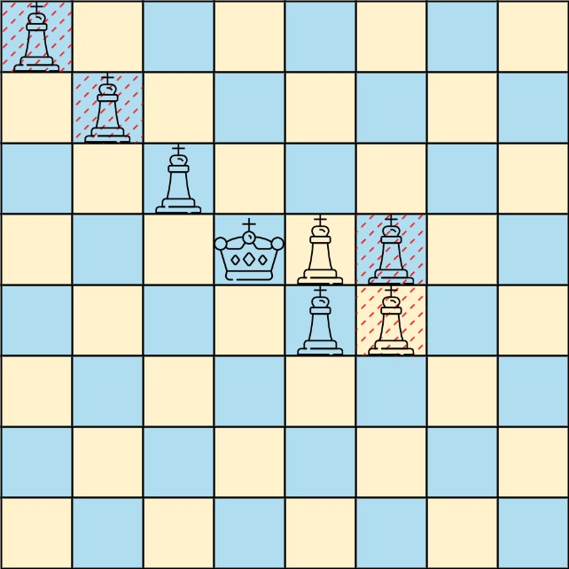

# 1222. 可以攻击国王的皇后

Medium · [力扣原题](https://leetcode.cn/problems/queens-that-can-attack-the-king/)

| 作者 | 题解 | 动画讲解 |
|---|---|---|
| 灵茶山艾府 | [📄 题解](灵茶山艾府.md) | [▶︎ 动画（GIF）](1222%20可以攻击国王的皇后%20·%20灵茶山艾府.gif) · [mp4 文件](1222%20可以攻击国王的皇后%20·%20灵茶山艾府.mp4) |
| yiduobo | [📄 题解](yiduobo.md) | [▶︎ 动画（GIF）](1222%20可以攻击国王的皇后%20·%20yiduobo.gif) · [mp4 文件](1222%20可以攻击国王的皇后%20·%20yiduobo.mp4) |

## 动画讲解

> 动图会循环播放；想暂停、拖进度条请下载上面表格里的 mp4 文件。

### 灵茶山艾府


### yiduobo


## 题目描述

在一个 **下标从 0 开始** 的 `8 x 8` 棋盘上，可能有多个黑皇后和一个白国王。

给你一个二维整数数组 `queens`，其中 `queens[i] = [xQueeni, yQueeni]` 表示第 `i` 个黑皇后在棋盘上的位置。还给你一个长度为 `2` 的整数数组 `king`，其中 `king = [xKing, yKing]` 表示白国王的位置。

返回 <em>能够直接攻击国王的黑皇后的坐标</em>。你可以以 **任何顺序** 返回答案。

**示例 1：**


```

输入：queens = [[0,1],[1,0],[4,0],[0,4],[3,3],[2,4]], king = [0,0]
输出：[[0,1],[1,0],[3,3]]
解释：上面的图示显示了三个可以直接攻击国王的皇后和三个不能攻击国王的皇后（用红色虚线标记）。
```

**示例 2：**



```

输入：queens = [[0,0],[1,1],[2,2],[3,4],[3,5],[4,4],[4,5]], king = [3,3]
输出：[[2,2],[3,4],[4,4]]
解释：上面的图示显示了三个能够直接攻击国王的黑皇后和三个不能攻击国王的黑皇后（用红色虚线标记）。
```

**提示：**

- `1 <= queens.length < 64`

- `queens[i].length == king.length == 2`

- `0 <= xQueen_i, yQueen_i, xKing, yKing < 8`

- 所有给定的位置都是 **唯一** 的。

---
[↑ 返回 1200-1299](../README.md) · [总索引](../../../索引.md) · [仓库首页](../../../README.md)
