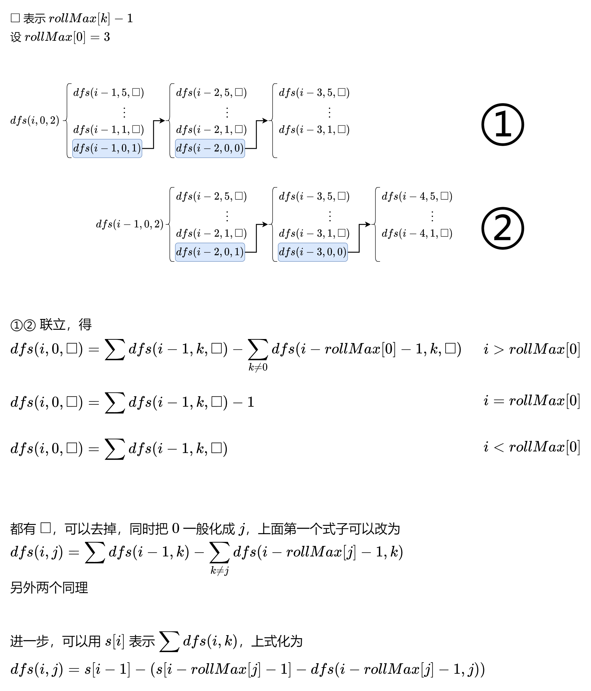

# 教你一步步思考动态规划！（Python/Java/C++/Go）

> **[1223. 掷骰子模拟](https://leetcode.cn/problems/dice-roll-simulation/solutions/2103292/jiao-ni-yi-bu-bu-si-kao-dong-tai-gui-hua-sje6/) · Hard · 难度分 2008**

> **所属题单**
> - [动态规划 · 七、其他线性 DP](../../../刷题路径/灵神原版题单/动态规划/七、其他线性%20DP.md) · §7.6 多维 DP

> **题目描述**
> 有一个骰子模拟器会每次投掷的时候生成一个 1 到 6 的随机数。
>
> 不过我们在使用它时有个约束，就是使得投掷骰子时，**连续** 掷出数字 `i` 的次数不能超过 `rollMax[i]`（`i` 从 1 开始编号）。
>
> 现在，给你一个整数数组 `rollMax` 和一个整数 `n`，请你来计算掷 `n` 次骰子可得到的不同点数序列的数量。
>
> 假如两个序列中至少存在一个元素不同，就认为这两个序列是不同的。由于答案可能很大，所以请返回 **模 `10^9 + 7`** 之后的结果。
>
> **示例 1：**
>
> ```
> 输入：n = 2, rollMax = [1,1,2,2,2,3]
> 输出：34
> 解释：我们掷 2 次骰子，如果没有约束的话，共有 6 * 6 = 36 种可能的组合。但是根据 rollMax 数组，数字 1 和 2 最多连续出现一次，所以不会出现序列 (1,1) 和 (2,2)。因此，最终答案是 36-2 = 34。
> ```
>
> **示例 2：**
>
> ```
> 输入：n = 2, rollMax = [1,1,1,1,1,1]
> 输出：30
> ```
>
> **示例 3：**
>
> ```
> 输入：n = 3, rollMax = [1,1,1,2,2,3]
> 输出：181
> ```
>
> **提示：**
>
> - `1 <= n <= 5000`
>
> - `rollMax.length == 6`
>
> - `1 <= rollMax[i] <= 15`

> **题解**
> 有些题解一上来就把状态定义甩在了读者脸上，丝毫不说这个定义是怎么来的，仿佛从天而降。这也让很多同学对动态规划产生了畏难心态。
>
> 其实，对于不少动态规划问题，「如何想出状态定义和状态转移方程」是有套路的。我在[【基础算法精讲 17】](https://www.bilibili.com/video/BV1Xj411K7oF/)中讲到，可以用**回溯**来启发思考。本文将遵照这个过程，来讲讲怎么从回溯开始，一步步写出最后的递推代码。
>
> > APP 用户需要分享到 wx 打开链接。
>
> # 第一步：思考回溯怎么写
>
> 想一想，掷了一个骰子（设值为 $x$）后，会发生什么情况？
>
> 既然题目有 $\textit{rollMax}$ 的限制，那么分类讨论：
>
> - 如果和上一个骰子值相同，那么 $x$ 的连续出现次数不能超过 $\textit{rollMax}[x]$；
> - 如果不同，那么可以重置连续出现次数为 $1$。
>
> ### 关键词提取：「上一个骰子值」和「连续出现次数」
>
> 那么在回溯中就需要知道（为了方便后面转成递推，定义成**剩余**）：
>
> - 剩余掷骰子的次数，用 $i$ 表示；
> - 上一个骰子值，用 $\textit{last}$ 表示；
> - $\textit{last}$ 的剩余连续出现次数，用 $\textit{left}$ 表示。
>
> 这样就确定了递归的参数，递归的返回值就是骰子序列个数。
>
> 要递归到哪里去呢？我们可以用回溯中的经典技巧「枚举选哪个」：
>
> - 如果选的骰子值和上一个相同，且 $\textit{left}>0$，那么递归到 $(i-1,\textit{last},\textit{left}-1)$；
> - 如果不同，设为 $j$，那么递归到 $(i-1,j,\textit{rollMax}[j]-1)$。
>
> 枚举 $j=0,1,2,3,4,5$，把递归后的结果相加，就是当前 $(i,\textit{last},\textit{left})$ 的答案。
>
> 递归到 $n=0$ 时结束，返回 $1$，表示找到了一个合法骰子序列。
>
> 最终答案为
>
> $$
> \sum_{j=0}^{j=5}\textit{dfs}(n-1,j,\textit{rollMax}[j]-1)
> $$
>
> 记得取模。
>
> ```python
> # 会超时的回溯写法
> class Solution:
>     def dieSimulator(self, n: int, rollMax: List[int]) -> int:
>         MOD = 10 ** 9 + 7
>         def dfs(i: int, last: int, left: int) -> int:
>             if i == 0: return 1
>             res = 0
>             for j, mx in enumerate(rollMax):
>                 if j != last: res += dfs(i - 1, j, mx - 1)
>                 elif left: res += dfs(i - 1, j, left - 1)
>             return res % MOD
>         return sum(dfs(n - 1, j, mx - 1) for j, mx in enumerate(rollMax)) % MOD
> ```
>
>
> # 第二步：改成记忆化搜索
>
> 举个例子，「先掷 $1$ 后掷 $3$」和「先掷 $2$ 后掷 $3$」，都会递归到 $\textit{dfs}(n-2,3,\textit{rollMax}[3]-1)$。
>
> 一叶知秋，整个回溯过程是有大量重复递归调用的。由于递归函数没有副作用，无论多少次调用 $\textit{dfs}(i,\textit{last},\textit{left})$ 算出来的结果都是一样的，因此可以用**记忆化搜索**来优化：
>
> - 如果一个状态（递归入参）是第一次遇到，那么可以在返回前，把状态及其结果记到一个 $\textit{cache}$ 数组（或者哈希表）中；
> - 如果一个状态不是第一次遇到，那么直接返回 $\textit{cache}$ 中保存的结果。
>
> ```python
> class Solution:
>     def dieSimulator(self, n: int, rollMax: List[int]) -> int:
>         MOD = 10 ** 9 + 7
>         @cache
>         def dfs(i: int, last: int, left: int) -> int:
>             if i == 0: return 1
>             res = 0
>             for j, mx in enumerate(rollMax):
>                 if j != last: res += dfs(i - 1, j, mx - 1)
>                 elif left: res += dfs(i - 1, j, left - 1)
>             return res % MOD
>         return sum(dfs(n - 1, j, mx - 1) for j, mx in enumerate(rollMax)) % MOD
> ```
>
>
> ### 复杂度分析
>
> - 时间复杂度：$O(nmS)$，其中 $m$ 为 $\textit{rollMax}$ 的长度，即 $6$，$S=\sum\textit{rollMax}$，这不会超过 $6\times 15=90$。动态规划的时间复杂度 $=$ 状态个数 $\times$ 单个状态的转移个数。本题中状态个数等于 $O(nS)$，而单个状态的转移个数为 $O(m)$，因此时间复杂度为 $O(nmS)$。
> - 空间复杂度：$O(nS)$。
>
> # 第三步：1比1翻译成递推
>
> 根据视频中讲的，我们可以去掉递归中的「递」，只保留「归」的部分，即自底向上计算。
>
> 做法：
>
> - $\textit{dfs}$ 改成 $f$ 数组；
> - 递归改成循环（每个参数都对应一层循环）；
> - 递归边界改成 $f$ 数组的初始值。
>
> 就完事了。
>
> ```python
> class Solution:
>     def dieSimulator(self, n: int, rollMax: List[int]) -> int:
>         MOD = 10 ** 9 + 7
>         m = len(rollMax)  # 6
>         f = [[[0] * mx for mx in rollMax] for _ in range(n)]
>         f[0] = [[1] * mx for mx in rollMax]
>         for i in range(1, n):
>             for last, mx in enumerate(rollMax):
>                 for left in range(mx):
>                     res = 0
>                     for j in range(m):
>                         if j != last:
>                             res += f[i - 1][j][-1]
>                         elif left:
>                             res += f[i - 1][j][left - 1]
>                     f[i][last][left] = res % MOD
>         return sum(f[-1][j][-1] for j in range(m)) % MOD
> ```
>
>
> ### 复杂度分析
>
> 同上。
>
> # 优化
>
> 
>
> ```python
> class Solution:
>     def dieSimulator(self, n: int, rollMax: List[int]) -> int:
>         MOD = 10 ** 9 + 7
>         m = len(rollMax)  # 6
>         f = [[0] * m for _ in range(n)]
>         f[0] = [1] * m
>         s = [0] * n
>         s[0] = m
>         for i in range(1, n):
>             for j, mx in enumerate(rollMax):
>                 res = s[i - 1]
>                 if i > mx: res -= s[i - mx - 1] - f[i - mx - 1][j]
>                 elif i == mx: res -= 1
>                 f[i][j] = res % MOD
>             s[i] = sum(f[i]) % MOD
>         return s[-1]
> ```
>
>
> ### 复杂度分析
>
> - 时间复杂度：$O(nm)$。其中 $m$ 为 $\textit{rollMax}$ 的长度，即 $6$。
> - 空间复杂度：$O(nm)$。
>
> ### 强化训练
>
> 可以看 [从周赛中学算法 - 2022 年周赛题目总结（下篇）](https://leetcode.cn/circle/discuss/WR1MJP/) 的「动态规划」这节，所有题目我都写了题解。
