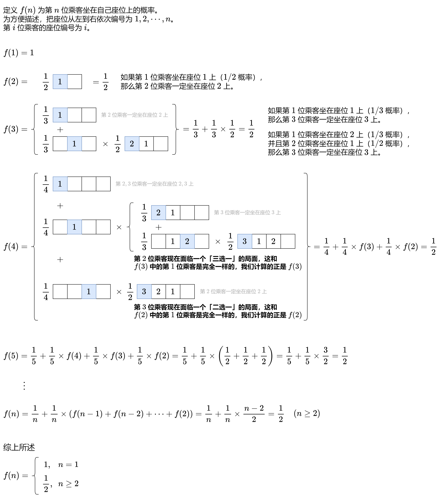

# 【图解】没想明白？一张图秒懂！（Python/Java/C++/C/Go/JS/Rust）

> **[1227. 飞机座位分配概率](https://leetcode.cn/problems/airplane-seat-assignment-probability/solutions/2858975/tu-jie-mei-xiang-ming-bai-yi-zhang-tu-mi-8bn4/) · Medium**

> **所属题单**
> - [数学算法 · 三、概率期望](../../../刷题路径/灵神原版题单/数学算法/三、概率期望.md)

> **题目描述**
> 有 `n` 位乘客即将登机，飞机正好有 `n` 个座位。第一位乘客的票丢了，他随便选了一个座位坐下。
>
> 剩下的乘客将会：
>
> -
>
> 如果他们自己的座位还空着，就坐到自己的座位上，
>
> - 当他们自己的座位被占用时，随机选择其他座位
>
> 第 `n` 位乘客坐在自己的座位上的概率是多少？
>
> **示例 1：**
>
> ```
>
> 输入：n = 1
> 输出：1.00000
> 解释：第一个人只会坐在自己的位置上。
> ```
>
> **示例 2：**
>
> ```
>
> 输入: n = 2
> 输出: 0.50000
> 解释：在第一个人选好座位坐下后，第二个人坐在自己的座位上的概率是 0.5。
> ```
>
> **提示：**
>
> - `1 <= n <= 10^5`

> **题解**
> 点击图片放大查看：
>
> 
>
> 另外一种理解方式是，假设 $n\ge 2$ 且第 $1$ 位乘客坐在了座位 $2$ 上，那么第 $2$ 位乘客随机选座位，假设第 $2$ 位乘客坐在了座位 $5$ 上。对于后面的乘客，他们其实**无法区分谁坐错了位置**，他们会认为其中一位乘客只是正常地坐在座位 $2$ 上，而另一位乘客随机选了一个座位 $5$。
>
> 依此类推，总是可以等价于第 $2$ 到 $n-1$ 位乘客都正常地坐在了自己的位置上，最终剩下 $2$ 个位置给第 $1$ 位乘客随机选，所以答案是 $\dfrac{1}{2}$。
>
> ```python
> class Solution:
>     def nthPersonGetsNthSeat(self, n: int) -> float:
>         return 1 if n == 1 else 0.5
> ```
>
>
> #### 复杂度分析
>
> - 时间复杂度：$\mathcal{O}(1)$。
> - 空间复杂度：$\mathcal{O}(1)$。
>
> ## 相似题目
>
> 之前写过一篇图解，推导 $f(n)$ 的过程有些类似。
>
> - [790. 多米诺和托米诺平铺](https://leetcode.cn/problems/domino-and-tromino-tiling/)（[图解](../../0700-0799/0790%20多米诺和托米诺平铺/灵茶山艾府.md)）
>
> ## 分类题单
>
> [如何科学刷题？](https://leetcode.cn/circle/discuss/RvFUtj/)
>
> 1. [滑动窗口与双指针（定长/不定长/单序列/双序列/三指针）](https://leetcode.cn/circle/discuss/0viNMK/)
> 2. [二分算法（二分答案/最小化最大值/最大化最小值/第K小）](https://leetcode.cn/circle/discuss/SqopEo/)
> 3. [单调栈（基础/矩形面积/贡献法/最小字典序）](https://leetcode.cn/circle/discuss/9oZFK9/)
> 4. [网格图（DFS/BFS/综合应用）](https://leetcode.cn/circle/discuss/YiXPXW/)
> 5. [位运算（基础/性质/拆位/试填/恒等式/思维）](https://leetcode.cn/circle/discuss/dHn9Vk/)
> 6. [图论算法（DFS/BFS/拓扑排序/最短路/最小生成树/二分图/基环树/欧拉路径）](https://leetcode.cn/circle/discuss/01LUak/)
> 7. [动态规划（入门/背包/状态机/划分/区间/状压/数位/数据结构优化/树形/博弈/概率期望）](https://leetcode.cn/circle/discuss/tXLS3i/)
> 8. [常用数据结构（前缀和/差分/栈/队列/堆/字典树/并查集/树状数组/线段树）](https://leetcode.cn/circle/discuss/mOr1u6/)
> 9. [数学算法（数论/组合/概率期望/博弈/计算几何/随机算法）](https://leetcode.cn/circle/discuss/IYT3ss/)
> 10. [贪心与思维（基本贪心策略/反悔/区间/字典序/数学/思维/脑筋急转弯/构造）](https://leetcode.cn/circle/discuss/g6KTKL/)
> 11. [链表、二叉树与一般树（前后指针/快慢指针/DFS/BFS/直径/LCA）](https://leetcode.cn/circle/discuss/K0n2gO/)
>
> [我的题解精选（已分类）](https://github.com/EndlessCheng/codeforces-go/blob/master/leetcode/SOLUTIONS.md)
>
> 欢迎关注 [B站@灵茶山艾府](https://space.bilibili.com/206214)
