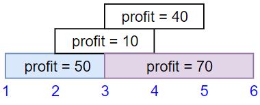
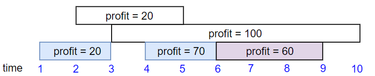
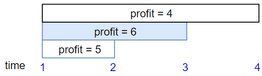
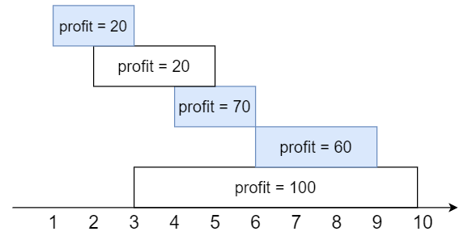

# 动态规划 + 二分查找优化（Python/Java/C++/Go/JS/Rust）

> **[1235. 规划兼职工作](https://leetcode.cn/problems/maximum-profit-in-job-scheduling/solutions/1913089/dong-tai-gui-hua-er-fen-cha-zhao-you-hua-zkcg/) · Hard · 难度分 2023**

> **所属题单**
> - [常用数据结构 · 五、堆（优先队列）](../../../刷题路径/灵神原版题单/常用数据结构/五、堆（优先队列）.md) · §5.2 进阶
> - [动态规划 · 七、其他线性 DP](../../../刷题路径/灵神原版题单/动态规划/七、其他线性%20DP.md) · §7.2 不相交区间

> **题目描述**
> 你打算利用空闲时间来做兼职工作赚些零花钱。
>
> 这里有 `n` 份兼职工作，每份工作预计从 `startTime[i]` 开始到 `endTime[i]` 结束，报酬为 `profit[i]`。
>
> 给你一份兼职工作表，包含开始时间 `startTime`，结束时间 `endTime` 和预计报酬 `profit` 三个数组，请你计算并返回可以获得的最大报酬。
>
> 注意，时间上出现重叠的 2 份工作不能同时进行。
>
> 如果你选择的工作在时间 `X` 结束，那么你可以立刻进行在时间 `X` 开始的下一份工作。
>
> **示例 1：**
>
> 
>
> ```
>
> 输入：startTime = [1,2,3,3], endTime = [3,4,5,6], profit = [50,10,40,70]
> 输出：120
> 解释：
> 我们选出第 1 份和第 4 份工作，
> 时间范围是 [1-3]+[3-6]，共获得报酬 120 = 50 + 70。
> ```
>
> **示例 2：**
>
> 
>
> ```
>
> 输入：startTime = [1,2,3,4,6], endTime = [3,5,10,6,9], profit = [20,20,100,70,60]
> 输出：150
> 解释：
> 我们选择第 1，4，5 份工作。
> 共获得报酬 150 = 20 + 70 + 60。
> ```
>
> **示例 3：**
>
> 
>
> ```
>
> 输入：startTime = [1,1,1], endTime = [2,3,4], profit = [5,6,4]
> 输出：6
> ```
>
> **提示：**
>
> - `1 <= startTime.length == endTime.length == profit.length <= 5 * 10^4`
>
> - `1 <= startTime[i] < endTime[i] <= 10^9`
>
> - `1 <= profit[i] <= 10^4`

> **题解**
> ### 提示 1
>
> 将工作按照结束时间排序，以示例 2 为例，得到下图：
>
> 
>
> 手动计算一下，按照结束时间排序后：
>
> - 前 $1$ 个工作的最大报酬为 $20$；
> - 前 $2$ 个工作的最大报酬为 $20$；
> - 前 $3$ 个工作的最大报酬为前 $1$ 个工作的最大报酬 $+70=20+70=90$；
> - 前 $4$ 个工作的最大报酬为前 $3$ 个工作的最大报酬 $+60=90+60=150$；
> - 前 $5$ 个工作的最大报酬，如果选了第 $5$ 个工作，那么报酬为前 $1$ 个工作的最大报酬 $+100=20+100=120$；但也可以不选第 $5$ 个工作，报酬为前 $4$ 个工作的最大报酬，即 $150$。由于 $150>120$，不选第 $5$ 个工作更好，因此前 $5$ 个工作的最大报酬为 $150$。
>
> 示例 2 等价于计算前 $5$ 个工作的最大报酬，即 $150$。
>
> ### 提示 2
>
> 总结一下，我们可以分类讨论，求出按照结束时间排序后的**前** $i$ 个工作的最大报酬：
>
> - 不选**第** $i$ 个工作，那么最大报酬等于**前** $i-1$ 个工作的最大报酬（转换成了一个规模更小的子问题）；
> - 选**第** $i$ 个工作，由于工作时间不能重叠，设 $j$ 是最大的满足 $\textit{endTime}[j]\le\textit{startTime}[i]$ 的 $j$，那么最大报酬等于**前** $j$ 个工作的最大报酬加上 $\textit{profit}[i]$（同样转换成了一个规模更小的子问题）；
> - 这两种决策取最大值。
>
> 注意，由于按照结束时间排序，**前** $j$ 个工作中的任意一个都不会与**第** $i$ 个工作的时间重叠。
>
> ### 提示 3
>
> 怎么实现？
>
> 上述思路是一个标准的关于**递推**的描述，定义 $f[i]$ 表示按照结束时间排序后的**前** $i$ 个工作的最大报酬，用「选或不选」分类讨论：
>
> - 不选**第** $i$ 个工作：$f[i] = f[i-1]$；
> - 选**第** $i$ 个工作：$f[i] = f[j]+\textit{profit}[i]$，其中 $j$ 是最大的满足 $\textit{endTime}[j]\le\textit{startTime}[i]$ 的 $j$，不存在时为 $-1$。
>
> 两者取最大值，即
>
> $$
> f[i] = \max(f[i-1], f[j]+\textit{profit}[i])
> $$
>
> 由于 $i=0$ 时会产生 $-1$，可以在 $f$ 数组前面插入一个 $0$，与 $f$ 有关的下标都 $+1$，即
>
> $$
> f[i+1] = \max(f[i], f[j+1]+\textit{profit}[i])
> $$
>
> 初始项 $f[0]=0$，答案为 $f[n]$。
>
> 代码实现时，由于结束时间是有序的，$j$ 可以用**二分查找**计算出来，原理请看[【基础算法精讲 04】](https://www.bilibili.com/video/BV1AP41137w7/)
>
> ```python
> class Solution:
>     def jobScheduling(self, startTime: List[int], endTime: List[int], profit: List[int]) -> int:
>         jobs = sorted(zip(endTime, startTime, profit))  # 按照结束时间排序
>         f = [0] * (len(jobs) + 1)
>         for i, (_, st, p) in enumerate(jobs):
>             j = bisect_left(jobs, (st + 1,), hi=i)  # hi=i 表示二分上界为 i（默认为 n）
>             # 状态转移中，为什么是 j 不是 j+1：上面算的是 > st，-1 后得到 <= st，但由于还要 +1，抵消了
>             f[i + 1] = max(f[i], f[j] + p)
>         return f[-1]
> ```
>
>
> #### 复杂度分析
>
> - 时间复杂度：$\mathcal{O}(n\log n)$，其中 $n$ 为 $\textit{startTime}$ 的长度。排序的时间复杂度为 $\mathcal{O}(n\log n)$，动态规划部分一共计算了 $n$ 次二分，时间复杂度为 $\mathcal{O}(n\log n)$，因此总的时间复杂度为 $\mathcal{O}(n\log n)$。
> - 空间复杂度：$\mathcal{O}(n)$。
>
> ## 算法小课堂：标准库二分的灵活运用
>
> 在写二分题目时，经常会遇到形如「在有序数组中查询大于某个数的最小数」这类问题。具体来说有四类：
>
> - $\ge$：在有序数组中查询大于或等于某个数的最小数；
> - $>$：在有序数组中查询大于某个数的最小数；
> - $\le$：在有序数组中查询小于或等于某个数的最大数；
> - $<$：在有序数组中查询小于某个数的最大数。
>
> 上面的一些编程语言用到了标准库中的二分，但这些二分在设计的时候，只提供了查询 $\ge$ 和 $>$ 的功能，并没有提供查询 $\le$ 和 $<$ 的功能。
>
> 没有关系，稍微转换下就能解决。比如查询 $>$ 得到了下标 $i$，那么 $i-1$ 就是 $\le$ 的结果了（假设数组为升序），同理 $<$ 可以用 $\ge$ 算出来。
>
> > 注：$>$ 和 $\ge$ 也可以转换，对于整数来说，$> x$ 等价于 $\ge x+1$。
>
> ## 相似题目
>
> - [1751. 最多可以参加的会议数目 II](https://leetcode.cn/problems/maximum-number-of-events-that-can-be-attended-ii/)
> - [2008. 出租车的最大盈利](https://leetcode.cn/problems/maximum-earnings-from-taxi/)
>
> ## 分类题单
>
> 1. [滑动窗口（定长/不定长/多指针）](https://leetcode.cn/circle/discuss/0viNMK/)
> 2. [二分算法（二分答案/最小化最大值/最大化最小值/第K小）](https://leetcode.cn/circle/discuss/SqopEo/)
> 3. [单调栈（矩形系列/字典序最小/贡献法）](https://leetcode.cn/circle/discuss/9oZFK9/)
> 4. [网格图（DFS/BFS/综合应用）](https://leetcode.cn/circle/discuss/YiXPXW/)
> 5. [位运算（基础/性质/拆位/试填/恒等式/贪心/脑筋急转弯）](https://leetcode.cn/circle/discuss/dHn9Vk/)
> 6. [图论算法（DFS/BFS/拓扑排序/最短路/最小生成树/二分图/基环树/欧拉路径）](https://leetcode.cn/circle/discuss/01LUak/)
> 7. [动态规划（入门/背包/状态机/划分/区间/状压/数位/数据结构优化/树形/博弈/概率期望）](https://leetcode.cn/circle/discuss/tXLS3i/)
> 8. [常用数据结构（前缀和/差分/栈/队列/堆/字典树/并查集/树状数组/线段树）](https://leetcode.cn/circle/discuss/mOr1u6/)
>
> 欢迎关注 [B站@灵茶山艾府](https://space.bilibili.com/206214)
>
> [我的题解精选（已分类）](https://github.com/EndlessCheng/codeforces-go/blob/master/leetcode/SOLUTIONS.md)
