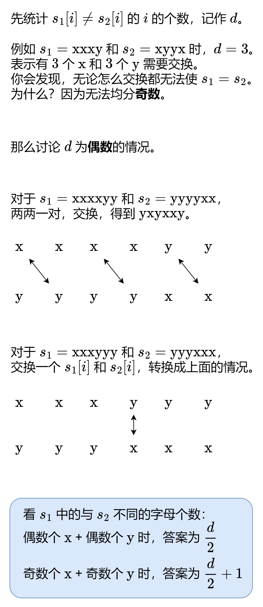

# 没想明白？一张图秒懂！（Python/Java/C++/Go）

> **[1247. 交换字符使得字符串相同](https://leetcode.cn/problems/minimum-swaps-to-make-strings-equal/solutions/2131832/mei-xiang-ming-bai-yi-zhang-tu-miao-dong-a6r1/) · Medium · 难度分 1597**

> **所属题单**
> - [贪心算法 · 五、思维题](../../../刷题路径/灵神原版题单/贪心算法/五、思维题.md) · §5.8 分类讨论

> **题目描述**
> 有两个长度相同的字符串 `s1` 和 `s2`，且它们其中 **只含有** 字符 `"x"` 和 `"y"`，你需要通过「交换字符」的方式使这两个字符串相同。
>
> 每次「交换字符」的时候，你都可以在两个字符串中各选一个字符进行交换。
>
> 交换只能发生在两个不同的字符串之间，绝对不能发生在同一个字符串内部。也就是说，我们可以交换 `s1[i]` 和 `s2[j]`，但不能交换 `s1[i]` 和 `s1[j]`。
>
> 最后，请你返回使 `s1` 和 `s2` 相同的最小交换次数，如果没有方法能够使得这两个字符串相同，则返回 `-1` 。
>
> **示例 1：**
>
> ```
>
> 输入：s1 = "xx", s2 = "yy"
> 输出：1
> 解释：
> 交换 s1[0] 和 s2[1]，得到 s1 = "yx"，s2 = "yx"。
> ```
>
> **示例 2：**
>
> ```
>
> 输入：s1 = "xy", s2 = "yx"
> 输出：2
> 解释：
> 交换 s1[0] 和 s2[0]，得到 s1 = "yy"，s2 = "xx" 。
> 交换 s1[0] 和 s2[1]，得到 s1 = "xy"，s2 = "xy" 。
> 注意，你不能交换 s1[0] 和 s1[1] 使得 s1 变成 "yx"，因为我们只能交换属于两个不同字符串的字符。
> ```
>
> **示例 3：**
>
> ```
>
> 输入：s1 = "xx", s2 = "xy"
> 输出：-1
> ```
>
> **提示：**
>
> - `1 <= s1.length, s2.length <= 1000`
>
> - `s1.length == s2.length`
>
> - `s1, s2` 只包含 `'x'` 或 `'y'`。

> **题解**
> 
>
> ## 答疑
>
> **问**：为什么这种交换方案是最优的？需不需要 $s_1[i]=s_2[i]$ 的字母参与？
>
> **答**：对于不同的字母，这种做法是尽量「内部消化」。对于偶数+偶数的情况，每次交换操作都使 $d$ 减二，这是单次操作的极限；对于奇数+奇数的情况，只额外交换了一次就转换成了偶数+偶数的情况，这是必要的。所以这种交换方案充分利用了每次交换操作，也无需 $s_1[i]=s_2[i]$ 的字母参与。
>
> **问**：为什么奇数+奇数交换一次就变成了偶数+偶数？
>
> **答**：交换一次后，要么 $s_1$ 中的 $\text{x}$ 多一，$\text{y}$ 少一，变成偶数+偶数；要么 $\text{x}$ 少一，$\text{y}$ 多一，也变成偶数+偶数。
>
> ```python
> class Solution:
>     def minimumSwap(self, s1: str, s2: str) -> int:
>         cnt = Counter(x for x, y in zip(s1, s2) if x != y)
>         d = cnt['x'] + cnt['y']
>         return -1 if d % 2 else d // 2 + cnt['x'] % 2
> ```
>
>
> ## 复杂度分析
>
> - 时间复杂度：$O(n)$，其中 $n$ 为 $s_1$ 的长度。
> - 空间复杂度：$O(1)$，仅用到若干额外变量。
>
> ## 思考题
>
> 如果字符串有超过两种字符，要怎么做呢？
>
> ---
>
> 欢迎关注 [B站@灵茶山艾府](https://space.bilibili.com/206214)
>
> 更多精彩题解，请看 [往期题解精选（已分类）](https://github.com/EndlessCheng/codeforces-go/blob/master/leetcode/SOLUTIONS.md)
