# 两种思路：先外后内/出界标记（Python/Java/C++/Go）

> **[1254. 统计封闭岛屿的数目](https://leetcode.cn/problems/number-of-closed-islands/solutions/2312616/liang-chong-si-lu-xian-wai-hou-nei-chu-j-b1e4/) · Medium · 难度分 1659**

> **所属题单**
> - [网格图 · 一、网格图 DFS](../../../刷题路径/灵神原版题单/网格图/一、网格图%20DFS.md)

> **题目描述**
> 二维矩阵 `grid` 由 `0` （土地）和 `1` （水）组成。岛是由最大的4个方向连通的 `0` 组成的群，封闭岛是一个 `完全` 由1包围（左、上、右、下）的岛。
>
> 请返回 <em>封闭岛屿</em> 的数目。
>
> **示例 1：**
>
> 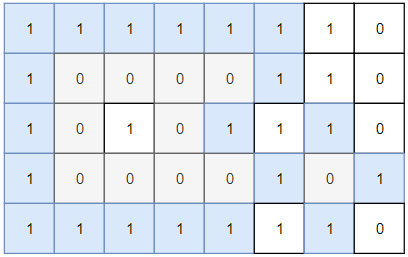
>
> ```
>
> 输入：grid = [[1,1,1,1,1,1,1,0],[1,0,0,0,0,1,1,0],[1,0,1,0,1,1,1,0],[1,0,0,0,0,1,0,1],[1,1,1,1,1,1,1,0]]
> 输出：2
> 解释：
> 灰色区域的岛屿是封闭岛屿，因为这座岛屿完全被水域包围（即被 1 区域包围）。
> ```
>
> **示例 2：**
>
> 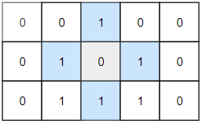
>
> ```
>
> 输入：grid = [[0,0,1,0,0],[0,1,0,1,0],[0,1,1,1,0]]
> 输出：1
> ```
>
> **示例 3：**
>
> ```
>
> 输入：grid = [[1,1,1,1,1,1,1],
>              [1,0,0,0,0,0,1],
>              [1,0,1,1,1,0,1],
>              [1,0,1,0,1,0,1],
>              [1,0,1,1,1,0,1],
>              [1,0,0,0,0,0,1],
>              [1,1,1,1,1,1,1]]
> 输出：2
> ```
>
> **提示：**
>
> - `1 <= grid.length, grid[0].length <= 100`
>
> - `0 <= grid[i][j] <=1`

> **题解**
> ## 前置知识：递归
>
> 详见 [计算机是怎么执行递归的？【基础算法精讲 09】](https://www.bilibili.com/video/BV1UD4y1Y769/)。
>
> > 制作不易，欢迎点赞！APP 用户如果无法打开，可以分享到微信。
>
> ## 一、思考
>
> #### 基础知识
>
> - 网格图的遍历，与二叉树的遍历有何区别？与一般图的遍历有何区别？
> - 在网格图中，是否会重复访问同一个格子？如何处理？
> - 什么情况下用 DFS，什么情况下用 BFS？
>
> #### 本题
>
> - 完全由 $1$ 包围意味着什么？
> - 应当从哪个（哪些）格子开始遍历？
> - 能否先遍历非封闭岛屿，再遍历封闭岛屿？
>
> ## 二、解惑
>
> #### 基础知识：二叉树 vs 网格图 vs 一般图
>
> ||重复访问|邻居个数|DFS|BFS|
> |---|---|---|---|---|
> |二叉树|否|$\le 3$|前中后序|层序|
> |网格图|是|$\le 4$|连通块|最短路|
> |一般图|是|任意|连通块、判环等|最短路等|
>
> > 注 1：「重复访问」指代码中是否需要处理访问过的节点。对于网格图和一般图，需要标记访问过的节点。例如在网格图中，向下访问后就不能再向上访问了，如果不做任何处理，那么会反复向下向上，无限递归下去。
> >
> > 注 2：通常网格图是四方向的，每个格子的邻居个数不超过 $4$。如果是八方向的，则每个格子的邻居个数不超过 $8$。
> > 
> > 注 3：BFS 也可以判断连通块，但要手动用**队列**保存待访问节点；而 DFS 是计算机帮你创建了一个**栈**，自动保存递归路径上的节点，不需要手动处理。所以代码上 DFS 通常比 BFS 要简短。
>
> #### 本题
>
> 如果从一个 $0$ 出发，向四方向移动，可以移动到网格图的边界（最外面一圈），那么这个 $0$ 所处的岛屿就不是封闭的；反之，如果无法移动到网格图的边界，就是封闭的。
>
> 既然关键是「边界」，那么不妨从边界出发，先标记所有非封闭岛屿。标记完后，网格图内部的 $0$ 就一定在封闭岛屿上。
>
> ## 三、算法一：先外后内
>
> 1. 从网格图的第一行、最后一行、第一列和最后一列的所有 $0$ 出发，DFS 访问四方向的 $0$，并把这些 $0$ 标记成「访问过」。代码实现时可以直接把 $0$ 修改成 $1$。
> 2. 然后从剩下的 $0$ 出发，按照同样的方式 DFS 访问四方向的 $0$，同时把 $0$ 改成 $1$。每次从一个新的 $0$ 出发（起点），就意味着找到了一个新的封闭岛屿，答案加一。
>
> 以示例 1 为例，动画过程如下：（单个蓝色 $0$ 表示 DFS 起点）
>
> <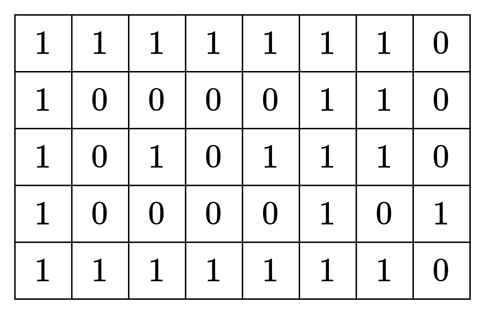,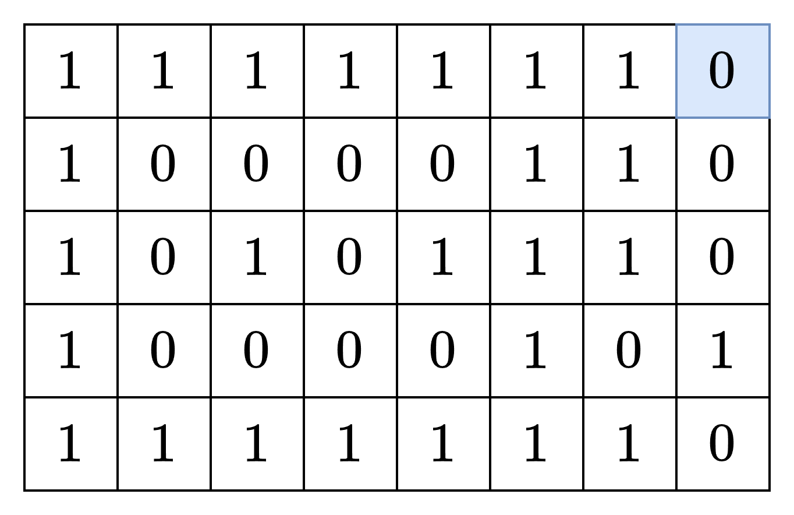,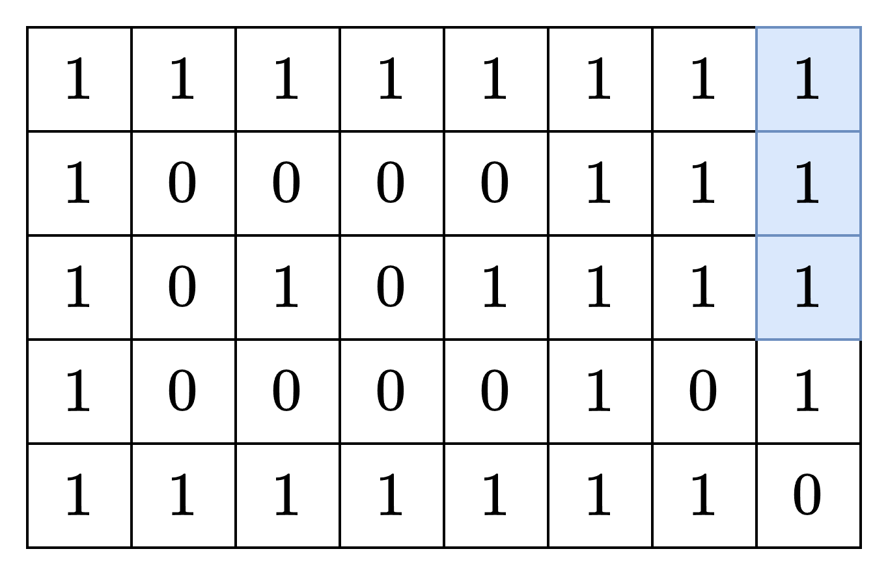,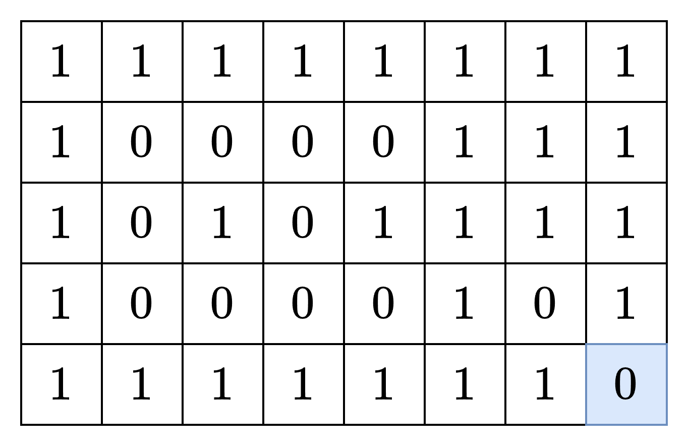,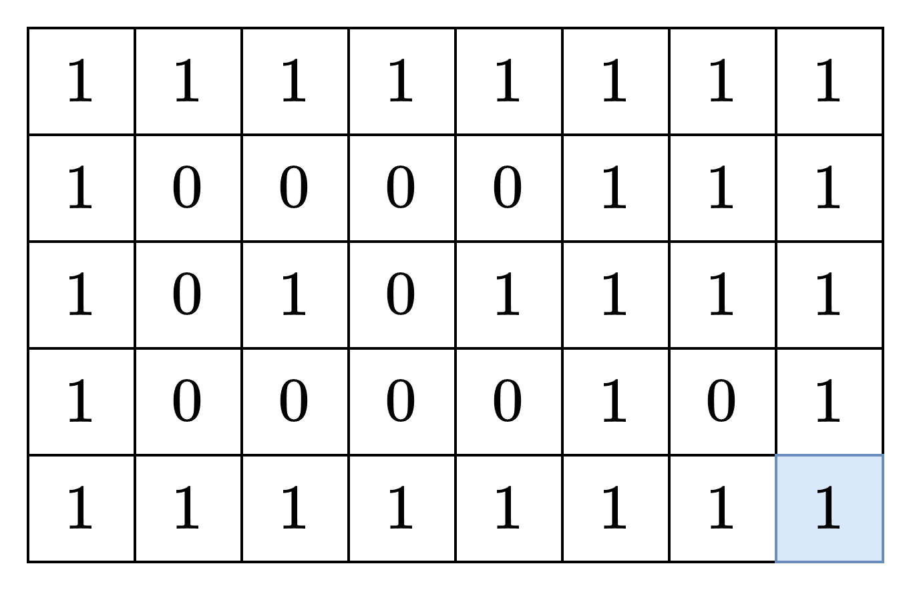,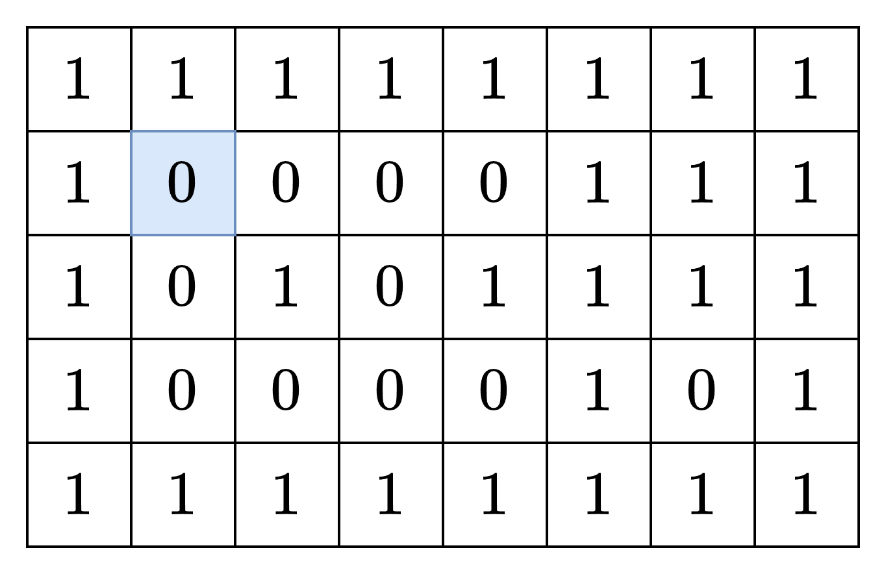,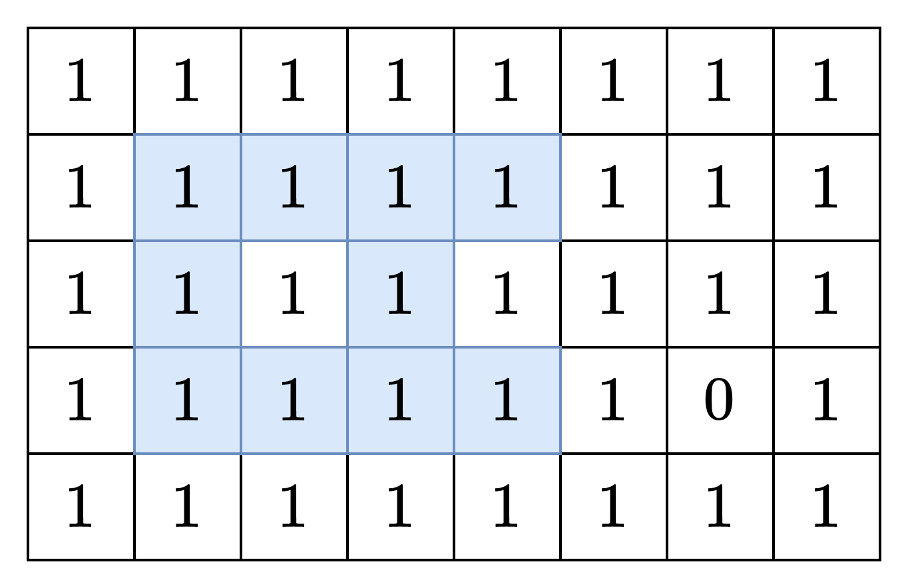,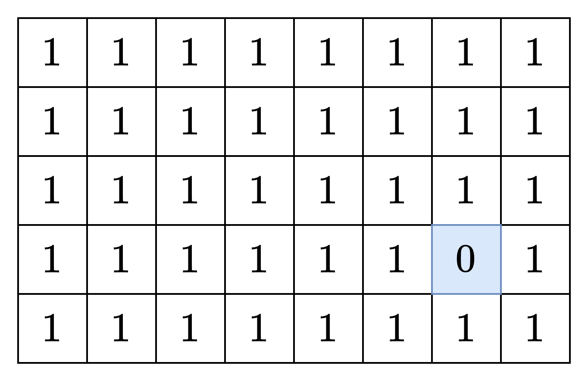,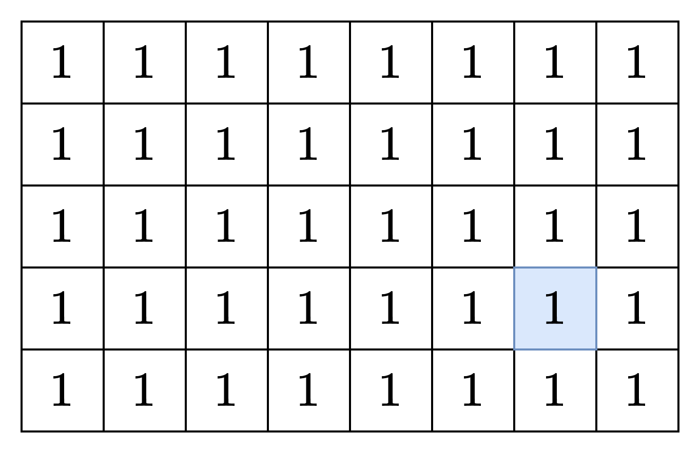>
>
> 此外，如果行数或列数不足 $3$，此时没有封闭岛屿，可以直接返回 $0$。
>
> ```python
> class Solution:
>     def closedIsland(self, grid: List[List[int]]) -> int:
>         m, n = len(grid), len(grid[0])
>         if m < 3 or n < 3: return 0
>
>         def dfs(x: int, y: int) -> None:
>             grid[x][y] = 1  # 标记 (x,y) 被访问，避免重复访问
>             # 访问四方向的 0
>             for i, j in (x - 1, y), (x + 1, y), (x, y - 1), (x, y + 1):
>                 if 0 <= i < m and 0 <= j < n and grid[i][j] == 0:
>                     dfs(i, j)
>
>         for i in range(m):
>             # 如果是第一行和最后一行，访问所有格子
>             # 如果不是，只访问第一列和最后一列的格子
>             step = 1 if i == 0 or i == m - 1 else n - 1
>             for j in range(0, n, step):
>                 if grid[i][j] == 0:  # 从没有访问过的 0 出发
>                     dfs(i, j)
>
>         ans = 0
>         for i in range(1, m - 1):
>             for j in range(1, n - 1):
>                 if grid[i][j] == 0:  # 从没有访问过的 0 出发
>                     ans += 1  # 一定是封闭岛屿
>                     dfs(i, j)
>         return ans
> ```
>
>
> #### 复杂度分析
>
> - 时间复杂度：$\mathcal{O}(mn)$，其中 $m$ 和 $n$ 分别为 $\textit{grid}$ 的行数和列数。
> - 空间复杂度：$\mathcal{O}(mn)$。递归最坏需要 $\mathcal{O}(mn)$ 的栈空间（想象一个蛇形的 $0$ 连通块）。
>
> ## 四、算法二：出界标记
>
> 把最外面一圈的格子叫做「边界」。
>
> 1. 从不在边界的 $0$ 出发，DFS 访问四方向的 $0$。DFS 之前，设置全局变量 $\textit{closed}$ 为 $\texttt{true}$。
> 2. 如果 DFS 中到达边界，设置 $\textit{closed}$ 为 $\texttt{false}$，意味着当前遍历的岛屿不是封闭岛屿。
> 3. 把访问过的 $0$ 改成 $1$，避免重复访问。
> 4. 注意每次 DFS 应当把这个岛屿的所有格子都遍历完，**不能中途退出 DFS**。如果在中途退出 DFS，会导致某些格子没有遍历到，那么在后续以这个格子为起点 DFS 时，可能会误把它当作封闭岛屿上的格子，从而算出比预期结果更大的值。
> 5. 递归结束时，如果 $\textit{closed}$ 仍然为 $\texttt{true}$，说明当前遍历的是一个封闭岛屿，答案加一。
>
> ```python
> class Solution:
>     def closedIsland(self, grid: List[List[int]]) -> int:
>         m, n = len(grid), len(grid[0])
>         if m < 3 or n < 3: return 0
>
>         def dfs(x: int, y: int) -> None:
>             if x == 0 or x == m - 1 or y == 0 or y == n - 1:  # 边界
>                 nonlocal closed
>                 closed = False  # 不是封闭岛屿
>             grid[x][y] = 1  # 标记 (x,y) 被访问，避免重复访问
>             # 访问四方向的 0
>             for i, j in (x - 1, y), (x + 1, y), (x, y - 1), (x, y + 1):
>                 if 0 <= i < m and 0 <= j < n and grid[i][j] == 0:
>                     dfs(i, j)
>
>         ans = 0
>         for i in range(1, m - 1):
>             for j in range(1, n - 1):
>                 if grid[i][j] == 0:  # 从没有访问过的 0 出发
>                     closed = True
>                     dfs(i, j)
>                     ans += closed
>         return ans
> ```
>
>
> #### 复杂度分析
>
> - 时间复杂度：$\mathcal{O}(mn)$，其中 $m$ 和 $n$ 分别为 $\textit{grid}$ 的行数和列数。
> - 空间复杂度：$\mathcal{O}(mn)$。递归最坏需要 $\mathcal{O}(mn)$ 的栈空间（想象一个蛇形的 $0$ 连通块）。
>
> ## 分类题单
>
> [如何科学刷题？](https://leetcode.cn/circle/discuss/RvFUtj/)
>
> 1. [滑动窗口与双指针（定长/不定长/单序列/双序列/三指针/分组循环）](https://leetcode.cn/circle/discuss/0viNMK/)
> 2. [二分算法（二分答案/最小化最大值/最大化最小值/第K小）](https://leetcode.cn/circle/discuss/SqopEo/)
> 3. [单调栈（基础/矩形面积/贡献法/最小字典序）](https://leetcode.cn/circle/discuss/9oZFK9/)
> 4. 【本题相关】[网格图（DFS/BFS/综合应用）](https://leetcode.cn/circle/discuss/YiXPXW/)
> 5. [位运算（基础/性质/拆位/试填/恒等式/思维）](https://leetcode.cn/circle/discuss/dHn9Vk/)
> 6. [图论算法（DFS/BFS/拓扑排序/最短路/最小生成树/二分图/基环树/欧拉路径）](https://leetcode.cn/circle/discuss/01LUak/)
> 7. [动态规划（入门/背包/状态机/划分/区间/状压/数位/数据结构优化/树形/博弈/概率期望）](https://leetcode.cn/circle/discuss/tXLS3i/)
> 8. [常用数据结构（前缀和/差分/栈/队列/堆/字典树/并查集/树状数组/线段树）](https://leetcode.cn/circle/discuss/mOr1u6/)
> 9. [数学算法（数论/组合/概率期望/博弈/计算几何/随机算法）](https://leetcode.cn/circle/discuss/IYT3ss/)
> 10. [贪心与思维（基本贪心策略/反悔/区间/字典序/数学/思维/脑筋急转弯/构造）](https://leetcode.cn/circle/discuss/g6KTKL/)
> 11. [链表、二叉树与回溯（前后指针/快慢指针/DFS/BFS/直径/LCA/一般树）](https://leetcode.cn/circle/discuss/K0n2gO/)
> 12. [字符串（KMP/Z函数/Manacher/字符串哈希/AC自动机/后缀数组/子序列自动机）](https://leetcode.cn/circle/discuss/SJFwQI/)
>
> [我的题解精选（已分类）](https://github.com/EndlessCheng/codeforces-go/blob/master/leetcode/SOLUTIONS.md)
>
> 欢迎关注 [B站@灵茶山艾府](https://space.bilibili.com/206214)
