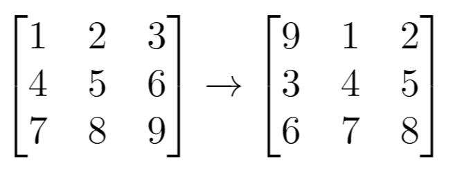

# 两种方法：创建新数组 / 原地三次反转（Python/Java/C++/Go）

> **[1260. 二维网格迁移](https://leetcode.cn/problems/shift-2d-grid/solutions/3998884/liang-chong-fang-fa-chuang-jian-xin-shu-v5kdb/) · Easy**

> **题目描述**
> 给你一个 `m` 行 `n` 列的二维网格 `grid` 和一个整数 `k`。你需要将 `grid` 迁移 `k` 次。
>
> 每次「迁移」操作将会引发下述活动：
>
> - 位于 `grid[i][j]`（`j < n - 1`）的元素将会移动到 `grid[i][j + 1]`。
>
> - 位于 `grid[i][n - 1]` 的元素将会移动到 `grid[i + 1][0]`。
>
> - 位于 `grid[m - 1][n - 1]` 的元素将会移动到 `grid[0][0]`。
>
> 请你返回 `k` 次迁移操作后最终得到的 **二维网格**。
>
> **示例 1：**
>
> 
>
> ```
>
> 输入：grid = [[1,2,3],[4,5,6],[7,8,9]], k = 1
> 输出：[[9,1,2],[3,4,5],[6,7,8]]
> ```
>
> **示例 2：**
>
> 
>
> ```
>
> 输入：grid = [[3,8,1,9],[19,7,2,5],[4,6,11,10],[12,0,21,13]], k = 4
> 输出：[[12,0,21,13],[3,8,1,9],[19,7,2,5],[4,6,11,10]]
> ```
>
> **示例 3：**
>
> ```
>
> 输入：grid = [[1,2,3],[4,5,6],[7,8,9]], k = 9
> 输出：[[1,2,3],[4,5,6],[7,8,9]]
> ```
>
> **提示：**
>
> - `m == grid.length`
>
> - `n == grid[i].length`
>
> - `1 <= m <= 50`
>
> - `1 <= n <= 50`
>
> - `-1000 <= grid[i][j] <= 1000`
>
> - `0 <= k <= 100`

> **题解**
> ## 方法一：创建新数组
>
> 题目说，位于 $\textit{grid}[i][n - 1]$ 的元素会移动到 $\textit{grid}[i + 1][0]$，也就是行末元素的「下一个元素」是下一行的第一个元素。
>
> 那么，把二维矩阵的每一行拼在一起，可以得到一个一维数组，方便我们处理。
>
> 示例 1 的矩阵转成一维数组，得 $a = [1,2,3,4,5,6,7,8,9]$。迁移（循环右移）$k=1$ 次，得到数组 $b = [9,1,2,3,4,5,6,7,8]$。再把 $b$ 转回矩阵，得到下图右边的答案。
>
> {:width=400px}
>
> 一般地，长为 $N$ 的数组 $a$ 循环右移 $k$ 次后，下标为 $i$ 的元素移动到下标 $(i+k)\bmod N$。
>
> 代码实现时，并不需要真的创建长为 $N = mn$ 的数组 $a$ 和 $b$。
>
> 1. 算出 $\textit{grid}[i][j]$ 在 $a$ 中的下标。由于每行有 $n$ 个元素，在 $\textit{grid}[i][j]$ 之前有完整的 $i$ 行，即 $in$ 个数，加上 $\textit{grid}[i][j]$ 这行的前 $j+1$ 个数，得到 $\textit{grid}[i][j]$ 是 $a$ 中的第 $in+j+1$ 个数，即 $a[in+j]$。
> 2. 循环右移 $k$ 次后，下标为 $in+j$ 的元素移动到下标 $p = (in+j+k)\bmod N$。
> 3. 找到 $p$ 在答案中的行号和列号。由于答案有 $n$ 列，所以下标 $p$ 之前有完整的 $\lfloor p/n \rfloor$ 行。下标 $p$ 在当前这一行的 $p\bmod n$ 列。
>
> ```python
> class Solution:
>     def shiftGrid(self, grid: List[List[int]], k: int) -> List[List[int]]:
>         m, n = len(grid), len(grid[0])
>         ans = [[0] * n for _ in range(m)]
>
>         size = m * n
>         for i, row in enumerate(grid):
>             for j, x in enumerate(row):
>                 p = (i * n + j + k) % size
>                 ans[p // n][p % n] = x
>         return ans
> ```
>
>
> ## 方法二：三次反转
>
> 利用 [189. 轮转数组](https://leetcode.cn/problems/rotate-array/) 的技巧，可以做到 $\mathcal{O}(1)$ 空间。原理见 [我的题解](../../0100-0199/0189%20轮转数组/灵茶山艾府.md)。
>
> ```python
> class Solution:
>     def shiftGrid(self, grid: List[List[int]], k: int) -> List[List[int]]:
>         m, n = len(grid), len(grid[0])
>
>         def reverse(l: int, r: int) -> None:
>             while l < r:
>                 x1, y1 = divmod(l, n)
>                 x2, y2 = divmod(r, n)
>                 grid[x1][y1], grid[x2][y2] = grid[x2][y2], grid[x1][y1]
>                 l += 1
>                 r -= 1
>
>         # 189. 轮转数组
>         size = m * n
>         k %= size  # 轮转 k 次等同于轮转 k % size 次
>         reverse(0, size - 1)
>         reverse(0, k - 1)
>         reverse(k, size - 1)
>         return grid
> ```
>
>
> #### 复杂度分析
>
> - 时间复杂度：$\mathcal{O}(mn)$，其中 $m$ 和 $n$ 分别是 $\textit{grid}$ 的行数和列数。
> - 空间复杂度：$\mathcal{O}(1)$。
>
> ## 相似题目
>
> [1914. 循环轮转矩阵](https://leetcode.cn/problems/cyclically-rotating-a-grid/)
>
> ## 分类题单
>
> [如何科学刷题？](https://leetcode.cn/discuss/post/3141566/ru-he-ke-xue-shua-ti-by-endlesscheng-q3yd/)
>
> 1. [滑动窗口与双指针（定长/不定长/单序列/双序列/三指针/分组循环）](https://leetcode.cn/discuss/post/3578981/ti-dan-hua-dong-chuang-kou-ding-chang-bu-rzz7/)
> 2. [二分算法（二分答案/最小化最大值/最大化最小值/第K小）](https://leetcode.cn/discuss/post/3579164/ti-dan-er-fen-suan-fa-er-fen-da-an-zui-x-3rqn/)
> 3. [单调栈（基础/矩形面积/贡献法/最小字典序）](https://leetcode.cn/discuss/post/3579480/ti-dan-dan-diao-zhan-ju-xing-xi-lie-zi-d-u4hk/)
> 4. [网格图（DFS/BFS/综合应用）](https://leetcode.cn/discuss/post/3580195/fen-xiang-gun-ti-dan-wang-ge-tu-dfsbfszo-l3pa/)
> 5. [位运算（基础/性质/拆位/试填/恒等式/思维）](https://leetcode.cn/discuss/post/3580371/fen-xiang-gun-ti-dan-wei-yun-suan-ji-chu-nth4/)
> 6. [图论算法（DFS/BFS/拓扑排序/基环树/最短路/最小生成树/网络流）](https://leetcode.cn/discuss/post/3581143/fen-xiang-gun-ti-dan-tu-lun-suan-fa-dfsb-qyux/)
> 7. [动态规划（入门/背包/划分/状态机/区间/状压/数位/数据结构优化/树形/博弈/概率期望）](https://leetcode.cn/discuss/post/3581838/fen-xiang-gun-ti-dan-dong-tai-gui-hua-ru-007o/)
> 8. [常用数据结构（前缀和/差分/栈/队列/堆/字典树/并查集/树状数组/线段树）](https://leetcode.cn/discuss/post/3583665/fen-xiang-gun-ti-dan-chang-yong-shu-ju-j-bvmv/)
> 9. [数学算法（数论/组合/概率期望/博弈/计算几何/随机算法）](https://leetcode.cn/discuss/post/3584388/fen-xiang-gun-ti-dan-shu-xue-suan-fa-shu-gcai/)
> 10. [贪心与思维（基本贪心策略/反悔/区间/字典序/数学/思维/脑筋急转弯/构造）](https://leetcode.cn/discuss/post/3091107/fen-xiang-gun-ti-dan-tan-xin-ji-ben-tan-k58yb/)
> 11. [链表、树与回溯（前后指针/快慢指针/DFS/BFS/直径/LCA）](https://leetcode.cn/discuss/post/3142882/fen-xiang-gun-ti-dan-lian-biao-er-cha-sh-6srp/)
> 12. [字符串（KMP/Z函数/Manacher/字符串哈希/AC自动机/后缀数组/子序列自动机）](https://leetcode.cn/discuss/post/3144832/fen-xiang-gun-ti-dan-zi-fu-chuan-kmpzhan-ugt4/)
>
> [我的题解精选（已分类）](https://github.com/EndlessCheng/codeforces-go/blob/master/leetcode/SOLUTIONS.md)
>
> 欢迎关注 [B站@灵茶山艾府](https://space.bilibili.com/206214)
