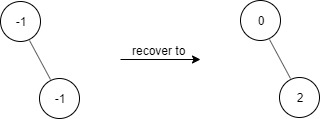
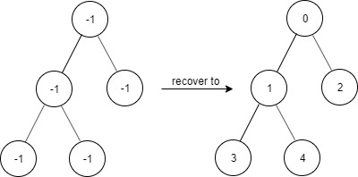
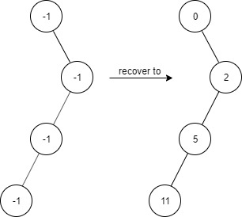
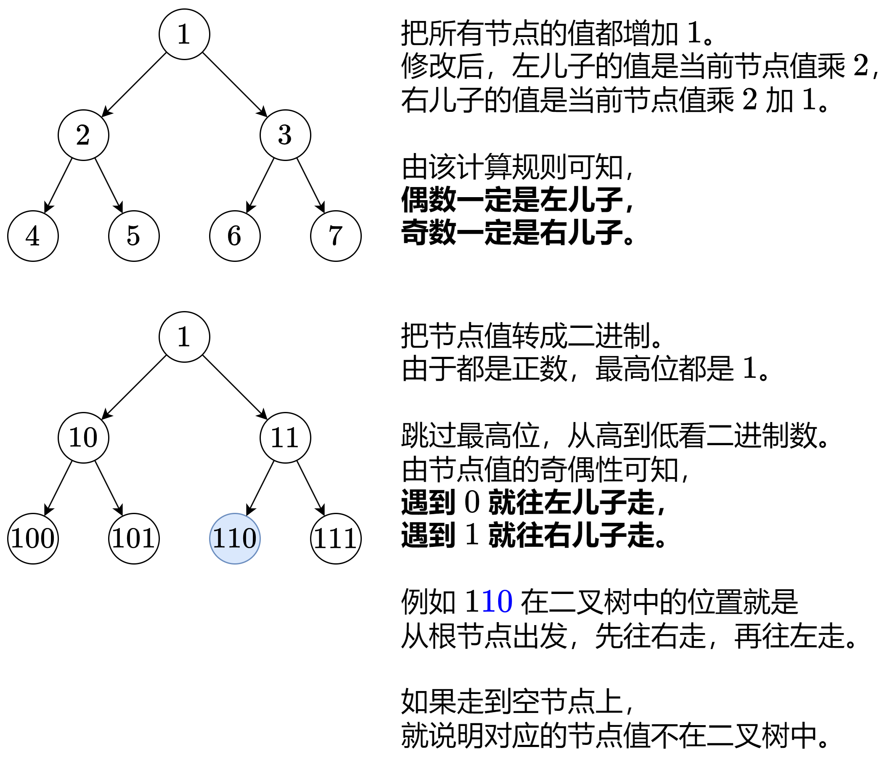

# 两种方法：哈希表/位运算（Python/Java/C++/Go/JS/Rust）

> **[1261. 在受污染的二叉树中查找元素](https://leetcode.cn/problems/find-elements-in-a-contaminated-binary-tree/solutions/2681672/liang-chong-fang-fa-ha-xi-biao-wei-yun-s-6m7w/) · Medium · 难度分 1440**

> **所属题单**
> - [链表、二叉树与回溯 · 二、二叉树](../../../刷题路径/灵神原版题单/链表、二叉树与回溯/二、二叉树.md) · §2.16 其他
> - [位运算 · 九、其他](../../../刷题路径/灵神原版题单/位运算/九、其他.md)

> **题目描述**
> 给出一个满足下述规则的二叉树：
>
> 1. `root.val == 0`
>
> 2. 对于任意 `treeNode`：
>
>     1. 如果 `treeNode.val` 为 `x` 且 `treeNode.left != null`，那么 `treeNode.left.val == 2 * x + 1`
>
>     2. 如果 `treeNode.val` 为 `x` 且 `treeNode.right != null`，那么 `treeNode.right.val == 2 * x + 2`
>
> 现在这个二叉树受到「污染」，所有的 `treeNode.val` 都变成了 `-1`。
>
> 请你先还原二叉树，然后实现 `FindElements` 类：
>
> - `FindElements(TreeNode* root)` 用受污染的二叉树初始化对象，你需要先把它还原。
>
> - `bool find(int target)` 判断目标值 `target` 是否存在于还原后的二叉树中并返回结果。
>
> **示例 1：**
>
> 
>
> ```
>
> 输入：
> ["FindElements","find","find"]
> [[[-1,null,-1]],[1],[2]]
> 输出：
> [null,false,true]
> 解释：
> FindElements findElements = new FindElements([-1,null,-1]);
> findElements.find(1); // return False
> findElements.find(2); // return True
> ```
>
> **示例 2：**
>
> 
>
> ```
>
> 输入：
> ["FindElements","find","find","find"]
> [[[-1,-1,-1,-1,-1]],[1],[3],[5]]
> 输出：
> [null,true,true,false]
> 解释：
> FindElements findElements = new FindElements([-1,-1,-1,-1,-1]);
> findElements.find(1); // return True
> findElements.find(3); // return True
> findElements.find(5); // return False
> ```
>
> **示例 3：**
>
> 
>
> ```
>
> 输入：
> ["FindElements","find","find","find","find"]
> [[[-1,null,-1,-1,null,-1]],[2],[3],[4],[5]]
> 输出：
> [null,true,false,false,true]
> 解释：
> FindElements findElements = new FindElements([-1,null,-1,-1,null,-1]);
> findElements.find(2); // return True
> findElements.find(3); // return False
> findElements.find(4); // return False
> findElements.find(5); // return True
> ```
>
> **提示：**
>
> - `TreeNode.val == -1`
>
> - 二叉树的高度不超过 `20`
>
> - 节点的总数在 `[1, 10⁴]` 之间
>
> - 调用 `find()` 的总次数在 `[1, 10⁴]` 之间
>
> - `0 <= target <= 10⁶`

> **题解**
> ## 方法一：哈希表
>
> 从 $\textit{root}$ 出发 DFS 这棵树，除了传入当前节点 $\textit{node}$，还传入需要还原的值 $\textit{val}$。
>
> 递归左儿子：传入 $\textit{val}\cdot 2 + 1$。
>
> 递归右儿子：传入 $\textit{val}\cdot 2 + 2$。
>
> 递归的同时，把还原后的节点值加到一个哈希表中。这样对于 $\texttt{find}$，只需要看 $\textit{target}$ 是否在哈希表中即可。
>
> 晕递归的同学推荐先看 [深入理解递归【基础算法精讲 09】](https://www.bilibili.com/video/BV1UD4y1Y769/)
>
> ```python
> class FindElements:
>     def __init__(self, root: Optional[TreeNode]):
>         s = set()
>         def dfs(node: Optional[TreeNode], val: int) -> None:
>             if node is None:
>                 return
>             s.add(val)
>             dfs(node.left, val * 2 + 1)
>             dfs(node.right, val * 2 + 2)
>         dfs(root, 0)
>         self.s = s
>
>     def find(self, target: int) -> bool:
>         return target in self.s
> ```
>
>
> #### 复杂度分析
>
> - 时间复杂度：初始化为 $\mathcal{O}(n)$，其中 $n$ 为二叉树的节点个数。$\texttt{find}$ 为 $\mathcal{O}(1)$。
> - 空间复杂度：$\mathcal{O}(n)$。
>
> ## 方法二：二进制即路径
>
> 
>
> 下面代码用到了一些位运算的技巧，请看 [从集合论到位运算，常见位运算技巧分类总结！](https://leetcode.cn/circle/discuss/CaOJ45/)
>
> ```python
> class FindElements:
>     def __init__(self, root: Optional[TreeNode]):
>         self.root = root
>
>     def find(self, target: int) -> bool:
>         target += 1
>         cur = self.root  # 从根节点出发
>         for i in range(target.bit_length() - 2, -1, -1):  # 从次高位开始枚举
>             bit = (target >> i) & 1  # target 第 i 位的比特值
>             cur = cur.right if bit else cur.left
>             if cur is None:  # 走到空节点，说明 target 不在二叉树中
>                 return False
>         return True  # 没有走到空节点，说明 target 在二叉树中
> ```
>
>
> #### 复杂度分析
>
> - 时间复杂度：初始化为 $\mathcal{O}(1)$。$\texttt{find}$ 为 $\mathcal{O}(\min(h, \log \textit{target}))$，其中 $h$ 为二叉树的高度。
> - 空间复杂度：$\mathcal{O}(1)$。
>
> 欢迎关注 [B站@灵茶山艾府](https://space.bilibili.com/206214)
>
> [往期题解精选（已分类）](https://github.com/EndlessCheng/codeforces-go/blob/master/leetcode/SOLUTIONS.md)
