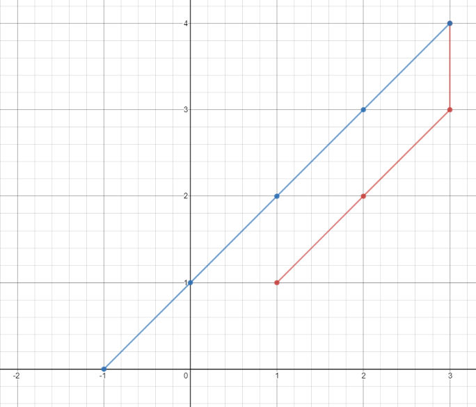

# 1266. 访问所有点的最小时间

Easy · 难度分 1303 · [力扣原题](https://leetcode.cn/problems/minimum-time-visiting-all-points/)

所在刷题路径：灵神题单·数学算法

| 作者 | 题解 | 动画讲解 |
|---|---|---|
| 灵茶山艾府 | [📄 题解](灵茶山艾府.md) | [▶︎ 动画（GIF）](1266%20访问所有点的最小时间%20·%20灵茶山艾府.gif) · [mp4 文件](1266%20访问所有点的最小时间%20·%20灵茶山艾府.mp4) |
| yiduobo | [📄 题解](yiduobo.md) | [▶︎ 动画（GIF）](1266%20访问所有点的最小时间%20·%20yiduobo.gif) · [mp4 文件](1266%20访问所有点的最小时间%20·%20yiduobo.mp4) |

## 动画讲解

> 动图会循环播放；想暂停、拖进度条请下载上面表格里的 mp4 文件。

### 灵茶山艾府


### yiduobo


## 题目描述

平面上有 `n` 个点，点的位置用整数坐标表示 `points[i] = [x_i, y_i]` 。请你计算访问所有这些点需要的 **最小时间**（以秒为单位）。

你需要按照下面的规则在平面上移动：

- 每一秒内，你可以：

    - 沿水平方向移动一个单位长度，或者

    - 沿竖直方向移动一个单位长度，或者

    - 跨过对角线移动 `sqrt(2)` 个单位长度（可以看作在一秒内向水平和竖直方向各移动一个单位长度）。

- 必须按照数组中出现的顺序来访问这些点。

- 在访问某个点时，可以经过该点后面出现的点，但经过的那些点不算作有效访问。

**示例 1：**



```

输入：points = [[1,1],[3,4],[-1,0]]
输出：7
解释：一条最佳的访问路径是： [1,1] -> [2,2] -> [3,3] -> [3,4] -> [2,3] -> [1,2] -> [0,1] -> [-1,0]
从 [1,1] 到 [3,4] 需要 3 秒
从 [3,4] 到 [-1,0] 需要 4 秒
一共需要 7 秒
```

**示例 2：**

```

输入：points = [[3,2],[-2,2]]
输出：5
```

**提示：**

- `points.length == n`

- `1 <= n <= 100`

- `points[i].length == 2`

- `-1000 <= points[i][0], points[i][1] <= 1000`

---
[↑ 返回 1200-1299](../README.md) · [总索引](../../../索引.md) · [仓库首页](../../../README.md)
