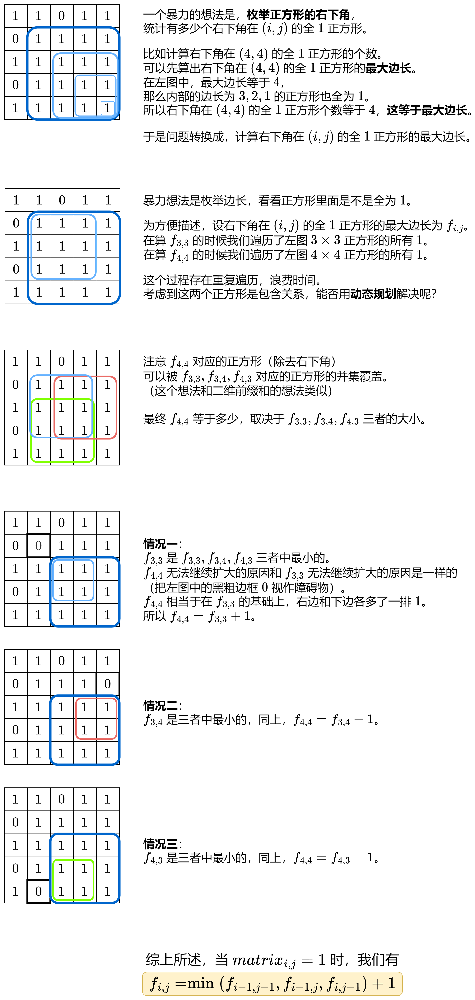
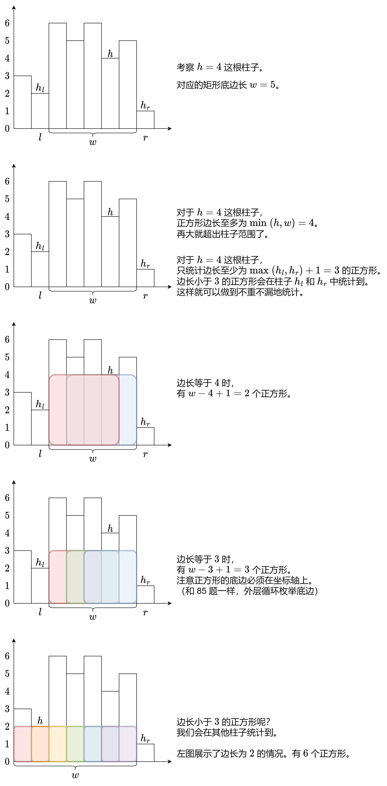

# 三种方法：枚举上下边界 / 动态规划 / 单调栈（Python/Java/C++/Go）

> **[1277. 统计全为 1 的正方形子矩阵](https://leetcode.cn/problems/count-square-submatrices-with-all-ones/solutions/3751608/tu-jie-dong-tai-gui-hua-jian-ji-xie-fa-p-1kiy/) · Medium**

> **所属题单**
> - [动态规划 · 七、其他线性 DP](../../../刷题路径/灵神原版题单/动态规划/七、其他线性%20DP.md) · §7.5 子矩形 DP
> - [单调栈 · 二、矩形](../../../刷题路径/灵神原版题单/单调栈/二、矩形.md)

> **题目描述**
> 给你一个 `m * n` 的矩阵，矩阵中的元素不是 `0` 就是 `1`，请你统计并返回其中完全由 `1` 组成的 **正方形** 子矩阵的个数。
>
> **示例 1：**
>
> ```
> 输入：matrix =
> [
>   [0,1,1,1],
>   [1,1,1,1],
>   [0,1,1,1]
> ]
> 输出：15
> 解释：
> 边长为 1 的正方形有 10 个。
> 边长为 2 的正方形有 4 个。
> 边长为 3 的正方形有 1 个。
> 正方形的总数 = 10 + 4 + 1 = 15.
> ```
>
> **示例 2：**
>
> ```
> 输入：matrix =
> [
>   [1,0,1],
>   [1,1,0],
>   [1,1,0]
> ]
> 输出：7
> 解释：
> 边长为 1 的正方形有 6 个。
> 边长为 2 的正方形有 1 个。
> 正方形的总数 = 6 + 1 = 7.
> ```
>
> **提示：**
>
> - `1 <= arr.length <= 300`
>
> - `1 <= arr[0].length <= 300`
>
> - `0 <= arr[i][j] <= 1`

> **题解**
> ## 方法一：枚举正方形的上下边界
>
> 枚举正方形的上下边界，统计每一列的 $1$ 的个数，把原问题「压缩」为一维数组上的问题。
>
> $$
> \begin{bmatrix}
> 0 & 1 & 1 & 1 \\
> 1 & 1 & 1 & 1 \\
> 0 & 1 & 1 & 1 \\
> \end{bmatrix}
> $$
>
> 在示例 1 中，假设现在枚举到正方形的上边界为 $0$ 行，下边界为 $1$ 行，即 $\textit{matrix}$ 的前两行。正方形的边长 $h=2$。
>
> 统计每一列 $1$ 的个数，得到一个一维数组 $a=[1,2,2,2]$。我们要找的正方形，就是 $a$ 的长度恰好为 $h=2$ 的子数组。由于全 $1$ 正方形的每一列都是 $1$，所以子数组的每一项都得是正方形的边长 $h=2$。问题变成：
>
> - 统计 $a$ 的长度恰好为 $h$ 的全 $h$ 子数组的数目。
>
> 思路类似 [2348. 全 0 子数组的数目](https://leetcode.cn/problems/number-of-zero-filled-subarrays/)。
>
> 代码实现时，外层循环枚举上边界，内层循环枚举下边界。当下边界 $\textit{bottom}$ 加一时，只需把每个 $a[j]$ 都增加相应的 $\textit{matrix}[\textit{bottom}][j]$，无需整个重新统计。
>
> ```python
> class Solution:
>     def countSquares(self, matrix: List[List[int]]) -> int:
>         m, n = len(matrix), len(matrix[0])
>         ans = 0
>         for top in range(m):  # 枚举上边界
>             a = [0] * n
>             for bottom in range(top, m):  # 枚举下边界
>                 h = bottom - top + 1  # 高
>                 # 2348. 全 h 子数组的数目
>                 last = -1
>                 for j in range(n):
>                     a[j] += matrix[bottom][j]  # 把 bottom 这一行的值加到 a 中
>                     if a[j] != h:
>                         last = j  # 记录上一个非 h 元素的位置
>                     elif j - last >= h:  # 右端点为 j 的长为 h 的子数组全是 h
>                         ans += 1
>         return ans
> ```
>
>
> #### 复杂度分析
>
> - 时间复杂度：$\mathcal{O}(m^2n)$，其中 $m$ 和 $n$ 分别为 $\textit{matrix}$ 的行数和列数。
> - 空间复杂度：$\mathcal{O}(n)$。
>
> ## 方法二：动态规划
>
> 思路启发：学习 [二维前缀和](../../0300-0399/0304%20二维区域和检索%20-%20矩阵不可变/灵茶山艾府.md) 对于想出本题的转移方程有帮助。
>
> 
>
> 整理上图中的结论。定义 $f_{i,j}$ 为右下角在 $(i,j)$ 的全 $1$ 正方形的最大边长。我们有
>
> $$
> f_{i,j} =
> \begin{cases}
> 0, & \textit{matrix}_{i,j} = 0     \\
> \min(f_{i-1,j-1},f_{i-1,j},f_{i,j-1}) + 1, & \textit{matrix}_{i,j} = 1     \\
> \end{cases}
> $$
>
> 然而，当 $i=0$ 或者 $j=0$ 时，上式会产生负数下标 $-1$。
>
> 为避免出现负数下标，可以在 $f$ 矩阵的最上边添加一行 $0$，最左边添加一列 $0$，对应下标出界的状态（正方形的最大边长为 $0$）。
>
> 由于修改了 $f$，状态转移方程中的 $f$ 的下标要加一，即
>
> $$
> f_{i+1,j+1} =
> \begin{cases}
> 0, & \textit{matrix}_{i,j} = 0     \\
> \min(f_{i,j},f_{i,j+1},f_{i+1,j}) + 1, & \textit{matrix}_{i,j} = 1     \\
> \end{cases}
> $$
>
> > 注意 $\textit{matrix}$ 的下标是不用变的，因为我们只是在 $f$ 矩阵的上边和左边插入了 $0$，所以只有 $f$ 的下标受此影响需要加一。
>
> 初始值 $f_{0,j} = f_{i,0} = 0$。
>
> 根据图中的结论（**正方形个数等价于正方形最大边长**），答案为整个 $f$ 矩阵的元素和。
>
> ### 优化前
>
> ```python
> class Solution:
>     def countSquares(self, matrix: List[List[int]]) -> int:
>         m, n = len(matrix), len(matrix[0])
>         f = [[0] * (n + 1) for _ in range(m + 1)]
>         for i, row in enumerate(matrix):
>             for j, x in enumerate(row):
>                 if x:
>                     f[i + 1][j + 1] = min(f[i][j], f[i][j + 1], f[i + 1][j]) + 1
>         return sum(map(sum, f))
> ```
>
>
> ### 优化
>
> 直接把 $\textit{matrix}$ 当作 $f$，原地修改。
>
> ```python
> class Solution:
>     def countSquares(self, matrix: List[List[int]]) -> int:
>         for i, row in enumerate(matrix):
>             for j, x in enumerate(row):
>                 if x and i and j:
>                     row[j] += min(matrix[i - 1][j], matrix[i - 1][j - 1], row[j - 1])
>         return sum(map(sum, matrix))
> ```
>
>
> #### 复杂度分析
>
> - 时间复杂度：$\mathcal{O}(mn)$，其中 $m$ 和 $n$ 分别为 $\textit{matrix}$ 的行数和列数。
> - 空间复杂度：优化前 $\mathcal{O}(mn)$，优化后 $\mathcal{O}(1)$。
>
> ## 方法三：单调栈
>
> **请先完成前置题目** [85. 最大矩形](https://leetcode.cn/problems/maximal-rectangle/)，接着 [我的题解](../../0000-0099/0085%20最大矩形/灵茶山艾府.md) 继续讲。
>
> 
>
> **注**：在宽度为 $w$ 的空间内，有 $w-k+1$ 个不同位置可以放边长为 $k$ 的正方形。
>
> 对于某个高为 $h$ 的柱子，设其对应的矩形底边长为 $w = \textit{heights}[r] - \textit{heights}[l] + 1$。其中 $\textit{heights}[l]$ 是 $h$ 左侧的高度小于 $h$ 的最近柱子（没有则为 $0$），$\textit{heights}[r]$ 是 $h$ 右侧的高度小于 $h$ 的最近柱子（没有则为 $n$）。
>
> 正方形边长下界为 $\textit{lower} = \max(\textit{heights}[l], \textit{heights}[r]) + 1$。
>
> 正方形边长上界为 $\textit{upper} = \min(h,w)$。
>
> 枚举正方形边长为 $k = \textit{lower}, \textit{lower}+1,\dots,\textit{upper}$，累加正方形个数 $w-k+1$，那么高为 $h$ 的柱子对答案的**贡献**为
>
> $$
> \sum_{k = \textit{lower}}^{\textit{upper}} w-k+1 = \dfrac{(2w+2 - \textit{lower}-\textit{upper})(\textit{upper}-\textit{lower}+1)}{2}
> $$
>
> ```python
> class Solution:
>     def solve(self, heights: List[int]) -> int:
>         st = [-1]  # 哨兵：在栈中只有一个数的时候，栈顶的「下面那个数」是 -1，对应 left[i] = -1 的情况
>         ans = 0
>         for r, hr in enumerate(heights):
>             while len(st) > 1 and heights[st[-1]] >= hr:
>                 h = heights[st.pop()]  # 矩形的高
>                 l = st[-1]  # 栈顶下面那个数就是 l
>                 w = r - l - 1
>                 upper = min(h, w)
>                 lower = (hr if l < 0 else max(heights[l], hr)) + 1
>                 if lower <= upper:
>                     ans += (w * 2 + 2 - lower - upper) * (upper - lower + 1) // 2
>             st.append(r)
>         return ans
>
>     def countSquares(self, matrix: List[List[int]]) -> int:
>         heights = [0] * (len(matrix[0]) + 1)  # 末尾多一个 0，理由见我 84 题题解
>         ans = 0
>         for row in matrix:
>             # 计算底边为 row 的柱子高度
>             for j, x in enumerate(row):
>                 if x == 0:
>                     heights[j] = 0  # 柱子高度为 0
>                 else:
>                     heights[j] += 1  # 柱子高度加一
>             ans += self.solve(heights)
>         return ans
> ```
>
>
> #### 复杂度分析
>
> - 时间复杂度：$\mathcal{O}(mn)$，其中 $m$ 和 $n$ 分别为 $\textit{matrix}$ 的行数和列数。
> - 空间复杂度：$\mathcal{O}(n)$。
>
> ## 专题训练
>
> 1. 动态规划题单的「**§7.5 子矩形 DP**」。
> 2. 单调栈题单的「**二、矩形**」。
>
> ## 分类题单
>
> [如何科学刷题？](https://leetcode.cn/circle/discuss/RvFUtj/)
>
> 1. [滑动窗口与双指针（定长/不定长/单序列/双序列/三指针/分组循环）](https://leetcode.cn/circle/discuss/0viNMK/)
> 2. [二分算法（二分答案/最小化最大值/最大化最小值/第K小）](https://leetcode.cn/circle/discuss/SqopEo/)
> 3. [单调栈（基础/矩形面积/贡献法/最小字典序）](https://leetcode.cn/circle/discuss/9oZFK9/)
> 4. [网格图（DFS/BFS/综合应用）](https://leetcode.cn/circle/discuss/YiXPXW/)
> 5. [位运算（基础/性质/拆位/试填/恒等式/思维）](https://leetcode.cn/circle/discuss/dHn9Vk/)
> 6. [图论算法（DFS/BFS/拓扑排序/基环树/最短路/最小生成树/网络流）](https://leetcode.cn/circle/discuss/01LUak/)
> 7. [动态规划（入门/背包/划分/状态机/区间/状压/数位/数据结构优化/树形/博弈/概率期望）](https://leetcode.cn/circle/discuss/tXLS3i/)
> 8. [常用数据结构（前缀和/差分/栈/队列/堆/字典树/并查集/树状数组/线段树）](https://leetcode.cn/circle/discuss/mOr1u6/)
> 9. [数学算法（数论/组合/概率期望/博弈/计算几何/随机算法）](https://leetcode.cn/circle/discuss/IYT3ss/)
> 10. [贪心与思维（基本贪心策略/反悔/区间/字典序/数学/思维/脑筋急转弯/构造）](https://leetcode.cn/circle/discuss/g6KTKL/)
> 11. [链表、二叉树与回溯（前后指针/快慢指针/DFS/BFS/直径/LCA/一般树）](https://leetcode.cn/circle/discuss/K0n2gO/)
> 12. [字符串（KMP/Z函数/Manacher/字符串哈希/AC自动机/后缀数组/子序列自动机）](https://leetcode.cn/circle/discuss/SJFwQI/)
>
> [我的题解精选（已分类）](https://github.com/EndlessCheng/codeforces-go/blob/master/leetcode/SOLUTIONS.md)
>
> 欢迎关注 [B站@灵茶山艾府](https://space.bilibili.com/206214)
