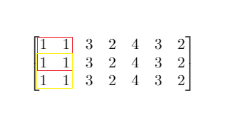

# 1292. 元素和小于等于阈值的正方形的最大边长

Medium · 难度分 1735 · [力扣原题](https://leetcode.cn/problems/maximum-side-length-of-a-square-with-sum-less-than-or-equal-to-threshold/)

所在刷题路径：灵神题单·常用数据结构

| 作者 | 题解 | 动画讲解 |
|---|---|---|
| 灵茶山艾府 | [📄 题解](灵茶山艾府.md) | [▶︎ 1292 元素和小于等于阈值的正方形的最大边长 · 灵茶山艾府.mp4](1292%20元素和小于等于阈值的正方形的最大边长%20·%20灵茶山艾府.mp4) |
| yiduobo | [📄 题解](yiduobo.md) | [▶︎ 1292 元素和小于等于阈值的正方形的最大边长 · yiduobo.mp4](1292%20元素和小于等于阈值的正方形的最大边长%20·%20yiduobo.mp4) |

## 题目描述

给你一个大小为 `m x n` 的矩阵 `mat` 和一个整数阈值 `threshold`。

请你返回元素总和小于或等于阈值的正方形区域的最大边长；如果没有这样的正方形区域，则返回 **0** 。

**示例 1：**



```

输入：mat = [[1,1,3,2,4,3,2],[1,1,3,2,4,3,2],[1,1,3,2,4,3,2]], threshold = 4
输出：2
解释：总和小于或等于 4 的正方形的最大边长为 2，如图所示。
```

**示例 2：**

```

输入：mat = [[2,2,2,2,2],[2,2,2,2,2],[2,2,2,2,2],[2,2,2,2,2],[2,2,2,2,2]], threshold = 1
输出：0
```

**提示：**

- `m == mat.length`

- `n == mat[i].length`

- `1 <= m, n <= 300`

- `0 <= mat[i][j] <= 10⁴`

- `0 <= threshold <= 10⁵`<sup> </sup>

---
[↑ 返回 1200-1299](../README.md) · [总索引](../../../索引.md) · [仓库首页](../../../README.md)
