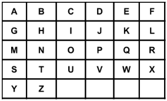

# 教你一步步思考 DP：记忆化搜索 -> 递推 -> 空间优化（Python/Java/C++/Go）

> **[1320. 二指输入的的最小距离](https://leetcode.cn/problems/minimum-distance-to-type-a-word-using-two-fingers/solutions/3946229/jiao-ni-yi-bu-bu-si-kao-dpji-yi-hua-sou-d9vls/) · Hard · 难度分 2028**

> **所属题单**
> - [动态规划 · 七、其他线性 DP](../../../刷题路径/灵神原版题单/动态规划/七、其他线性%20DP.md) · §7.6 多维 DP

> **题目描述**
> 
>
> 二指输入法定制键盘在 **X-Y** 平面上的布局如上图所示，其中每个大写英文字母都位于某个坐标处。
>
> - 例如字母 **A** 位于坐标 **(0,0)**，字母 **B** 位于坐标 **(0,1)**，字母 **P** 位于坐标 **(2,3)** 且字母 **Z** 位于坐标 **(4,1)**。
>
> 给你一个待输入字符串 `word`，请你计算并返回在仅使用两根手指的情况下，键入该字符串需要的最小移动总距离。
>
> 坐标` (x₁,y₁) `和 `(x₂,y₂)` 之间的 **距离** 是 `|x₁ - x₂| + |y₁ - y₂|`。
>
> **注意**，两根手指的起始位置是零代价的，不计入移动总距离。你的两根手指的起始位置也不必从首字母或者前两个字母开始。
>
> **示例 1：**
>
> ```
>
> 输入：word = "CAKE"
> 输出：3
> 解释：
> 使用两根手指输入 "CAKE" 的最佳方案之一是：
> 手指 1 在字母 'C' 上 -> 移动距离 = 0
> 手指 1 在字母 'A' 上 -> 移动距离 = 从字母 'C' 到字母 'A' 的距离 = 2
> 手指 2 在字母 'K' 上 -> 移动距离 = 0
> 手指 2 在字母 'E' 上 -> 移动距离 = 从字母 'K' 到字母 'E' 的距离  = 1
> 总距离 = 3
> ```
>
> **示例 2：**
>
> ```
>
> 输入：word = "HAPPY"
> 输出：6
> 解释：
> 使用两根手指输入 "HAPPY" 的最佳方案之一是：
> 手指 1 在字母 'H' 上 -> 移动距离 = 0
> 手指 1 在字母 'A' 上 -> 移动距离 = 从字母 'H' 到字母 'A' 的距离 = 2
> 手指 2 在字母 'P' 上 -> 移动距离 = 0
> 手指 2 在字母 'P' 上 -> 移动距离 = 从字母 'P' 到字母 'P' 的距离 = 0
> 手指 1 在字母 'Y' 上 -> 移动距离 = 从字母 'A' 到字母 'Y' 的距离 = 4
> 总距离 = 6
> ```
>
> **提示：**
>
> - `2 <= word.length <= 300`
>
> - 每个 `word[i]` 都是一个大写英文字母。

> **题解**
> ## 一、分析
>
> 示例 1 的 $\textit{word} = \texttt{CAKE}$，敲完 $\texttt{E}$ 就结束了，所以最后一定有一根手指停在 $\texttt{E}$。
>
> 另一根手指呢？最后一定停在 $\texttt{K}$ 吗？不一定，如果第一根手指输入 $\texttt{CA}$，第二根手指输入 $\texttt{KE}$，那么第一根手指最后会停在 $\texttt{A}$，第二根手指最后会停在 $\texttt{E}$。
>
> 只要我们能实时跟踪两根手指的位置（在哪个字母），就能暴力搜索所有输入的过程。
>
> ## 二、状态定义与状态转移方程
>
> 根据上面的讨论，定义 $\textit{dfs}(i, \textit{finger}_1, \textit{finger}_2)$ 表示在手指 1 位于字母 $\textit{finger}_1$，手指 2 位于字母 $\textit{finger}_2$ 的情况下，输入 $\textit{word}$ 的前缀 $[0,i]$ 的最小移动总距离。
>
> > **注**：从右往左递归，主要是方便把递归翻译成从左往右的递推。从左往右递归也是可以的。
>
> 讨论用哪根手指输入 $\textit{word}[i]$：
>
> - 用手指 1，那么接下来要解决的问题是，在手指 1 位于字母 $\textit{word}[i]$，手指 2 位于字母 $\textit{finger}_2$ 的情况下，输入 $\textit{word}$ 的前缀 $[0,i-1]$ 的最小移动总距离，即 $\textit{dfs}(i-1, \textit{word}[i],\textit{finger}_2)$，加上从 $\textit{finger}_1$ 到 $\textit{word}[i]$ 的距离。 
> - 用手指 2，那么接下来要解决的问题是，在手指 1 位于字母 $\textit{finger}_1$，手指 2 位于字母 $\textit{word}[i]$ 的情况下，输入 $\textit{word}$ 的前缀 $[0,i-1]$ 的最小移动总距离，即 $\textit{dfs}(i-1, \textit{finger}_1,\textit{word}[i])$，加上从 $\textit{finger}_2$ 到 $\textit{word}[i]$ 的距离。
>
> 这两种情况取最小值，就得到了 $\textit{dfs}(i, \textit{finger}_1, \textit{finger}_2)$，即
>
> $$
> \textit{dfs}(i, \textit{finger}_1, \textit{finger}_2) = \min
> \begin{cases}
> \textit{dfs}(i-1, \textit{word}[i],\textit{finger}_2) + \textit{dis}[\textit{finger}_1][\textit{word}[i]]     \\
> \textit{dfs}(i-1, \textit{finger}_1,\textit{word}[i]) + \textit{dis}[\textit{finger}_2][\textit{word}[i]]     \\
> \end{cases}
> $$
>
> 其中 $\textit{dis}[x][y]$ 表示从字母 $x$ 到字母 $y$ 的距离。这个二维数组可以在跑 $\textit{dfs}$ 之前预处理出来。
>
> **递归边界**：$\textit{dfs}(-1, \textit{finger}_1, \textit{finger}_2)=0$。没有字母需要输入，无需移动。
>
> **递归入口**：$\textit{dfs}(n-2, \textit{word}[n-1], \textit{finger}_2)$。最后一定有一根手指在 $\textit{word}[n-1]$，另一根手指的位置不确定，枚举 $\textit{finger}_2$。
>
> ## 三、递归搜索 + 保存递归返回值 = 记忆化搜索
>
> 考虑到整个递归过程中有大量重复递归调用（递归入参相同）。由于递归函数没有副作用，同样的入参无论计算多少次，算出来的结果都是一样的，因此可以用**记忆化搜索**来优化：
>
> - 如果一个状态（递归入参）是第一次遇到，那么可以在返回前，把状态及其结果记到一个 $\textit{memo}$ 数组中。
> - 如果一个状态不是第一次遇到（$\textit{memo}$ 中保存的结果不等于 $\textit{memo}$ 的初始值），那么可以直接返回 $\textit{memo}$ 中保存的结果。
>
> ⚠**注意**：$\textit{memo}$ 数组的**初始值**一定不能等于要记忆化的值！例如初始值设置为 $0$，并且要记忆化的 $\textit{dfs}(i, \textit{finger}_1, \textit{finger}_2)$ 也等于 $0$，那就没法判断 $0$ 到底表示第一次遇到这个状态，还是表示之前遇到过了，从而导致记忆化失效。一般把初始值设置为 $-1$。
>
> > Python 用户可以无视上面这段，直接用 `@cache` 装饰器。
>
> 具体请看视频讲解 [动态规划入门：从记忆化搜索到递推【基础算法精讲 17】](https://www.bilibili.com/video/BV1Xj411K7oF/)，其中包含把记忆化搜索 1:1 翻译成递推的技巧。
>
> ```python
> # 预处理两个字母的距离
> COLUMN = 6
> get_dis = lambda a, b: abs(a // COLUMN - b // COLUMN) + abs(a % COLUMN - b % COLUMN)
> dis = [[get_dis(i, j) for j in range(26)] for i in range(26)]
>
> class Solution:
>     def minimumDistance(self, word: str) -> int:
>         word = [ord(ch) - ord('A') for ch in word]  # 避免在 dfs 中频繁调用 ord
>
>         @cache  # 缓存装饰器，避免重复计算 dfs（一行代码实现记忆化）
>         def dfs(i: int, finger1: int, finger2: int) -> int:
>             if i < 0:
>                 return 0
>
>             # 手指 1 移到 word[i]
>             res1 = dfs(i - 1, word[i], finger2) + dis[finger1][word[i]]
>
>             # 手指 2 移到 word[i]
>             res2 = dfs(i - 1, finger1, word[i]) + dis[finger2][word[i]]
>
>             return min(res1, res2)
>
>         n = len(word)
>         # 最后一定有一根手指在 word[-1]，另一根手指的位置不确定，枚举
>         return min(dfs(n - 2, word[-1], finger2) for finger2 in range(26))
> ```
>
>
> #### 复杂度分析
>
> 不计入预处理的时间和空间。
>
> - 时间复杂度：$\mathcal{O}(n|\Sigma|)$ 或 $\mathcal{O}(n|\Sigma|^2)$，其中 $n$ 是 $\textit{word}$ 的长度，$|\Sigma|=26$ 是字符集合的大小。如果用哈希表保存状态，则时间复杂度为 $\mathcal{O}(n|\Sigma|)$，否则瓶颈在创建 $\textit{memo}$ 数组上。理由见下一章。
> - 空间复杂度：$\mathcal{O}(n|\Sigma|)$ 或 $\mathcal{O}(n|\Sigma|^2)$。理由见下一章。
>
> ## 四、状态优化
>
> 回顾上面的代码，在输入 $\textit{word}[i]$ 之前，一定有一根手指在 $\textit{word}[i+1]$。这意味着，知道了 $i$，就知道了其中一根手指的位置。所以 $\textit{finger}_1$ 和 $\textit{finger}_2$ 中的一个是**多余**的。
>
> 定义 $\textit{dfs}(i, \textit{anotherFinger})$ 表示在一根手指位于字母 $\textit{word}[i+1]$，另一根手指位于字母 $\textit{anotherFinger}$ 的情况下，输入 $\textit{word}$ 的前缀 $[0,i]$ 的最小移动总距离。
>
> 讨论用哪根手指输入 $\textit{word}[i]$：
>
> - 用位于 $\textit{word}[i+1]$ 的手指输入 $\textit{word}[i]$，那么另一根手指仍然位于字母 $\textit{anotherFinger}$，所以接下来要解决的问题是，在一根手指位于字母 $\textit{word}[i]$，另一根手指位于字母 $\textit{anotherFinger}$ 的情况下，输入 $\textit{word}$ 的前缀 $[0,i-1]$ 的最小移动总距离，即 $\textit{dfs}(i-1, \textit{anotherFinger})$，加上从 $\textit{word}[i+1]$ 到 $\textit{word}[i]$ 的距离。
> - 用位于 $\textit{anotherFinger}$ 的手指输入 $\textit{word}[i]$，那么位于 $\textit{word}[i+1]$ 的手指就变成了「另一根手指」，所以接下来要解决的问题是，在一根手指位于字母 $\textit{word}[i]$，另一根手指位于字母 $\textit{word}[i+1]$ 的情况下，输入 $\textit{word}$ 的前缀 $[0,i-1]$ 的最小移动总距离，即 $\textit{dfs}(i-1, \textit{word}[i+1])$，加上从 $\textit{anotherFinger}$ 到 $\textit{word}[i]$ 的距离。
>
> 这两种情况取最小值，就得到了 $\textit{dfs}(i, \textit{anotherFinger})$，即
>
> $$
> \textit{dfs}(i, \textit{anotherFinger}) = \min
> \begin{cases}
> \textit{dfs}(i-1, \textit{anotherFinger}) + \textit{dis}[\textit{word}[i+1]][\textit{word}[i]]     \\
> \textit{dfs}(i-1, \textit{word}[i+1]) + \textit{dis}[\textit{anotherFinger}][\textit{word}[i]]     \\
> \end{cases}
> $$
>
> **递归边界**：$\textit{dfs}(-1, \textit{anotherFinger})=0$。没有字母需要输入，无需移动。
>
> **递归入口**：$\textit{dfs}(n-2, \textit{anotherFinger})$。最后一定有一根手指在 $\textit{word}[n-1]$，另一根手指的位置不确定，枚举 $\textit{anotherFinger}$。
>
> ```python
> # 预处理两个字母的距离
> COLUMN = 6
> get_dis = lambda a, b: abs(a // COLUMN - b // COLUMN) + abs(a % COLUMN - b % COLUMN)
> dis = [[get_dis(i, j) for j in range(26)] for i in range(26)]
>
> class Solution:
>     def minimumDistance(self, word: str) -> int:
>         word = [ord(ch) - ord('A') for ch in word]  # 避免在 dfs 中频繁调用 ord
>
>         @cache  # 缓存装饰器，避免重复计算 dfs（一行代码实现记忆化）
>         def dfs(i: int, another_finger: int) -> int:
>             if i < 0:
>                 return 0
>
>             # 在 word[i+1] 的手指移到 word[i]
>             res1 = dfs(i - 1, another_finger) + dis[word[i + 1]][word[i]]
>
>             # 另一根手指移到 word[i]，原来在 word[i+1] 的手指变成 another_finger
>             res2 = dfs(i - 1, word[i + 1]) + dis[another_finger][word[i]]
>
>             return min(res1, res2)
>
>         n = len(word)
>         # 最后一定有一根手指在 word[-1]，另一根手指的位置不确定，枚举
>         return min(dfs(n - 2, another_finger) for another_finger in range(26))
> ```
>
>
> #### 复杂度分析
>
> 不计入预处理的时间和空间。
>
> - 时间复杂度：$\mathcal{O}(n|\Sigma|)$，其中 $n$ 是 $\textit{word}$ 的长度，$|\Sigma|=26$ 是字符集合的大小。由于每个状态只会计算一次，动态规划的时间复杂度 $=$ 状态个数 $\times$ 单个状态的计算时间。本题状态个数等于 $\mathcal{O}(n|\Sigma|)$，单个状态的计算时间为 $\mathcal{O}(1)$，所以总的时间复杂度为 $\mathcal{O}(n|\Sigma|)$。
> - 空间复杂度：$\mathcal{O}(n|\Sigma|)$。保存多少状态，就需要多少空间。
>
> ## 五、1:1 翻译成递推
>
> 我们可以去掉递归中的「递」，只保留「归」的部分，即自底向上计算。
>
> 具体来说，$f[i+1][\textit{anotherFinger}]$ 的定义和 $\textit{dfs}(i,\textit{anotherFinger})$ 的定义是一样的，都表示在一根手指位于字母 $\textit{word}[i+1]$，另一根手指位于字母 $\textit{anotherFinger}$ 的情况下，输入 $\textit{word}$ 的前缀 $[0,i]$ 的最小移动总距离。这里 $+1$ 是为了把 $\textit{dfs}(-1,\textit{anotherFinger})$ 这个状态也翻译过来，这样我们可以把 $f[0]$ 作为初始值。
>
> 相应的递推式（状态转移方程）也和 $\textit{dfs}$ 一样：
>
> $$
> f[i+1][\textit{anotherFinger}] = \min
> \begin{cases}
> f[i][\textit{anotherFinger}] + \textit{dis}[\textit{word}[i+1]][\textit{word}[i]]     \\
> f[i][\textit{word}[i+1]] + \textit{dis}[\textit{anotherFinger}][\textit{word}[i]]     \\
> \end{cases}
> $$
>
> 初始值 $f[0][\textit{anotherFinger}]=0$，翻译自递归边界 $\textit{dfs}(-1, \textit{anotherFinger})$。
>
> 答案为 $f[n-1][\textit{anotherFinger}]$，翻译自递归入口 $\textit{dfs}(n-2, \textit{anotherFinger})$。
>
> ```python
> # 预处理两个字母的距离
> COLUMN = 6
> get_dis = lambda a, b: abs(a // COLUMN - b // COLUMN) + abs(a % COLUMN - b % COLUMN)
> dis = [[get_dis(i, j) for j in range(26)] for i in range(26)]
>
> class Solution:
>     def minimumDistance(self, word: str) -> int:
>         f = [[0] * 26 for _ in word]
>         for i, (x, y) in enumerate(pairwise(word)):
>             x = ord(x) - ord('A')
>             y = ord(y) - ord('A')
>             for another_finger in range(26):
>                 f[i + 1][another_finger] = min(f[i][another_finger] + dis[y][x], f[i][y] + dis[another_finger][x])
>         return min(f[-1])
> ```
>
>
> #### 复杂度分析
>
> 不计入预处理的时间和空间。
>
> - 时间复杂度：$\mathcal{O}(n|\Sigma|)$，其中 $n$ 是 $\textit{word}$ 的长度，$|\Sigma|=26$ 是字符集合的大小。
> - 空间复杂度：$\mathcal{O}(n|\Sigma|)$。
>
> ## 六、空间优化
>
> 去掉 $f$ 的第一个维度，把 $f[i+1]$ 和 $f[i]$ 保存到**同一个数组**中。
>
> 此外，由于 $\textit{dis}[x][y] = \textit{dis}[y][x]$，我们可以交换转移方程中的 $\textit{dis}$ 的两个维度，这样在同一个内层循环中只会访问 $\textit{dis}[x]$ 这一个数组。
>
> ```python
> COLUMN = 6
> get_dis = lambda a, b: abs(a // COLUMN - b // COLUMN) + abs(a % COLUMN - b % COLUMN)
> dis = [[get_dis(i, j) for j in range(26)] for i in range(26)]
>
> class Solution:
>     def minimumDistance(self, word: str) -> int:
>         f = [0] * 26
>         for x, y in pairwise(word):
>             x = ord(x) - ord('A')
>             y = ord(y) - ord('A')
>             dis_x = dis[x]
>             fy = f[y]
>             for another_finger in range(26):
>                 f[another_finger] = min(f[another_finger] + dis_x[y], fy + dis_x[another_finger])
>         return min(f)
> ```
>
>
> #### 复杂度分析
>
> 不计入预处理的时间和空间。
>
> - 时间复杂度：$\mathcal{O}(n|\Sigma|)$，其中 $n$ 是 $\textit{word}$ 的长度，$|\Sigma|=26$ 是字符集合的大小。
> - 空间复杂度：$\mathcal{O}(|\Sigma|)$。
>
> ## 专题训练
>
> 见下面动态规划题单的「**§7.6 多维 DP**」。
>
> ## 分类题单
>
> [如何科学刷题？](https://leetcode.cn/circle/discuss/RvFUtj/)
>
> 1. [滑动窗口与双指针（定长/不定长/单序列/双序列/三指针/分组循环）](https://leetcode.cn/circle/discuss/0viNMK/)
> 2. [二分算法（二分答案/最小化最大值/最大化最小值/第K小）](https://leetcode.cn/circle/discuss/SqopEo/)
> 3. [单调栈（基础/矩形面积/贡献法/最小字典序）](https://leetcode.cn/circle/discuss/9oZFK9/)
> 4. [网格图（DFS/BFS/综合应用）](https://leetcode.cn/circle/discuss/YiXPXW/)
> 5. [位运算（基础/性质/拆位/试填/恒等式/思维）](https://leetcode.cn/circle/discuss/dHn9Vk/)
> 6. [图论算法（DFS/BFS/拓扑排序/基环树/最短路/最小生成树/网络流）](https://leetcode.cn/circle/discuss/01LUak/)
> 7. [动态规划（入门/背包/划分/状态机/区间/状压/数位/数据结构优化/树形/博弈/概率期望）](https://leetcode.cn/circle/discuss/tXLS3i/)
> 8. [常用数据结构（前缀和/差分/栈/队列/堆/字典树/并查集/树状数组/线段树）](https://leetcode.cn/circle/discuss/mOr1u6/)
> 9. [数学算法（数论/组合/概率期望/博弈/计算几何/随机算法）](https://leetcode.cn/circle/discuss/IYT3ss/)
> 10. [贪心与思维（基本贪心策略/反悔/区间/字典序/数学/思维/脑筋急转弯/构造）](https://leetcode.cn/circle/discuss/g6KTKL/)
> 11. [链表、树与回溯（前后指针/快慢指针/DFS/BFS/直径/LCA）](https://leetcode.cn/circle/discuss/K0n2gO/)
> 12. [字符串（KMP/Z函数/Manacher/字符串哈希/AC自动机/后缀数组/子序列自动机）](https://leetcode.cn/circle/discuss/SJFwQI/)
>
> [我的题解精选（已分类）](https://github.com/EndlessCheng/codeforces-go/blob/master/leetcode/SOLUTIONS.md)
>
> 欢迎关注 [B站@灵茶山艾府](https://space.bilibili.com/206214)
