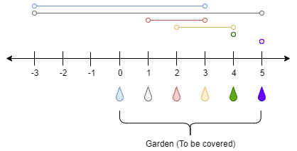

# 1326. 灌溉花园的最少水龙头数目

Hard · 难度分 1885 · [力扣原题](https://leetcode.cn/problems/minimum-number-of-taps-to-open-to-water-a-garden/)

所在刷题路径：灵神题单·贪心与思维

| 作者 | 题解 | 动画讲解 |
|---|---|---|
| 灵茶山艾府 | [📄 题解](灵茶山艾府.md) | [▶︎ 1326 灌溉花园的最少水龙头数目 · 灵茶山艾府.mp4](1326%20灌溉花园的最少水龙头数目%20·%20灵茶山艾府.mp4) |
| yiduobo | [📄 题解](yiduobo.md) | [▶︎ 1326 灌溉花园的最少水龙头数目 · yiduobo.mp4](1326%20灌溉花园的最少水龙头数目%20·%20yiduobo.mp4) |

## 题目描述

在 x 轴上有一个一维的花园。花园长度为 `n`，从点 `0` 开始，到点 `n` 结束。

花园里总共有 `n + 1` 个水龙头，分别位于 `[0, 1, ..., n]` 。

给你一个整数 `n` 和一个长度为 `n + 1` 的整数数组 `ranges` ，其中 `ranges[i]` （下标从 0 开始）表示：如果打开点 `i` 处的水龙头，可以灌溉的区域为 `[i -  ranges[i], i + ranges[i]]` 。

请你返回可以灌溉整个花园的 **最少水龙头数目** 。如果花园始终存在无法灌溉到的地方，请你返回 **-1** 。

**示例 1：**



```

输入：n = 5, ranges = [3,4,1,1,0,0]
输出：1
解释：
点 0 处的水龙头可以灌溉区间 [-3,3]
点 1 处的水龙头可以灌溉区间 [-3,5]
点 2 处的水龙头可以灌溉区间 [1,3]
点 3 处的水龙头可以灌溉区间 [2,4]
点 4 处的水龙头可以灌溉区间 [4,4]
点 5 处的水龙头可以灌溉区间 [5,5]
只需要打开点 1 处的水龙头即可灌溉整个花园 [0,5] 。
```

**示例 2：**

```

输入：n = 3, ranges = [0,0,0,0]
输出：-1
解释：即使打开所有水龙头，你也无法灌溉整个花园。
```

**提示：**

- `1 <= n <= 10⁴`

- `ranges.length == n + 1`

- `0 <= ranges[i] <= 100`

---
[↑ 返回 1300-1399](../README.md) · [总索引](../../../索引.md) · [仓库首页](../../../README.md)
