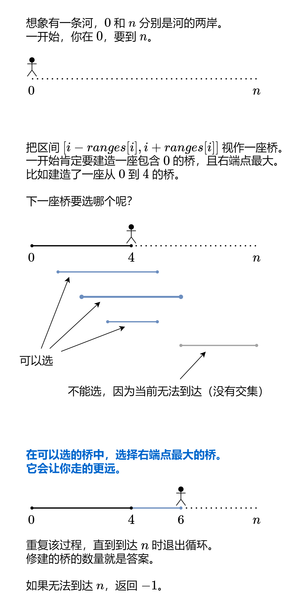

# 一张图秒懂！（Python/Java/C++/Go）

> **[1326. 灌溉花园的最少水龙头数目](https://leetcode.cn/problems/minimum-number-of-taps-to-open-to-water-a-garden/solutions/2123855/yi-zhang-tu-miao-dong-pythonjavacgo-by-e-wqry/) · Hard · 难度分 1885**

> **所属题单**
> - [贪心算法 · 二、区间贪心](../../../刷题路径/灵神原版题单/贪心算法/二、区间贪心.md) · §2.4 区间覆盖

> **题目描述**
> 在 x 轴上有一个一维的花园。花园长度为 `n`，从点 `0` 开始，到点 `n` 结束。
>
> 花园里总共有 `n + 1` 个水龙头，分别位于 `[0, 1, ..., n]` 。
>
> 给你一个整数 `n` 和一个长度为 `n + 1` 的整数数组 `ranges` ，其中 `ranges[i]` （下标从 0 开始）表示：如果打开点 `i` 处的水龙头，可以灌溉的区域为 `[i -  ranges[i], i + ranges[i]]` 。
>
> 请你返回可以灌溉整个花园的 **最少水龙头数目** 。如果花园始终存在无法灌溉到的地方，请你返回 **-1** 。
>
> **示例 1：**
>
> 
>
> ```
>
> 输入：n = 5, ranges = [3,4,1,1,0,0]
> 输出：1
> 解释：
> 点 0 处的水龙头可以灌溉区间 [-3,3]
> 点 1 处的水龙头可以灌溉区间 [-3,5]
> 点 2 处的水龙头可以灌溉区间 [1,3]
> 点 3 处的水龙头可以灌溉区间 [2,4]
> 点 4 处的水龙头可以灌溉区间 [4,4]
> 点 5 处的水龙头可以灌溉区间 [5,5]
> 只需要打开点 1 处的水龙头即可灌溉整个花园 [0,5] 。
> ```
>
> **示例 2：**
>
> ```
>
> 输入：n = 3, ranges = [0,0,0,0]
> 输出：-1
> 解释：即使打开所有水龙头，你也无法灌溉整个花园。
> ```
>
> **提示：**
>
> - `1 <= n <= 10⁴`
>
> - `ranges.length == n + 1`
>
> - `0 <= ranges[i] <= 100`

> **题解**
> 首先解释下示例 2 为什么要输出 $-1$：因为「整个花园」包含不是整点的位置，例如 $0.5$ 这种小数位置也要被灌溉到，但输入只能灌溉 $0,1,2,3$ 这 $4$ 个整点。
>
> 
>
> ## 答疑
>
> **问**：我能想出这题的思路，就是代码实现总是写不对，有没有什么建议？
>
> **答**：清晰的变量名以及一些必要的注释，会对理清代码逻辑有帮助。在出现错误时，可以用一些小数据去运行你的代码，通过 print 或者打断点的方式，查看这些关键变量的值，看看是否与预期结果一致。
>
> **问**：为什么没有初始化 $\textit{rightMost}[i]=i$？
>
> **答**：如果可以走到 $i$，那么 $\textit{nextRight}\ge i$，此时 $\textit{rightMost}[i]=i$ 还是 $=0$ 都不会影响 $\textit{nextRight}$ 的值，也就没必要初始化 $\textit{rightMost}[i]=i$ 了。
>
> ```python
> class Solution:
>     def minTaps(self, n: int, ranges: List[int]) -> int:
>         right_most = [0] * (n + 1)
>         for i, r in enumerate(ranges):
>             left = max(i - r, 0)
>             right_most[left] = max(right_most[left], i + r)
>
>         ans = 0
>         cur_right = 0  # 已建造的桥的右端点
>         next_right = 0  # 下一座桥的右端点的最大值
>         for i in range(n):  # 如果走到 n-1 时没有返回 -1，那么必然可以到达 n
>             next_right = max(next_right, right_most[i])
>             if i == cur_right:  # 到达已建造的桥的右端点
>                 if i == next_right:  # 无论怎么造桥，都无法从 i 到 i+1
>                     return -1
>                 cur_right = next_right  # 造一座桥
>                 ans += 1
>         return ans
> ```
>
>
> ## 复杂度分析
>
> - 时间复杂度：$\mathcal{O}(n)$。
> - 空间复杂度：$\mathcal{O}(n)$。
>
> ## 相似题目
>
> - [55. 跳跃游戏](https://leetcode.cn/problems/jump-game/)
> - [45. 跳跃游戏 II](https://leetcode.cn/problems/jump-game-ii/)
> - [1024. 视频拼接](https://leetcode.cn/problems/video-stitching/)
>
> ## 分类题单
>
> [如何科学刷题？](https://leetcode.cn/circle/discuss/RvFUtj/)
>
> 1. [滑动窗口与双指针（定长/不定长/单序列/双序列/三指针/分组循环）](https://leetcode.cn/circle/discuss/0viNMK/)
> 2. [二分算法（二分答案/最小化最大值/最大化最小值/第K小）](https://leetcode.cn/circle/discuss/SqopEo/)
> 3. [单调栈（基础/矩形面积/贡献法/最小字典序）](https://leetcode.cn/circle/discuss/9oZFK9/)
> 4. [网格图（DFS/BFS/综合应用）](https://leetcode.cn/circle/discuss/YiXPXW/)
> 5. [位运算（基础/性质/拆位/试填/恒等式/思维）](https://leetcode.cn/circle/discuss/dHn9Vk/)
> 6. [图论算法（DFS/BFS/拓扑排序/最短路/最小生成树/二分图/基环树/欧拉路径）](https://leetcode.cn/circle/discuss/01LUak/)
> 7. [动态规划（入门/背包/状态机/划分/区间/状压/数位/数据结构优化/树形/博弈/概率期望）](https://leetcode.cn/circle/discuss/tXLS3i/)
> 8. [常用数据结构（前缀和/差分/栈/队列/堆/字典树/并查集/树状数组/线段树）](https://leetcode.cn/circle/discuss/mOr1u6/)
> 9. [数学算法（数论/组合/概率期望/博弈/计算几何/随机算法）](https://leetcode.cn/circle/discuss/IYT3ss/)
> 10. [贪心与思维（基本贪心策略/反悔/区间/字典序/数学/思维/脑筋急转弯/构造）](https://leetcode.cn/circle/discuss/g6KTKL/)
> 11. [链表、二叉树与回溯（前后指针/快慢指针/DFS/BFS/直径/LCA/一般树）](https://leetcode.cn/circle/discuss/K0n2gO/)
> 12. [字符串（KMP/Z函数/Manacher/字符串哈希/AC自动机/后缀数组/子序列自动机）](https://leetcode.cn/circle/discuss/SJFwQI/)
>
> [我的题解精选（已分类）](https://github.com/EndlessCheng/codeforces-go/blob/master/leetcode/SOLUTIONS.md)
>
> 欢迎关注 [B站@灵茶山艾府](https://space.bilibili.com/206214)
