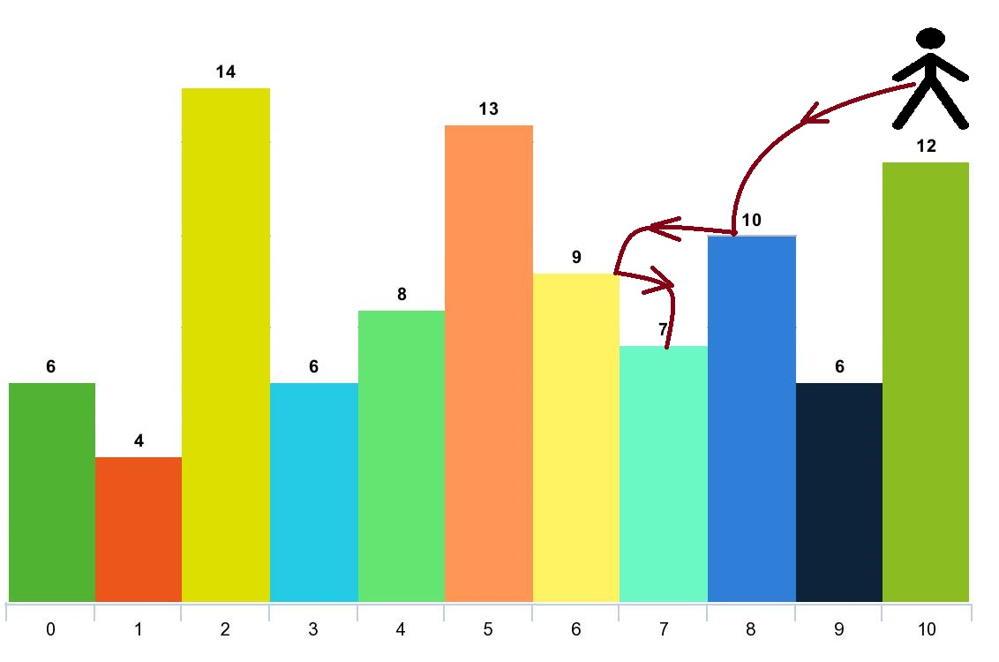

# 两种方法：正着跳 / 倒着跳，O(n) 时间（Python/Java/C++/Go）

> **[1340. 跳跃游戏 V](https://leetcode.cn/problems/jump-game-v/solutions/3963787/liang-chong-fang-fa-zheng-zhao-tiao-dao-pl5ep/) · Hard · 难度分 1866**

> **所属题单**
> - [动态规划 · 专题：跳跃游戏](../../../刷题路径/灵神原版题单/动态规划/专题：跳跃游戏.md)
> - [单调栈 · 一、单调栈](../../../刷题路径/灵神原版题单/单调栈/一、单调栈.md) · §1.2 进阶

> **题目描述**
> 给你一个整数数组 `arr` 和一个整数 `d` 。每一步你可以从下标 `i` 跳到：
>
> - `i + x` ，其中 `i + x < arr.length` 且 `0 < x <= d` 。
>
> - `i - x` ，其中 `i - x >= 0` 且 `0 < x <= d` 。
>
> 除此以外，你从下标 `i` 跳到下标 `j` 需要满足：`arr[i] > arr[j]` 且 `arr[i] > arr[k]` ，其中下标 `k` 是所有 `i` 到 `j` 之间的数字（更正式的，`min(i, j) < k < max(i, j)`）。
>
> 你可以选择数组的任意下标开始跳跃。请你返回你 **最多** 可以访问多少个下标。
>
> 请注意，任何时刻你都不能跳到数组的外面。
>
> **示例 1：**
>
> 
>
> ```
> 输入：arr = [6,4,14,6,8,13,9,7,10,6,12], d = 2
> 输出：4
> 解释：你可以从下标 10 出发，然后如上图依次经过 10 --> 8 --> 6 --> 7 。
> 注意，如果你从下标 6 开始，你只能跳到下标 7 处。你不能跳到下标 5 处因为 13 > 9 。你也不能跳到下标 4 处，因为下标 5 在下标 4 和 6 之间且 13 > 9 。
> 类似的，你不能从下标 3 处跳到下标 2 或者下标 1 处。
> ```
>
> **示例 2：**
>
> ```
> 输入：arr = [3,3,3,3,3], d = 3
> 输出：1
> 解释：你可以从任意下标处开始且你永远无法跳到任何其他坐标。
> ```
>
> **示例 3：**
>
> ```
> 输入：arr = [7,6,5,4,3,2,1], d = 1
> 输出：7
> 解释：从下标 0 处开始，你可以按照数值从大到小，访问所有的下标。
> ```
>
> **示例 4：**
>
> ```
> 输入：arr = [7,1,7,1,7,1], d = 2
> 输出：2
> ```
>
> **示例 5：**
>
> ```
> 输入：arr = [66], d = 1
> 输出：1
> ```
>
> **提示：**
>
> - `1 <= arr.length <= 1000`
>
> - `1 <= arr[i] <= 10^5`
>
> - `1 <= d <= arr.length`

> **题解**
> ## 方法一：正着跳
>
> 写个暴力搜索，枚举所有情况。
>
> - 从 $i$ 往左跳：枚举 $j=i-1,i-2,\ldots,\max(i-d,0)$。根据题目要求，遍历过的元素都必须严格小于 $\textit{arr}[i]$，如果 $\textit{arr}[j]\ge \textit{arr}[i]$ 就停止枚举。然后从 $j$ 开始继续跳。
> - 从 $i$ 往右跳：枚举 $j=i+1,i+2,\ldots,\min(i+d,n-1)$。根据题目要求，遍历过的元素都必须严格小于 $\textit{arr}[i]$，如果 $\textit{arr}[j]\ge \textit{arr}[i]$ 就停止枚举。然后从 $j$ 开始继续跳。
>
> 考虑到整个递归过程中有大量重复递归调用（递归入参相同）。由于递归函数没有副作用，同样的入参无论计算多少次，算出来的结果都是一样的，因此可以用**记忆化搜索**来优化：
>
> - 如果一个状态（递归入参）是第一次遇到，那么可以在返回前，把状态及其结果记到一个 $\textit{memo}$ 数组中。
> - 如果一个状态不是第一次遇到（$\textit{memo}$ 中保存的结果不等于 $\textit{memo}$ 的初始值），那么可以直接返回 $\textit{memo}$ 中保存的结果。
>
> 关于记忆化搜索的原理，请看视频讲解 [动态规划入门：从记忆化搜索到递推【基础算法精讲 17】](https://www.bilibili.com/video/BV1Xj411K7oF/)。
>
> ```python
> class Solution:
>     def maxJumps(self, arr: List[int], d: int) -> int:
>         n = len(arr)
>
>         @cache  # 缓存装饰器，避免重复计算 dfs（一行代码实现记忆化）
>         def dfs(i: int) -> int:
>             res = 1
>
>             # 往左跳
>             for j in range(i - 1, max(i - d - 1, -1), -1):
>                 if arr[j] >= arr[i]:
>                     break
>                 res = max(res, dfs(j) + 1)
>
>             # 往右跳
>             for j in range(i + 1, min(i + d + 1, n)):
>                 if arr[j] >= arr[i]:
>                     break
>                 res = max(res, dfs(j) + 1)
>
>             return res
>
>         # 枚举起点
>         return max(dfs(i) for i in range(n))
> ```
>
>
> #### 复杂度分析
>
> - 时间复杂度：$\mathcal{O}(nd)$，其中 $n$ 是 $\textit{arr}$ 的长度。由于每个状态只会计算一次，记忆化搜索的时间复杂度 $=$ 状态个数 $\times$ 单个状态的计算时间。本题状态个数等于 $\mathcal{O}(n)$，单个状态的计算时间为 $\mathcal{O}(d)$，所以总的时间复杂度为 $\mathcal{O}(nd)$。
> - 空间复杂度：$\mathcal{O}(n)$。保存多少状态，就需要多少空间。
>
> ## 方法二：倒着跳
>
> 能不能从小到大跳？
>
> 
>
> 逆向思维，倒着跳，从下标 $i$ 跳到下标 $j$，需要满足：
>
> - $i$ 到 $j$ 之间（包含 $i$ 不包含 $j$）的每个数都严格小于 $\textit{arr}[j]$。
>
> 上图中的元素 $7$ 往左可以跳到元素 $9,13,14$，往右可以跳到元素 $10,12$。由于 $7$ 往左能跳到的元素，$9$ 往左也可以跳到（都满足要求），所以 $7\to 9\to 13$ 一定比 $7\to 13$ 更优。
>
> 一般地，**跳到左右最近的更大元素是最优的**。
>
> 所以无需枚举 $[i-d,i+d]$ 中的 $j$，只需考虑两个下标 $j$：
>
> - $\textit{arr}[i]$ 左边最近的更大元素 $\textit{arr}[j]$。
> - $\textit{arr}[i]$ 右边最近的更大元素 $\textit{arr}[j]$。
>
> 这是**单调栈**的标准应用，原理见 [单调栈【基础算法精讲 26】](https://www.bilibili.com/video/BV1VN411J7S7/)。
>
> ```python
> class Solution:
>     def maxJumps(self, arr: List[int], d: int) -> int:
>         n = len(arr)
>
>         # 计算 arr[i] 左边最近的更大元素 arr[left[i]]
>         left = [0] * n
>         st = []
>         for i, x in enumerate(arr):
>             while st and arr[st[-1]] <= x:
>                 st.pop()
>             # 如果左边没有更大的数，或者跳跃距离超过 d，都标记为 -1
>             left[i] = st[-1] if st and i - st[-1] <= d else -1
>             st.append(i)
>
>         # 计算 arr[i] 右边最近的更大元素 arr[right[i]]
>         right = [0] * n
>         st.clear()
>         for i in range(n - 1, -1, -1):
>             x = arr[i]
>             while st and arr[st[-1]] <= x:
>                 st.pop()
>             # 如果右边没有更大的数，或者跳跃距离超过 d，都标记为 -1
>             right[i] = st[-1] if st and st[-1] - i <= d else -1
>             st.append(i)
>
>         @cache  # 缓存装饰器，避免重复计算 dfs（一行代码实现记忆化）
>         def dfs(i: int) -> int:
>             if i < 0:  # 没有更大的数，或者跳跃距离超过 d
>                 return 0
>             # 往左跳 vs 往右跳
>             return max(dfs(left[i]), dfs(right[i])) + 1
>
>         # 枚举终点，倒着跳
>         return max(dfs(i) for i in range(n))
> ```
>
>
> #### 复杂度分析
>
> - 时间复杂度：$\mathcal{O}(n)$，其中 $n$ 是 $\textit{arr}$ 的长度。对于单调栈的二重循环，由于每个下标至多入栈出栈各一次（在一个二重循环中），所以二重循环的时间复杂度为 $\mathcal{O}(n)$。对于记忆化搜索，由于每个状态只会计算一次，记忆化搜索的时间复杂度 $=$ 状态个数 $\times$ 单个状态的计算时间。本题状态个数等于 $\mathcal{O}(n)$，单个状态的计算时间为 $\mathcal{O}(1)$，所以记忆化搜索的时间复杂度为 $\mathcal{O}(n)$。
> - 空间复杂度：$\mathcal{O}(n)$。
>
> ## 专题训练
>
> 1. 动态规划题单的「**专题：跳跃游戏**」。
> 2. 单调栈题单。
>
> ## 分类题单
>
> [如何科学刷题？](https://leetcode.cn/circle/discuss/RvFUtj/)
>
> 1. [滑动窗口与双指针（定长/不定长/单序列/双序列/三指针/分组循环）](https://leetcode.cn/circle/discuss/0viNMK/)
> 2. [二分算法（二分答案/最小化最大值/最大化最小值/第K小）](https://leetcode.cn/circle/discuss/SqopEo/)
> 3. [单调栈（基础/矩形面积/贡献法/最小字典序）](https://leetcode.cn/circle/discuss/9oZFK9/)
> 4. [网格图（DFS/BFS/综合应用）](https://leetcode.cn/circle/discuss/YiXPXW/)
> 5. [位运算（基础/性质/拆位/试填/恒等式/思维）](https://leetcode.cn/circle/discuss/dHn9Vk/)
> 6. [图论算法（DFS/BFS/拓扑排序/基环树/最短路/最小生成树/网络流）](https://leetcode.cn/circle/discuss/01LUak/)
> 7. [动态规划（入门/背包/划分/状态机/区间/状压/数位/数据结构优化/树形/博弈/概率期望）](https://leetcode.cn/circle/discuss/tXLS3i/)
> 8. [常用数据结构（前缀和/差分/栈/队列/堆/字典树/并查集/树状数组/线段树）](https://leetcode.cn/circle/discuss/mOr1u6/)
> 9. [数学算法（数论/组合/概率期望/博弈/计算几何/随机算法）](https://leetcode.cn/circle/discuss/IYT3ss/)
> 10. [贪心与思维（基本贪心策略/反悔/区间/字典序/数学/思维/脑筋急转弯/构造）](https://leetcode.cn/circle/discuss/g6KTKL/)
> 11. [链表、树与回溯（前后指针/快慢指针/DFS/BFS/直径/LCA）](https://leetcode.cn/circle/discuss/K0n2gO/)
> 12. [字符串（KMP/Z函数/Manacher/字符串哈希/AC自动机/后缀数组/子序列自动机）](https://leetcode.cn/circle/discuss/SJFwQI/)
>
> [我的题解精选（已分类）](https://github.com/EndlessCheng/codeforces-go/blob/master/leetcode/SOLUTIONS.md)
>
> 欢迎关注 [B站@灵茶山艾府](https://space.bilibili.com/206214)
