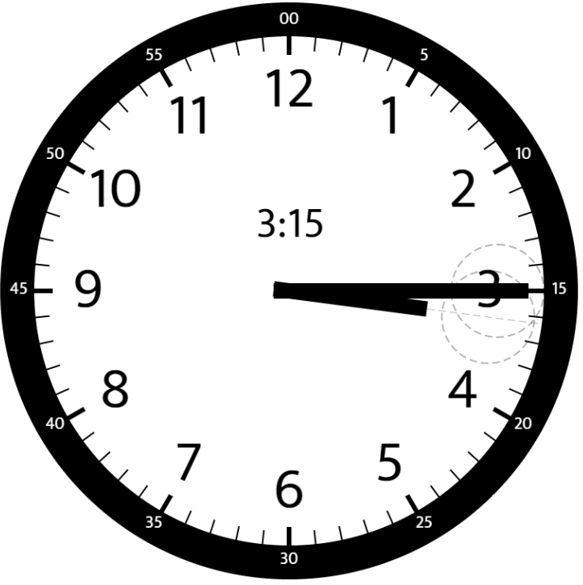

# 1344. 时钟指针的夹角

Medium · [力扣原题](https://leetcode.cn/problems/angle-between-hands-of-a-clock/)

| 作者 | 题解 | 动画讲解 |
|---|---|---|
| 灵茶山艾府 | [📄 题解](灵茶山艾府.md) | [▶︎ 1344 时钟指针的夹角 · 灵茶山艾府.mp4](1344%20时钟指针的夹角%20·%20灵茶山艾府.mp4) |
| yiduobo | [📄 题解](yiduobo.md) | [▶︎ 1344 时钟指针的夹角 · yiduobo.mp4](1344%20时钟指针的夹角%20·%20yiduobo.mp4) |

## 题目描述

给你两个数 `hour` 和 `minutes` 。请你返回在时钟上，由给定时间的时针和分针组成的较小角的角度（60 单位制）。

**示例 1：**


```
输入：hour = 12, minutes = 30
输出：165
```

**示例 2：**


```
输入：hour = 3, minutes = 30
输出；75
```

**示例 3：**



```
输入：hour = 3, minutes = 15
输出：7.5
```

**示例 4：**

```
输入：hour = 4, minutes = 50
输出：155
```

**示例 5：**

```
输入：hour = 12, minutes = 0
输出：0
```

**提示：**

- `1 <= hour <= 12`

- `0 <= minutes <= 59`

- 与标准答案误差在 `10^-5` 以内的结果都被视为正确结果。

---
[↑ 返回 1300-1399](../README.md) · [总索引](../../../索引.md) · [仓库首页](../../../README.md)
