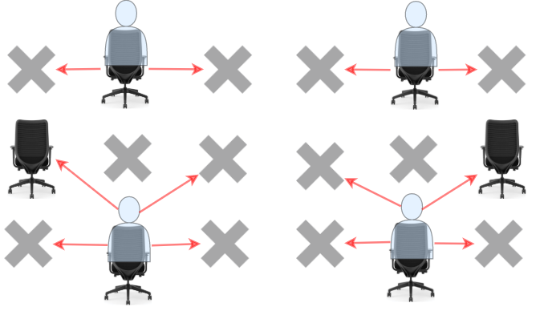

# 1349. 参加考试的最大学生数

Hard · 难度分 2386 · [力扣原题](https://leetcode.cn/problems/maximum-students-taking-exam/)

所在刷题路径：灵神题单·图论算法、灵神题单·动态规划

| 作者 | 题解 | 动画讲解 |
|---|---|---|
| 灵茶山艾府 | [📄 题解](灵茶山艾府.md) | [▶︎ 动画（GIF）](1349%20参加考试的最大学生数%20·%20灵茶山艾府.gif) · [mp4 文件](1349%20参加考试的最大学生数%20·%20灵茶山艾府.mp4) |
| yiduobo | [📄 题解](yiduobo.md) | [▶︎ 动画（GIF）](1349%20参加考试的最大学生数%20·%20yiduobo.gif) · [mp4 文件](1349%20参加考试的最大学生数%20·%20yiduobo.mp4) |

## 动画讲解

> 动图会循环播放；想暂停、拖进度条请下载上面表格里的 mp4 文件。

### 灵茶山艾府


### yiduobo


## 题目描述

给你一个 `m * n` 的矩阵 `seats` 表示教室中的座位分布。如果座位是坏的（不可用），就用 `'#'` 表示；否则，用 `'.'` 表示。

学生可以看到左侧、右侧、左上、右上这四个方向上紧邻他的学生的答卷，但是看不到直接坐在他前面或者后面的学生的答卷。请你计算并返回该考场可以容纳的同时参加考试且无法作弊的 **最大** 学生人数。

学生必须坐在状况良好的座位上。

**示例 1：**



```

输入：seats = [["#",".","#","#",".","#"],
              [".","#","#","#","#","."],
              ["#",".","#","#",".","#"]]
输出：4
解释：教师可以让 4 个学生坐在可用的座位上，这样他们就无法在考试中作弊。
```

**示例 2：**

```

输入：seats = [[".","#"],
              ["#","#"],
              ["#","."],
              ["#","#"],
              [".","#"]]
输出：3
解释：让所有学生坐在可用的座位上。
```

**示例 3：**

```

输入：seats = [["#",".",".",".","#"],
              [".","#",".","#","."],
              [".",".","#",".","."],
              [".","#",".","#","."],
              ["#",".",".",".","#"]]
输出：10
解释：让学生坐在第 1、3 和 5 列的可用座位上。
```

**提示：**

- `seats` 只包含字符 `'.' 和``'#'`

- `m == seats.length`

- `n == seats[i].length`

- `1 <= m <= 8`

- `1 <= n <= 8`

---
[↑ 返回 1300-1399](../README.md) · [总索引](../../../索引.md) · [仓库首页](../../../README.md)
