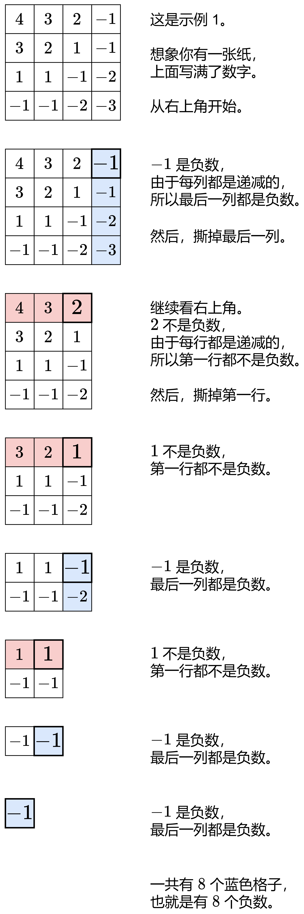

# 【图解】疯狂撕数字，一图秒懂（Python/Java/C++/C/Go/JS/Rust）

> **[1351. 统计有序矩阵中的负数](https://leetcode.cn/problems/count-negative-numbers-in-a-sorted-matrix/solutions/3861108/tu-jie-zuo-fa-tong-240-ti-yi-tu-miao-don-vovs/) · Easy**

> **所属题单**
> - [滑动窗口与双指针 · 三、单序列双指针](../../../刷题路径/灵神原版题单/滑动窗口与双指针/三、单序列双指针.md) · §3.6 矩阵上的双指针

> **题目描述**
> 给你一个 `m * n` 的矩阵 `grid`，矩阵中的元素无论是按行还是按列，都以非严格递减顺序排列。 请你统计并返回 `grid` 中 **负数** 的数目。
>
> **示例 1：**
>
> ```
>
> 输入：grid = [[4,3,2,-1],[3,2,1,-1],[1,1,-1,-2],[-1,-1,-2,-3]]
> 输出：8
> 解释：矩阵中共有 8 个负数。
> ```
>
> **示例 2：**
>
> ```
>
> 输入：grid = [[3,2],[1,0]]
> 输出：0
> ```
>
> **提示：**
>
> - `m == grid.length`
>
> - `n == grid[i].length`
>
> - `1 <= m, n <= 100`
>
> - `-100 <= grid[i][j] <= 100`
>
> **进阶：**你可以设计一个时间复杂度为 `O(n + m)` 的解决方案吗？

> **题解**
> {:width=600px}
>
> > 注：也可以从左下角开始，方法类似。
>
> **总结**：利用 $\textit{grid}$ 行列有序的性质，我们可以用 $\mathcal{O}(1)$ 的时间获取 $\mathcal{O}(m)$ 或 $\mathcal{O}(n)$ 的信息。相比之下，$\mathcal{O}(mn)$ 的暴力查找（一个一个地找），每次花费 $\mathcal{O}(1)$ 的时间，只获取了 $\mathcal{O}(1)$ 的信息。
>
> 这就是为什么我们可以把 $\mathcal{O}(mn)$ 的暴力查找优化成 $\mathcal{O}(m+n)$。
>
> ```python
> class Solution:
>     def countNegatives(self, grid: List[List[int]]) -> int:
>         m, n = len(grid), len(grid[0])
>         ans = 0
>         i, j = 0, n - 1  # 从右上角开始
>         while i < m and j >= 0:  # 还有剩余元素
>             if grid[i][j] < 0:
>                 ans += m - i  # 这一列剩余元素都是负数
>                 j -= 1
>             else:
>                 i += 1  # 这一行剩余元素全都非负，排除
>         return ans
> ```
>
>
> #### 复杂度分析
>
> - 时间复杂度：$\mathcal{O}(m + n)$，其中 $m$ 和 $n$ 分别是 $\textit{grid}$ 的行数和列数。
> - 空间复杂度：$\mathcal{O}(1)$。
>
> **注**：本题不存在时间复杂度低于 $\mathcal{O}(m + n)$ 的算法，见 [240 题我的题解](../../0200-0299/0240%20搜索二维矩阵%20II/灵茶山艾府.md) 文末的注。
>
> ## 相似题目
>
> [240. 搜索二维矩阵 II](https://leetcode.cn/problems/search-a-2d-matrix-ii/)
>
> ## 分类题单
>
> [如何科学刷题？](https://leetcode.cn/circle/discuss/RvFUtj/)
>
> 1. [滑动窗口与双指针（定长/不定长/单序列/双序列/三指针/分组循环）](https://leetcode.cn/circle/discuss/0viNMK/)
> 2. [二分算法（二分答案/最小化最大值/最大化最小值/第K小）](https://leetcode.cn/circle/discuss/SqopEo/)
> 3. [单调栈（基础/矩形面积/贡献法/最小字典序）](https://leetcode.cn/circle/discuss/9oZFK9/)
> 4. [网格图（DFS/BFS/综合应用）](https://leetcode.cn/circle/discuss/YiXPXW/)
> 5. [位运算（基础/性质/拆位/试填/恒等式/思维）](https://leetcode.cn/circle/discuss/dHn9Vk/)
> 6. [图论算法（DFS/BFS/拓扑排序/基环树/最短路/最小生成树/网络流）](https://leetcode.cn/circle/discuss/01LUak/)
> 7. [动态规划（入门/背包/划分/状态机/区间/状压/数位/数据结构优化/树形/博弈/概率期望）](https://leetcode.cn/circle/discuss/tXLS3i/)
> 8. [常用数据结构（前缀和/差分/栈/队列/堆/字典树/并查集/树状数组/线段树）](https://leetcode.cn/circle/discuss/mOr1u6/)
> 9. [数学算法（数论/组合/概率期望/博弈/计算几何/随机算法）](https://leetcode.cn/circle/discuss/IYT3ss/)
> 10. [贪心与思维（基本贪心策略/反悔/区间/字典序/数学/思维/脑筋急转弯/构造）](https://leetcode.cn/circle/discuss/g6KTKL/)
> 11. [链表、树与回溯（前后指针/快慢指针/DFS/BFS/直径/LCA）](https://leetcode.cn/circle/discuss/K0n2gO/)
> 12. [字符串（KMP/Z函数/Manacher/字符串哈希/AC自动机/后缀数组/子序列自动机）](https://leetcode.cn/circle/discuss/SJFwQI/)
>
> [我的题解精选（已分类）](https://github.com/EndlessCheng/codeforces-go/blob/master/leetcode/SOLUTIONS.md)
>
> 欢迎关注 [B站@灵茶山艾府](https://space.bilibili.com/206214)
