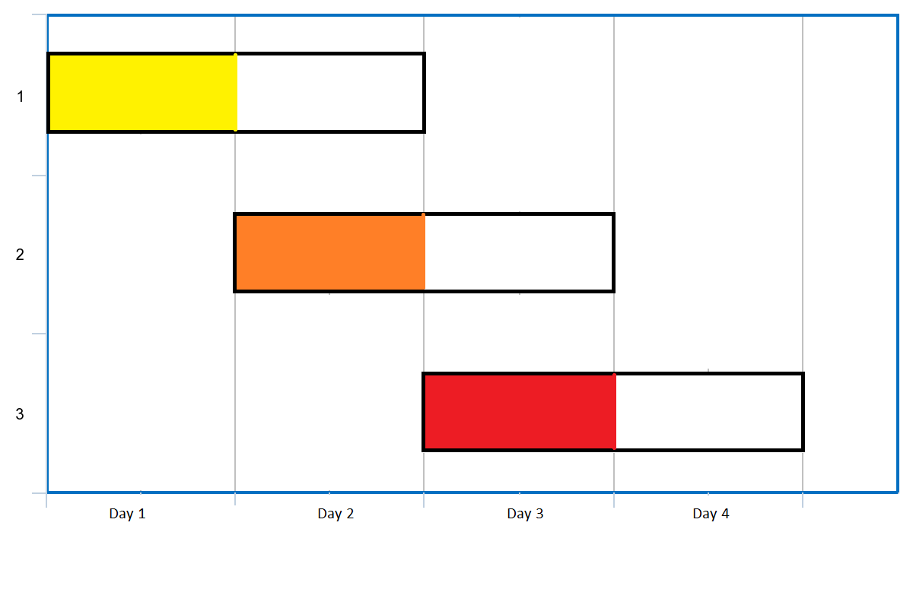

# 两种方法：最小堆 / 并查集（Python/Java/C++/Go/JS/Rust）

> **[1353. 最多可以参加的会议数目](https://leetcode.cn/problems/maximum-number-of-events-that-can-be-attended/solutions/3707151/liang-chong-fang-fa-zui-xiao-dui-bing-ch-ijbf/) · Medium · 难度分 2016**

> **所属题单**
> - [常用数据结构 · 五、堆（优先队列）](../../../刷题路径/灵神原版题单/常用数据结构/五、堆（优先队列）.md) · §5.2 进阶
> - [常用数据结构 · 七、并查集](../../../刷题路径/灵神原版题单/常用数据结构/七、并查集.md) · §7.4 数组上的并查集
> - [贪心算法 · 二、区间贪心](../../../刷题路径/灵神原版题单/贪心算法/二、区间贪心.md) · §2.6 其他区间贪心

> **题目描述**
> 给你一个数组 `events`，其中 `events[i] = [startDay_i, endDay_i]` ，表示会议 `i` 开始于 `startDay_i` ，结束于 `endDay_i` 。
>
> 你可以在满足 `startDay_i <= d <= endDay_i`<sub> </sub>中的任意一天 `d` 参加会议 `i` 。在任意一天 `d` 中只能参加一场会议。
>
> 请你返回你可以参加的 **最大** 会议数目。
>
> **示例 1：**
>
> 
>
> ```
>
> 输入：events = [[1,2],[2,3],[3,4]]
> 输出：3
> 解释：你可以参加所有的三个会议。
> 安排会议的一种方案如上图。
> 第 1 天参加第一个会议。
> 第 2 天参加第二个会议。
> 第 3 天参加第三个会议。
> ```
>
> **示例 2：**
>
> ```
>
> 输入：events= [[1,2],[2,3],[3,4],[1,2]]
> 输出：4
> ```
>
> **提示：**​​​​​​
>
> - `1 <= events.length <= 10⁵`
>
> - `events[i].length == 2`
>
> - `1 <= startDay_i <= endDay_i <= 10⁵`

> **题解**
> ## 方法一：按开始时间分组 + 最小堆
>
> ### 分析
>
> **观察一**：第一天（即开始时间 $\textit{startDay}_i$ 的最小值）一定要参加会议，若不参加，岂不是白白浪费机会？比如有个会议是 $[1,1]$，不参加就错过了。
>
> > 或者说，对于任意最优解，如果第一天什么也没做，我们总是可以把其中某个会议的参加时间改成第一天。
>
> 如果有多个会议的 $\textit{startDay}_i$ 都相同呢？比如有三个会议 $[1,1],[1,2],[1,3]$，参加哪个会议更好？
>
> **观察二**：参加结束时间 $\textit{endDay}_i$ 最小的会议。如果第一天不参加会议 $[1,1]$，而是参加会议 $[1,2]$，那么第二天就没法参加会议 $[1,1]$ 了。
>
> 参加 $\textit{endDay}_i$ 最小的会议后，问题变成从第二天开始，解决剩余 $n-1$ 个会议的子问题。
>
> ### 需要知道哪些信息？
>
> 在第一天，可以参加哪些会议？
>
> 在第二天，可以参加哪些会议？
>
> 在第 $i$ 天，可以参加哪些会议？
>
> 若按照开始时间分组，那么在第 $i$ 天，开始时间为 $i$ 的会议就是**新增**的可以参加的会议。
>
> 此外，还需要知道**在剩余可以参加的会议中，结束时间最小的会议**。根据观察二，参加这个会议。
>
> ### 算法
>
> 把会议按照开始时间分组，用 $\textit{groups}[i]$ 表示所有开始时间为 $i$ 的会议的结束时间。
>
> 我们需要一个数据结构维护结束时间。这个数据结构需要支持如下操作：
>
> - 添加结束时间。
> - 查询结束时间的最小值。
> - 删除最小的结束时间，表示我们参加这个会议，或者这个会议已过期（结束时间小于当前时间）。
>
> **最小堆**完美符合要求。
>
> 在第 $i$ 天：
>
> 1. 删除最小堆中结束时间小于 $i$ 的会议（已过期）。
> 2. 把开始时间为 $i$ 的会议的结束时间，加到最小堆中。
> 3. 如果最小堆不为空，那么弹出堆顶（参加会议），把答案加一。
>
> ```python
> class Solution:
>     def maxEvents(self, events: List[List[int]]) -> int:
>         mx = max(e[1] for e in events) 
>
>         # 按照开始时间分组
>         groups = [[] for _ in range(mx + 1)]
>         for e in events:
>             groups[e[0]].append(e[1])
>
>         ans = 0
>         h = []
>         for i, g in enumerate(groups):
>             # 删除过期会议
>             while h and h[0] < i:
>                 heappop(h)
>             # 新增可以参加的会议
>             for end_day in g:
>                 heappush(h, end_day)
>             # 参加一个结束时间最早的会议
>             if h:
>                 ans += 1
>                 heappop(h)
>         return ans
> ```
>
>
> #### 复杂度分析
>
> - 时间复杂度：$\mathcal{O}(U+n\log n)$，其中 $n$ 是 $\textit{events}$ 的长度，$U=\max(\textit{endDay}_i)$。注意不是 $\mathcal{O}(U\log n)$，因为有 $n$ 个会议，所以在 $\mathcal{O}(U)$ 天中，只有 $\mathcal{O}(n)$ 天在做入堆出堆的操作。可以优化到 $\mathcal{O}(n\log n)$，留给读者思考。
> - 空间复杂度：$\mathcal{O}(n+U)$。
>
> ## 方法二：按结束时间排序 + 并查集
>
> 把问题换个表述，大家就很熟悉了：
>
> - 你有 $n$ 门课程要考试，第 $i$ 门课程可以复习的时间段为 $[\textit{startDay}_i, \textit{endDay}_i]$。对于每门课程，你可以选择时间段内的一天~~速通~~复习，一天最多复习一门课程。为了最大化可以复习的课程数，应该如何安排？
>
> 优先复习临考（$\textit{endDay}_i$ 小）的课程，即按照 $\textit{endDay}_i$ 从小到大排序。对于每门课，选择区间中最早的未被占用的那天复习。
>
> 怎么找到「最早的未被占用的那天」？
>
> 普通写法是创建一个 $\textit{used}$ 布尔数组，标记哪些天被占用了。每次找的时候就遍历这个布尔数组。但这太慢了。
>
> 实际上，遍历布尔数组的过程，和并查集 $\texttt{find}$ 函数查找代表元的过程是类似的，我们可以应用**路径压缩**的技巧加快效率。
>
> - 当 $i$ 被占用时，合并 $i$ 和 $i+1$，把 $i$ 指向 $i+1$。如果 $i+1$ 没被占用，那么我们指向没被占用的天数。如果 $i+1$ 被占用，那么顺着 $i+1$ 指向的值继续找，最终可以找到一个没被占用的天数。
> - 如此一来，调用 $\text{find}(\textit{startDay}_i)$ 就可以得到下一个未被占用的天数，也就是 $\ge \textit{startDay}_i$ 的未被占用的最小值 $x$。如果 $x\le \textit{endDay}_i$，那么就可以在 $x$ 这一天复习。然后合并 $x$ 和 $x+1$，表示 $x$ 被占用。
>
> ```python
> class Solution:
>     def maxEvents(self, events: List[List[int]]) -> int:
>         events.sort(key=lambda e: e[1])
>
>         mx = events[-1][1]
>         fa = list(range(mx + 2))
>
>         def find(x: int) -> int:
>             if fa[x] != x:
>                 fa[x] = find(fa[x])
>             return fa[x]
>
>         ans = 0
>         for start_day, end_day in events:
>             x = find(start_day)  # 查找从 start_day 开始的第一个可用天
>             if x <= end_day:
>                 ans += 1
>                 fa[x] = x + 1  # 标记 x 已占用
>         return ans
> ```
>
>
> #### 复杂度分析
>
> - 时间复杂度：$\mathcal{O}(U + n\log n)$，其中 $n$ 是 $\textit{events}$ 的长度，$U=\max(\textit{endDay}_i)$。
> - 空间复杂度：$\mathcal{O}(U)$。
>
> **注**：用哈希表实现并查集，可以做到 $\mathcal{O}(n\log n)$ 时间和 $\mathcal{O}(n)$ 空间。留给感兴趣的读者思考。
>
> ## 相似题目
>
> 1. 贪心题单的「**二、区间贪心**」。
> 2. 数据结构题单的「**五、堆（优先队列）**」。
> 3. 数据结构题单的「**§7.4 数组上的并查集**」。
>
> ## 分类题单
>
> [如何科学刷题？](https://leetcode.cn/circle/discuss/RvFUtj/)
>
> 1. [滑动窗口与双指针（定长/不定长/单序列/双序列/三指针/分组循环）](https://leetcode.cn/circle/discuss/0viNMK/)
> 2. [二分算法（二分答案/最小化最大值/最大化最小值/第K小）](https://leetcode.cn/circle/discuss/SqopEo/)
> 3. [单调栈（基础/矩形面积/贡献法/最小字典序）](https://leetcode.cn/circle/discuss/9oZFK9/)
> 4. [网格图（DFS/BFS/综合应用）](https://leetcode.cn/circle/discuss/YiXPXW/)
> 5. [位运算（基础/性质/拆位/试填/恒等式/思维）](https://leetcode.cn/circle/discuss/dHn9Vk/)
> 6. [图论算法（DFS/BFS/拓扑排序/基环树/最短路/最小生成树/网络流）](https://leetcode.cn/circle/discuss/01LUak/)
> 7. [动态规划（入门/背包/划分/状态机/区间/状压/数位/数据结构优化/树形/博弈/概率期望）](https://leetcode.cn/circle/discuss/tXLS3i/)
> 8. [常用数据结构（前缀和/差分/栈/队列/堆/字典树/并查集/树状数组/线段树）](https://leetcode.cn/circle/discuss/mOr1u6/)
> 9. [数学算法（数论/组合/概率期望/博弈/计算几何/随机算法）](https://leetcode.cn/circle/discuss/IYT3ss/)
> 10. [贪心与思维（基本贪心策略/反悔/区间/字典序/数学/思维/脑筋急转弯/构造）](https://leetcode.cn/circle/discuss/g6KTKL/)
> 11. [链表、二叉树与回溯（前后指针/快慢指针/DFS/BFS/直径/LCA/一般树）](https://leetcode.cn/circle/discuss/K0n2gO/)
> 12. [字符串（KMP/Z函数/Manacher/字符串哈希/AC自动机/后缀数组/子序列自动机）](https://leetcode.cn/circle/discuss/SJFwQI/)
>
> [我的题解精选（已分类）](https://github.com/EndlessCheng/codeforces-go/blob/master/leetcode/SOLUTIONS.md)
>
> 欢迎关注 [B站@灵茶山艾府](https://space.bilibili.com/206214)
