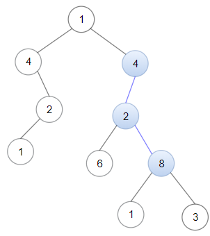
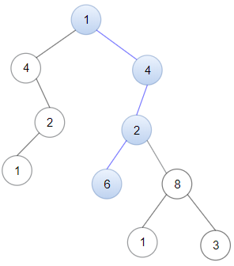

# 两种方法：暴力匹配 / 滚动哈希（Python/Java/C++/Go）

> **[1367. 二叉树中的链表](https://leetcode.cn/problems/linked-list-in-binary-tree/solutions/3034003/dan-di-gui-xie-fa-pythonjavacgo-by-endle-00js/) · Medium · 难度分 1650**

> **所属题单**
> - [链表、二叉树与回溯 · 二、二叉树](../../../刷题路径/灵神原版题单/链表、二叉树与回溯/二、二叉树.md) · §2.14 链表+二叉树
> - [字符串 · 四、字符串哈希](../../../刷题路径/灵神原版题单/字符串/四、字符串哈希.md)

> **题目描述**
> 给你一棵以 `root` 为根的二叉树和一个 `head` 为第一个节点的链表。
>
> 如果在二叉树中，存在一条一直向下的路径，且每个点的数值恰好一一对应以 `head` 为首的链表中每个节点的值，那么请你返回 `True` ，否则返回 `False` 。
>
> 一直向下的路径的意思是：从树中某个节点开始，一直连续向下的路径。
>
> **示例 1：**
>
> 
>
> ```
> 输入：head = [4,2,8], root = [1,4,4,null,2,2,null,1,null,6,8,null,null,null,null,1,3]
> 输出：true
> 解释：树中蓝色的节点构成了与链表对应的子路径。
> ```
>
> **示例 2：**
>
> 
>
> ```
> 输入：head = [1,4,2,6], root = [1,4,4,null,2,2,null,1,null,6,8,null,null,null,null,1,3]
> 输出：true
> ```
>
> **示例 3：**
>
> ```
> 输入：head = [1,4,2,6,8], root = [1,4,4,null,2,2,null,1,null,6,8,null,null,null,null,1,3]
> 输出：false
> 解释：二叉树中不存在一一对应链表的路径。
> ```
>
> **提示：**
>
> - 二叉树和链表中的每个节点的值都满足 `1 <= node.val <= 100` 。
>
> - 链表包含的节点数目在 `1` 到 `100` 之间。
>
> - 二叉树包含的节点数目在 `1` 到 `2500` 之间。

> **题解**
> ## 方法一：暴力匹配
>
> 注：方法一的代码和官解的代码本质上是一样的，旨在向大家说明，官解的两个递归函数，是可以合并成一个递归函数的。
>
> 仍然是两个参数，链表节点 $s$ 和二叉树节点 $t$。分类讨论：
>
> 1. 如果 $s$ 是空的，说明整个链表匹配完毕，返回 $\texttt{true}$。
> 2. 否则需要继续匹配。如果 $t$ 是空的，说明匹配失败，返回 $\texttt{false}$。
> 3. 如果 $s$ 的节点值等于 $t$ 的节点值，那么继续匹配，递归 $s$ 的下一个节点和 $t$ 的左右儿子。
> 4. 如果 $s$ 的节点值不等于 $t$ 的节点值，那么从 $\textit{head}$ 开始重新匹配，递归 $\textit{head}$ 和 $t$ 的左右儿子。注意只在 $s$ 等于 $\textit{head}$ 的时候才去递归，如果不加这句话，可能情况 3 中链表匹配到一半，匹配失败，那么前面匹配成功的每个节点都会进入情况 4。这些节点继续匹配，如果又匹配到一半失败，就会重复这个过程，产生大量重复的递归，时间复杂度将会是指数级别的。为了保证没有重复调用，我们规定只有当 $s$ 是链表头的时候，才进入情况 4 的递归。
>
> 也可以这样理解，下面的递归代码相当于把官解的两个递归函数，合并成了一个递归函数，并通过 `s == head` 来表示当前处于哪个递归函数中：
>
> - 如果 `s == head`，则对应着官解的 `isSubPath` 递归函数。
> - 如果 `s != head`，则对应着官解的 `dfs` 递归函数。
>
> ```python
> class Solution:
>     def isSubPath(self, head: ListNode, root: TreeNode) -> bool:
>         def dfs(s: Optional[ListNode], t: Optional[TreeNode]) -> bool:
>             if s is None:  # 整个链表匹配完毕
>                 return True
>             # 否则需要继续匹配
>             if t is None:  # 无法继续匹配
>                 return False
>             # 节点值相同则继续匹配，否则从 head 开始重新匹配
>             return s.val == t.val and (dfs(s.next, t.left) or dfs(s.next, t.right)) or \
>                    s is head and (dfs(head, t.left) or dfs(head, t.right))
>         return dfs(head, root)
> ```
>
>
> #### 复杂度分析
>
> - 时间复杂度：$\mathcal{O}(m^2)$，其中 $m$ 是二叉树的节点个数。从二叉树的某个节点 $t$ 开始的匹配，会访问 $t$ 子树中的每个节点至多一次。
> - 空间复杂度：$\mathcal{O}(m)$。最坏情况下，二叉树是一条链，因此递归需要 $\mathcal{O}(m)$ 的栈空间。
>
> ## 方法二：滚动哈希
>
> 计算链表的哈希值，记作 $\textit{listHash}$。
>
> 然后在二叉树上滚动计算哈希值，做法同 [2156. 查找给定哈希值的子串](https://leetcode.cn/problems/find-substring-with-given-hash-value/)。
>
> 如果发现哈希值等于 $\textit{listHash}$，则立刻返回 $\texttt{true}$。
>
> 代码中用到了一些取模的细节（尤其是减法），原理见 [模运算的世界：当加减乘除遇上取模](https://leetcode.cn/circle/discuss/mDfnkW/)。
>
> ```python
> class Solution:
>     def isSubPath(self, head: ListNode, root: TreeNode) -> bool:
>         # MOD 和 BASE 随机其中一个就行，无需两个都随机
>         MOD = 1_070_777_777
>         BASE = randint(8 * 10 ** 8, 9 * 10 ** 8)  # 随机 BASE，防止 hack
>
>         n = 0  # 链表长度
>         pow_base = 1  # BASE^(n-1)
>         list_hash = 0  # 多项式哈希 s[0] * BASE^(n-1) + s[1] * BASE^(n-2) + ... + s[n-2] * BASE + s[n-1]
>         while head:
>             n += 1
>             if n > 1:
>                 pow_base = pow_base * BASE % MOD
>             list_hash = (list_hash * BASE + head.val) % MOD
>             head = head.next
>
>         st = []
>         def dfs(t: Optional[TreeNode], h: int) -> bool:
>             if t is None:  # 无法继续匹配
>                 return False
>             st.append(t.val)
>             h = (h * BASE + t.val) % MOD
>             if len(st) >= n:
>                 if h == list_hash:
>                     return True
>                 h = (h - pow_base * st[-n]) % MOD
>             if dfs(t.left, h) or dfs(t.right, h):
>                 return True
>             st.pop()  # 恢复现场
>             return False
>         return dfs(root, 0)
> ```
>
>
> #### 复杂度分析
>
> - 时间复杂度：$\mathcal{O}(n+m)$，其中 $n$ 是链表节点个数，$m$ 是二叉树的节点个数。
> - 空间复杂度：$\mathcal{O}(m)$。最坏情况下，二叉树是一条链，因此递归需要 $\mathcal{O}(m)$ 的栈空间。
>
> ⚠**注意**：KMP 算法无法做到线性。因为在二叉树上，KMP 中的 $\texttt{while}$ 循环（失配时的指针回退）无法被均摊成 $\mathcal{O}(1)$，复杂度和方法一的暴力没有区别。
>
> ## 分类题单
>
> [如何科学刷题？](https://leetcode.cn/circle/discuss/RvFUtj/)
>
> 1. [滑动窗口与双指针（定长/不定长/单序列/双序列/三指针/分组循环）](https://leetcode.cn/circle/discuss/0viNMK/)
> 2. [二分算法（二分答案/最小化最大值/最大化最小值/第K小）](https://leetcode.cn/circle/discuss/SqopEo/)
> 3. [单调栈（基础/矩形面积/贡献法/最小字典序）](https://leetcode.cn/circle/discuss/9oZFK9/)
> 4. [网格图（DFS/BFS/综合应用）](https://leetcode.cn/circle/discuss/YiXPXW/)
> 5. [位运算（基础/性质/拆位/试填/恒等式/思维）](https://leetcode.cn/circle/discuss/dHn9Vk/)
> 6. [图论算法（DFS/BFS/拓扑排序/最短路/最小生成树/二分图/基环树/欧拉路径）](https://leetcode.cn/circle/discuss/01LUak/)
> 7. [动态规划（入门/背包/状态机/划分/区间/状压/数位/数据结构优化/树形/博弈/概率期望）](https://leetcode.cn/circle/discuss/tXLS3i/)
> 8. [常用数据结构（前缀和/差分/栈/队列/堆/字典树/并查集/树状数组/线段树）](https://leetcode.cn/circle/discuss/mOr1u6/)
> 9. [数学算法（数论/组合/概率期望/博弈/计算几何/随机算法）](https://leetcode.cn/circle/discuss/IYT3ss/)
> 10. [贪心与思维（基本贪心策略/反悔/区间/字典序/数学/思维/脑筋急转弯/构造）](https://leetcode.cn/circle/discuss/g6KTKL/)
> 11. 【本题相关】[链表、二叉树与回溯（前后指针/快慢指针/DFS/BFS/直径/LCA/一般树）](https://leetcode.cn/circle/discuss/K0n2gO/)
> 12. [字符串（KMP/Z函数/Manacher/字符串哈希/AC自动机/后缀数组/子序列自动机）](https://leetcode.cn/circle/discuss/SJFwQI/)
>
> [我的题解精选（已分类）](https://github.com/EndlessCheng/codeforces-go/blob/master/leetcode/SOLUTIONS.md)
>
> 欢迎关注 [B站@灵茶山艾府](https://space.bilibili.com/206214)
