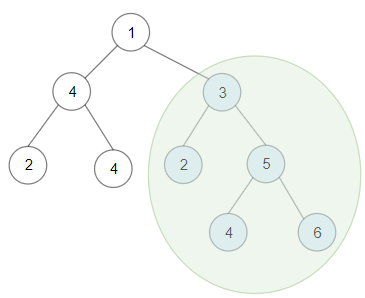

# 1373. 二叉搜索子树的最大键值和

Hard · 难度分 1914 · [力扣原题](https://leetcode.cn/problems/maximum-sum-bst-in-binary-tree/)

所在刷题路径：灵神题单·链表树与回溯

| 作者 | 题解 | 动画讲解 |
|---|---|---|
| 灵茶山艾府 | [📄 题解](灵茶山艾府.md) | [▶︎ 1373 二叉搜索子树的最大键值和 · 灵茶山艾府.mp4](1373%20二叉搜索子树的最大键值和%20·%20灵茶山艾府.mp4) |
| yiduobo | [📄 题解](yiduobo.md) | [▶︎ 1373 二叉搜索子树的最大键值和 · yiduobo.mp4](1373%20二叉搜索子树的最大键值和%20·%20yiduobo.mp4) |

## 题目描述

给你一棵以 `root` 为根的 **二叉树** ，请你返回 **任意** 二叉搜索子树的最大键值和。

二叉搜索树的定义如下：

- 任意节点的左子树中的键值都 **小于** 此节点的键值。

- 任意节点的右子树中的键值都 **大于** 此节点的键值。

- 任意节点的左子树和右子树都是二叉搜索树。

**示例 1：**



```

输入：root = [1,4,3,2,4,2,5,null,null,null,null,null,null,4,6]
输出：20
解释：键值为 3 的子树是和最大的二叉搜索树。
```

**示例 2：**


```

输入：root = [4,3,null,1,2]
输出：2
解释：键值为 2 的单节点子树是和最大的二叉搜索树。
```

**示例 3：**

```

输入：root = [-4,-2,-5]
输出：0
解释：所有节点键值都为负数，和最大的二叉搜索树为空。
```

**示例 4：**

```

输入：root = [2,1,3]
输出：6
```

**示例 5：**

```

输入：root = [5,4,8,3,null,6,3]
输出：7
```

**提示：**

- 每棵树有 `1` 到 `40000` 个节点。

- 每个节点的键值在 `[-4 * 10^4 , 4 * 10^4]` 之间。

---
[↑ 返回 1300-1399](../README.md) · [总索引](../../../索引.md) · [仓库首页](../../../README.md)
