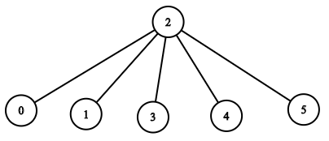

# 深入理解递归：自顶向下/自底向上/记忆化搜索（附 O(1) 空间迭代写法！）

> **[1376. 通知所有员工所需的时间](https://leetcode.cn/problems/time-needed-to-inform-all-employees/solutions/2251986/shen-ru-li-jie-di-gui-zi-ding-xiang-xia-ps0mm/) · Medium · 难度分 1561**

> **所属题单**
> - [链表、二叉树与回溯 · 三、一般树](../../../刷题路径/灵神原版题单/链表、二叉树与回溯/三、一般树.md) · §3.2 自顶向下 DFS

> **题目描述**
> 公司里有 `n` 名员工，每个员工的 ID 都是独一无二的，编号从 `0` 到 `n - 1`。公司的总负责人通过 `headID` 进行标识。
>
> 在 `manager` 数组中，每个员工都有一个直属负责人，其中 `manager[i]` 是第 `i` 名员工的直属负责人。对于总负责人，`manager[headID] = -1`。题目保证从属关系可以用树结构显示。
>
> 公司总负责人想要向公司所有员工通告一条紧急消息。他将会首先通知他的直属下属们，然后由这些下属通知他们的下属，直到所有的员工都得知这条紧急消息。
>
> 第 `i` 名员工需要 `informTime[i]` 分钟来通知它的所有直属下属（也就是说在 `informTime[i]` 分钟后，他的所有直属下属都可以开始传播这一消息）。
>
> 返回通知所有员工这一紧急消息所需要的 **分钟数** 。
>
> **示例 1：**
>
> ```
>
> 输入：n = 1, headID = 0, manager = [-1], informTime = [0]
> 输出：0
> 解释：公司总负责人是该公司的唯一一名员工。
> ```
>
> **示例 2：**
>
> 
>
> ```
>
> 输入：n = 6, headID = 2, manager = [2,2,-1,2,2,2], informTime = [0,0,1,0,0,0]
> 输出：1
> 解释：id = 2 的员工是公司的总负责人，也是其他所有员工的直属负责人，他需要 1 分钟来通知所有员工。
> 上图显示了公司员工的树结构。
> ```
>
> **提示：**
>
> - `1 <= n <= 10^5`
>
> - `0 <= headID < n`
>
> - `manager.length == n`
>
> - `0 <= manager[i] < n`
>
> - `manager[headID] == -1`
>
> - `informTime.length == n`
>
> - `0 <= informTime[i] <= 1000`
>
> - 如果员工 `i` 没有下属，`informTime[i] == 0` 。
>
> - 题目 **保证** 所有员工都可以收到通知。

> **题解**
> ## 方法一：一般树递归
>
> 本质是 [104. 二叉树的最大深度](https://leetcode.cn/problems/maximum-depth-of-binary-tree/)，把递归中的 $1$ 替换成 $\textit{informTime}[x]$。
>
> 关于 104 题的做法，可以看[【基础算法精讲 09】](https://www.bilibili.com/video/BV1UD4y1Y769/)。
>
> 相比二叉树，本题是一般树，需要先通过 $\textit{manager}$ 数组把每个点的儿子预处理出来，存储在 $g$ 数组中。然后在递归中遍历当前节点的儿子，向下递归。
>
> 和视频中讲的一样，有如下两种写法。
>
> ### 写法一：自底向上
>
> ```python
> class Solution:
>     def numOfMinutes(self, n: int, headID: int, manager: List[int], informTime: List[int]) -> int:
>         g = [[] for _ in range(n)]
>         for i, m in enumerate(manager):
>             if m >= 0:
>                 g[m].append(i)  # 建树
>         def dfs(x: int) -> int:
>             max_path_sum = 0
>             for y in g[x]:  # 遍历 x 的儿子 y（如果没有儿子就不会进入循环）
>                 max_path_sum = max(max_path_sum, dfs(y))
>             # 这和 104 题代码中的 max(l_depth, r_depth) + 1 是一个意思
>             return max_path_sum + informTime[x]
>         return dfs(headID)  # 从根节点 headID 开始递归
> ```
>
>
> ### 写法二：自顶向下
>
> ```python
> class Solution:
>     def numOfMinutes(self, n: int, headID: int, manager: List[int], informTime: List[int]) -> int:
>         g = [[] for _ in range(n)]
>         for i, m in enumerate(manager):
>             if m >= 0:
>                 g[m].append(i)  # 建树
>         ans = 0
>         def dfs(x: int, path_sum: int) -> None:
>             path_sum += informTime[x]  # 累加递归路径上的 informTime[x]
>             nonlocal ans
>             ans = max(ans, path_sum)  # 更新答案的最大值
>             for y in g[x]:  # 遍历 x 的儿子 y（如果没有儿子就不会进入循环）
>                 dfs(y, path_sum)  # 继续递归
>         dfs(headID, 0)  # 从根节点 headID 开始递归
>         return ans
> ```
>
>
> #### 复杂度分析
>
> - 时间复杂度：$\mathcal{O}(n)$。每个节点都恰好访问一次。
> - 空间复杂度：$\mathcal{O}(n)$。最坏情况下，树退化成一条链，递归需要 $\mathcal{O}(n)$ 的栈空间。
>
> ## 方法二：记忆化搜索
>
> 由于 $\textit{manager}$ 数组中保存了每个节点的父节点，无需建树，直接顺着父节点，一路向上，同时累加路径上的 $\textit{informTime}[x]$。
>
> 如果暴力枚举每个点，取所有累加值中的最大值作为答案，时间复杂度是 $\mathcal{O}(n^2)$ 的。如何优化？
>
> 使用 [记忆化搜索](https://www.bilibili.com/video/BV1Xj411K7oF/) 这一思想，把从 $x$ 向上得到的累加值记录到一个 $\textit{memo}$ 数组中，如果下次再递归到 $x$，就直接返回 $\textit{memo}$ 数组中保存的累加值。（Python 可以用 `@cache` 装饰器）
>
> ```python
> class Solution:
>     def numOfMinutes(self, n: int, headID: int, manager: List[int], informTime: List[int]) -> int:
>         @cache  # 缓存装饰器，避免重复计算 dfs 的结果
>         def dfs(x: int) -> int:
>             if manager[x] < 0:
>                 return informTime[x]
>             return dfs(manager[x]) + informTime[x]
>         return max(dfs(i) for i in range(n))
> ```
>
>
> ### 空间优化·其一
>
> 把计算结果直接保存到 $\textit{informTime}$ 中。
>
> 如何判断之前是否计算过呢？利用 $\textit{manager}$ 数组，如果 $x$ 计算过，就把 $\textit{manager}[x]$ 置为 $-1$。
>
> ```python
> class Solution:
>     def numOfMinutes(self, n: int, headID: int, manager: List[int], informTime: List[int]) -> int:
>         def dfs(x: int) -> int:
>             if manager[x] >= 0:
>                 informTime[x] += dfs(manager[x])
>                 manager[x] = -1  # 标记 x 计算过
>             return informTime[x]
>         return max(dfs(i) for i in range(n))
> ```
>
>
> ### 空间优化·其二
>
> 进一步地，把上面的代码改成两次迭代：
>
> - 第一次迭代，仅累加，不更新，计算从当前节点往上的 $\textit{informTime}$ 的累加值 $s$。
> - 第二次迭代，更新从当前节点向上的每个未被计算的节点值的对应累加值。在向上移动之前，从 $s$ 中减去当前节点的 $\textit{informTime}$ 值，同时设置当前节点的 $\textit{manger}$ 值为 $-1$。
>
> > 如果你学过并查集，可以试试利用这个技巧，写出 $\texttt{find}$ 函数的非递归版本。
>
> ```python
> class Solution:
>     def numOfMinutes(self, n: int, headID: int, manager: List[int], informTime: List[int]) -> int:
>         for i, m in enumerate(manager):
>             if m < 0: continue
>
>             # 计算从 i 向上的累加值
>             s = 0
>             x = i
>             while manager[x] >= 0:
>                 s += informTime[x]
>                 x = manager[x]
>             # 此时 x 要么是 headID，要么是一个计算过的节点
>             s += informTime[x]
>
>             # 记录从 i 向上的每个未被计算的节点值的对应累加值
>             x = i
>             while manager[x] >= 0:  # 未被计算
>                 informTime[x], s = s, s - informTime[x]
>                 manager[x], x = -1, manager[x]
>         return max(informTime)
> ```
>
>
> #### 复杂度分析
>
> - 时间复杂度：$\mathcal{O}(n)$。没有建图，实际运行速度比方法一要快一些。
> - 空间复杂度：$\mathcal{O}(1)$。仅用到若干额外变量。
>
> ## 分类题单
>
> [如何科学刷题？](https://leetcode.cn/circle/discuss/RvFUtj/)
>
> 1. [滑动窗口与双指针（定长/不定长/单序列/双序列/三指针/分组循环）](https://leetcode.cn/circle/discuss/0viNMK/)
> 2. [二分算法（二分答案/最小化最大值/最大化最小值/第K小）](https://leetcode.cn/circle/discuss/SqopEo/)
> 3. [单调栈（基础/矩形面积/贡献法/最小字典序）](https://leetcode.cn/circle/discuss/9oZFK9/)
> 4. [网格图（DFS/BFS/综合应用）](https://leetcode.cn/circle/discuss/YiXPXW/)
> 5. [位运算（基础/性质/拆位/试填/恒等式/思维）](https://leetcode.cn/circle/discuss/dHn9Vk/)
> 6. [图论算法（DFS/BFS/拓扑排序/最短路/最小生成树/二分图/基环树/欧拉路径）](https://leetcode.cn/circle/discuss/01LUak/)
> 7. [动态规划（入门/背包/状态机/划分/区间/状压/数位/数据结构优化/树形/博弈/概率期望）](https://leetcode.cn/circle/discuss/tXLS3i/)
> 8. [常用数据结构（前缀和/差分/栈/队列/堆/字典树/并查集/树状数组/线段树）](https://leetcode.cn/circle/discuss/mOr1u6/)
> 9. [数学算法（数论/组合/概率期望/博弈/计算几何/随机算法）](https://leetcode.cn/circle/discuss/IYT3ss/)
> 10. [贪心与思维（基本贪心策略/反悔/区间/字典序/数学/思维/脑筋急转弯/构造）](https://leetcode.cn/circle/discuss/g6KTKL/)
> 11. [链表、二叉树与回溯（前后指针/快慢指针/DFS/BFS/直径/LCA/一般树）](https://leetcode.cn/circle/discuss/K0n2gO/)
> 12. [字符串（KMP/Z函数/Manacher/字符串哈希/AC自动机/后缀数组/子序列自动机）](https://leetcode.cn/circle/discuss/SJFwQI/)
>
> [我的题解精选（已分类）](https://github.com/EndlessCheng/codeforces-go/blob/master/leetcode/SOLUTIONS.md)
>
> 欢迎关注 [B站@灵茶山艾府](https://space.bilibili.com/206214)
