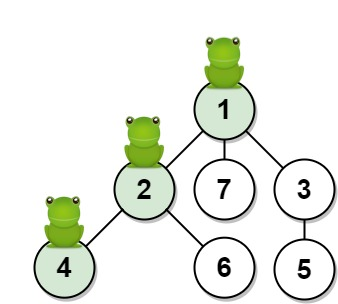
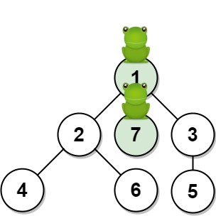
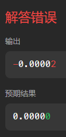

# DFS + 记一次有趣的 hack

> **[1377. T 秒后青蛙的位置](https://leetcode.cn/problems/frog-position-after-t-seconds/solutions/2281408/dfs-ji-yi-ci-you-qu-de-hack-by-endlessch-jtsr/) · Hard · 难度分 1824**

> **所属题单**
> - [链表、二叉树与回溯 · 三、一般树](../../../刷题路径/灵神原版题单/链表、二叉树与回溯/三、一般树.md) · §3.2 自顶向下 DFS

> **题目描述**
> 给你一棵由 `n` 个顶点组成的无向树，顶点编号从 `1` 到 `n`。青蛙从 **顶点 1** 开始起跳。规则如下：
>
> - 在一秒内，青蛙从它所在的当前顶点跳到另一个 **未访问** 过的顶点（如果它们直接相连）。
>
> - 青蛙无法跳回已经访问过的顶点。
>
> - 如果青蛙可以跳到多个不同顶点，那么它跳到其中任意一个顶点上的机率都相同。
>
> - 如果青蛙不能跳到任何未访问过的顶点上，那么它每次跳跃都会停留在原地。
>
> 无向树的边用数组 `edges` 描述，其中 `edges[i] = [a_i, b_i]` 意味着存在一条直接连通 `a_i` 和 `b_i` 两个顶点的边。
>
> 返回青蛙在 <em>`t`</em> 秒后位于目标顶点 <em>`target`</em> 上的概率。与实际答案相差不超过 `10⁻⁵` 的结果将被视为正确答案。
>
> **示例 1：**
>
> 
>
> ```
>
> 输入：n = 7, edges = [[1,2],[1,3],[1,7],[2,4],[2,6],[3,5]], t = 2, target = 4
> 输出：0.16666666666666666
> 解释：上图显示了青蛙的跳跃路径。青蛙从顶点 1 起跳，第 1 秒 有 1/3 的概率跳到顶点 2 ，然后第 2 秒 有 1/2 的概率跳到顶点 4，因此青蛙在 2 秒后位于顶点 4 的概率是 1/3 * 1/2 = 1/6 = 0.16666666666666666 。
> ```
>
> **示例 2：**
>
> 
>
> ```
>
> 输入：n = 7, edges = [[1,2],[1,3],[1,7],[2,4],[2,6],[3,5]], t = 1, target = 7
> 输出：0.3333333333333333
> 解释：上图显示了青蛙的跳跃路径。青蛙从顶点 1 起跳，有 1/3 = 0.3333333333333333 的概率能够 1 秒 后跳到顶点 7 。
> ```
>
> **提示：**
>
> - `1 <= n <= 100`
>
> - `edges.length == n - 1`
>
> - `edges[i].length == 2`
>
> - `1 <= a_i, b_i <= n`
>
> - `1 <= t <= 50`
>
> - `1 <= target <= n`

> **题解**
> ## 一、思考
>
> 如果青蛙跳到了一棵不包含 $\textit{target}$ 的子树，它还能到达 $\textit{target}$ 吗？
>
> 如果当前节点有 $c$ 个儿子，青蛙跳到其中一个节点的概率是多少？
>
> （可选）考虑到浮点数在计算时可能会丢失精度，你能想到一个尽量避免丢失精度的写法吗？
>
> ## 二、解惑
>
> 根据题意，青蛙只能一路向下，不能回头。如果青蛙跳到了一棵不包含 $\textit{target}$ 的子树，它就无法到达 $\textit{target}$。
>
> 如果当前节点有 $c$ 个儿子，青蛙跳到其中一个节点的概率是 $\dfrac{1}{c}$。看示例 1，第一步有 $\dfrac{1}{3}$ 的概率跳到节点 $2$，第二步有 $\dfrac{1}{2}$ 的概率跳到节点 $4$。所以 $t=2$ 秒后位于 $\textit{target}=4$ 的概率是 $\dfrac{1}{6}$。
>
> 既然答案是由若干分子为 $1$ 的分数相乘得到，那么干脆**只把分母相乘**，最后再计算一下倒数，就可以避免因浮点乘法导致的精度丢失了。另外，整数的计算效率通常比浮点数的高。
>
> ## 三、算法
>
> DFS，从根节点 $1$ 出发，搜索 $\textit{target}$。
>
> 这里有自顶向下和自底向上两种实现方案。
>
> **自顶向下**是一边「递」，一边把儿子个数 $c$ 乘起来，如果能在第 $t$ 秒到达 $\textit{target}$，或者小于 $t$ 秒到达 $\textit{target}$ 且 $\textit{target}$ 是叶子节点（此时每次跳跃都会停留在原地），那么就记录答案为乘积的倒数，同时返回一个布尔值表示递归结束。
>
> **自底向上**的思路是类似的，找到 $\textit{target}$ 后，在「归」的过程中做乘法。个人更喜欢这种写法，因为只在找到 $\textit{target}$ 之后才做乘法，而自顶向下即使在不含 $\textit{target}$ 的子树中搜索，也会盲目地做乘法。
>
> ## 四、细节与技巧
>
> 什么情况下算出的乘积最大？考虑构造这样一棵树，根节点有 $c$ 个儿子，其中一个儿子又有 $c$ 个儿子，依此类推。这样计算出来的乘积约为 $c^{n/c}$，当 $n=100,c=3$ 时取到最大值，这超出了 $32$ 位整数范围，但在 $64$ 位整数范围内。所以为了避免溢出，乘积需要用 $64$ 位整数存储。
>
> 此外，可以把节点 $1$ 添加一个 $0$ 号邻居，从而避免判断当前节点为根节点 $1$，也避免了特判 $n=1$ 的情况。
>
> 此外，DFS 中的时间不是从 $0$ 开始增加到 $t$，而是从 $\textit{leftT}=t$ 开始减小到 $0$，这样代码中只需和 $0$ 比较，无需和 $t$ 比较，从而减少一个 DFS 之外变量的引入。
>
> ### 答疑
>
> **问**：自底向上代码中 `dfs` 的两个 `if` 能否合并为 `if left_t == 0 or len(g[x]) == 1: return x == target`？
>
> **答**：这样写也是可以的。但如果 $\textit{target}$ 在非叶节点上，到达 $\textit{target}$ 时 $\textit{leftT}>0$，那么这样写会**经过** $\textit{target}$ 继续往下递归，并没有提前返回，所以会有一些无效计算。
>
> ### 自顶向下（递）
>
> ```python
> class Solution:
>     def frogPosition(self, n: int, edges: List[List[int]], t: int, target: int) -> float:
>         g = [[] for _ in range(n + 1)]
>         g[1] = [0]  # 减少额外判断的小技巧
>         for x, y in edges:
>             g[x].append(y)
>             g[y].append(x)  # 建树
>         ans = 0
>
>         def dfs(x: int, fa: int, left_t: int, prod: int) -> True:
>             # t 秒后必须在 target（恰好到达，或者 target 是叶子停在原地）
>             if x == target and (left_t == 0 or len(g[x]) == 1):
>                 nonlocal ans
>                 ans = 1 / prod
>                 return True
>             if x == target or left_t == 0: return False
>             for y in g[x]:  # 遍历 x 的儿子 y
>                 if y != fa and dfs(y, x, left_t - 1, prod * (len(g[x]) - 1)):
>                     return True  # 找到 target 就不再递归了
>             return False  # 未找到 target
>
>         dfs(1, 0, t, 1)
>         return ans
> ```
>
>
> ### 自底向上（归）
>
> ```python
> class Solution:
>     def frogPosition(self, n: int, edges: List[List[int]], t: int, target: int) -> float:
>         g = [[] for _ in range(n + 1)]
>         g[1] = [0]  # 减少额外判断的小技巧
>         for x, y in edges:
>             g[x].append(y)
>             g[y].append(x)  # 建树
>
>         def dfs(x: int, fa: int, left_t: int) -> int:
>             # t 秒后必须在 target（恰好到达，或者 target 是叶子停在原地）
>             if left_t == 0: return x == target
>             if x == target: return len(g[x]) == 1
>             for y in g[x]:  # 遍历 x 的儿子 y
>                 if y != fa:  # y 不能是父节点
>                     prod = dfs(y, x, left_t - 1)  # 寻找 target
>                     if prod: return prod * (len(g[x]) - 1)  # 乘上儿子个数，并直接返回
>             return 0  # 未找到 target
>
>         prod = dfs(1, 0, t)
>         return 1 / prod if prod else 0
> ```
>
>
> #### 复杂度分析
>
> - 时间复杂度：$\mathcal{O}(n)$。每个节点都至多递归一次。
> - 空间复杂度：$\mathcal{O}(n)$。
>
> #### 相似题目
>
> - [2467. 树上最大得分和路径](https://leetcode.cn/problems/most-profitable-path-in-a-tree/)
> - [2646. 最小化旅行的价格总和](https://leetcode.cn/problems/minimize-the-total-price-of-the-trips/)
>
> [往期每日一题题解](https://github.com/EndlessCheng/codeforces-go/blob/master/leetcode/SOLUTIONS.md)
>
> ## 后记：一次有趣的 hack
>
> 在写这篇题解时，我发现只使用 $32$ 位整数存储乘积，也可以通过。
>
> 我的第一反应是，这数据也太弱了吧。于是我造了一棵树，根节点有 $2$ 个儿子，其中一个儿子又有 $2$ 个儿子，依此类推，从而可以使乘积等于 $2^{32}$。这样可以 hack 掉自顶向下的写法，因为乘法溢出后恰好等于 $0$，计算倒数就错了。
>
> 但对于自底向上的写法，算出来的结果刚好是 $0$，同时由于实际乘积很大，标准答案也几乎是 $0$，所以也算通过。
>
> 那么构造一个不是 $2^{32}$ 的倍数的数呢？由于和标准答案差距在 $10^{-5}$ 内就能通过，所以这个乘积还得小心地构造。
>
> 具体地，需要构造一个乘积在区间 $[2^{32}k+1,2^{32}k+99999]$ 内的数（溢出后小于 $10^5$），且质因子之和不能超过 $99$（否则树的节点数会超出 $n$ 的上界 $100$）。
>
> 满足该要求的最小的数是：
>
> $$
> 2^{32} + 95168 =  2^6 \cdot 3 \cdot 7^5 \cdot 11^3
> $$
>
> 但运行结果却是……
>
> 
>
> ~~嗯？先保留到第五位小数再判断浮点数之差？谁教你这么写代码的？~~
>
> 那就试试溢出到一个绝对值比较小的负数。先试试小于 $2^{32}$ 的最大的数，且质因子之和不超过 $99$。
>
> 求出来的数是：
>
> $$
> 2^{32} - 49216 =  2^6 \cdot 3^7 \cdot 5 \cdot 17 \cdot 19^2
> $$
>
> 运行，hack 成功！
>
> 
>
> #### 附
>
> $2^{32} + 95168$ 的测试数据
>
> ```
> 84
> [[1,2],[2,3],[3,4],[4,5],[5,6],[6,7],[7,8],[8,9],[9,10],[10,11],[11,12],[12,13],[13,14],[14,15],[15,16],[1,17],[1,18],[1,19],[1,20],[1,21],[1,22],[1,23],[1,24],[1,25],[1,26],[2,27],[2,28],[2,29],[2,30],[2,31],[2,32],[2,33],[2,34],[2,35],[2,36],[3,37],[3,38],[3,39],[3,40],[3,41],[3,42],[3,43],[3,44],[3,45],[3,46],[4,47],[4,48],[4,49],[4,50],[4,51],[4,52],[5,53],[5,54],[5,55],[5,56],[5,57],[5,58],[6,59],[6,60],[6,61],[6,62],[6,63],[6,64],[7,65],[7,66],[7,67],[7,68],[7,69],[7,70],[8,71],[8,72],[8,73],[8,74],[8,75],[8,76],[9,77],[9,78],[10,79],[11,80],[12,81],[13,82],[14,83],[15,84]]
> 15
> 84
> ```
>
> $2^{32} - 49216$ 的测试数据（已提交给官方）
>
> ```
> 94
> [[1,2],[2,3],[3,4],[4,5],[5,6],[6,7],[7,8],[8,9],[9,10],[10,11],[11,12],[12,13],[13,14],[14,15],[15,16],[16,17],[17,18],[1,19],[1,20],[1,21],[1,22],[1,23],[1,24],[1,25],[1,26],[1,27],[1,28],[1,29],[1,30],[1,31],[1,32],[1,33],[1,34],[1,35],[1,36],[2,37],[2,38],[2,39],[2,40],[2,41],[2,42],[2,43],[2,44],[2,45],[2,46],[2,47],[2,48],[2,49],[2,50],[2,51],[2,52],[2,53],[2,54],[3,55],[3,56],[3,57],[3,58],[3,59],[3,60],[3,61],[3,62],[3,63],[3,64],[3,65],[3,66],[3,67],[3,68],[3,69],[3,70],[4,71],[4,72],[4,73],[4,74],[5,75],[5,76],[6,77],[6,78],[7,79],[7,80],[8,81],[8,82],[9,83],[9,84],[10,85],[10,86],[11,87],[11,88],[12,89],[13,90],[14,91],[15,92],[16,93],[17,94]]
> 17
> 94
> ```
>
> ---
>
> 欢迎关注[ biIibiIi@灵茶山艾府](https://space.bilibili.com/206214)，高质量算法教学，持续输出中~
