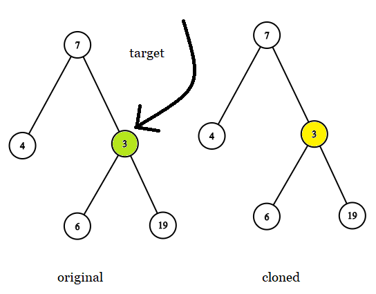
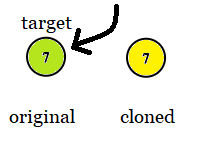
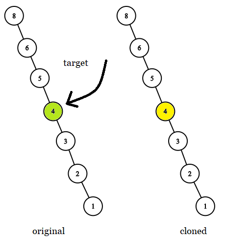

# 简洁写法（Python/Java/C++/JS）

> **[1379. 找出克隆二叉树中的相同节点](https://leetcode.cn/problems/find-a-corresponding-node-of-a-binary-tree-in-a-clone-of-that-tree/solutions/2721724/jian-ji-xie-fa-pythonjavacjs-by-endlessc-3vri/) · Easy**

> **所属题单**
> - [链表、二叉树与回溯 · 二、二叉树](../../../刷题路径/灵神原版题单/链表、二叉树与回溯/二、二叉树.md) · §2.3 自底向上 DFS（后序遍历）

> **题目描述**
> 给你两棵二叉树，原始树 `original` 和克隆树 `cloned`，以及一个位于原始树 `original` 中的目标节点 `target`。
>
> 其中，克隆树 `cloned` 是原始树 `original` 的一个 **副本** 。
>
> 请找出在树 `cloned` 中，与 `target` **相同** 的节点，并返回对该节点的引用（在 C/C++ 等有指针的语言中返回 节点指针，其他语言返回节点本身）。
>
> **注意：**你 **不能** 对两棵二叉树，以及 `target` 节点进行更改。**只能** 返回对克隆树 `cloned` 中已有的节点的引用。
>
> **示例 1:**
>
> 
>
> ```
>
> 输入: tree = [7,4,3,null,null,6,19], target = 3
> 输出: 3
> 解释: 上图画出了树 original 和 cloned。target 节点在树 original 中，用绿色标记。答案是树 cloned 中的黄颜色的节点（其他示例类似）。
> ```
>
> **示例 2:**
>
> 
>
> ```
>
> 输入: tree = [7], target =  7
> 输出: 7
> ```
>
> **示例 3:**
>
> 
>
> ```
>
> 输入: tree = [8,null,6,null,5,null,4,null,3,null,2,null,1], target = 4
> 输出: 4
> ```
>
> **提示：**
>
> - 树中节点的数量范围为 `[1, 10⁴]` 。
>
> - 同一棵树中，没有值相同的节点。
>
> - `target` 节点是树 `original` 中的一个节点，并且不会是 `null` 。
>
> **进阶：**如果树中允许出现值相同的节点，将如何解答？

> **题解**
> 我们直接在 $\texttt{getTargetCopy}$ 内部调用它自己，执行递归（先序遍历）：
>
> 1. 如果 $\textit{original}$ 是空节点，返回空。
> 2. 如果 $\textit{original} = \textit{target}$（注意这里比较的是节点，不是节点值），说明我们找到了对应的节点，返回 $\textit{cloned}$。
> 3. 否则递归 $\textit{original}$ 和 $\textit{cloned}$ 的左子树，如果返回值 $\textit{leftRes}$ 不为空，说明 $\textit{target}$ 在左子树中，返回 $\textit{leftRes}$。
> 4. 否则递归 $\textit{original}$ 和 $\textit{cloned}$ 的右子树，由于题目保证 $\textit{target}$ 一定在二叉树中，所以直接返回递归右子树的返回值。
>
> 晕递归的同学可以看 [深刻理解递归【基础算法精讲 09】](https://www.bilibili.com/video/BV1UD4y1Y769/)
>
> 注：由于我们比较的是节点而不是节点值（例如 C++ 比较的是地址），所以下面的代码也适用于树中有值相同节点的情况（本题的进阶问题）。
>
> ```python
> class Solution:
>     def getTargetCopy(self, original: TreeNode, cloned: TreeNode, target: TreeNode) -> TreeNode:
>         if original is None or original is target:
>             return cloned
>         return self.getTargetCopy(original.left, cloned.left, target) or \
>                self.getTargetCopy(original.right, cloned.right, target)
> ```
>
>
> #### 复杂度分析
>
> - 时间复杂度：$\mathcal{O}(n)$，其中 $n$ 为二叉树的节点个数。
> - 空间复杂度：$\mathcal{O}(n)$。最坏情况下，二叉树退化成一条链，递归需要 $\mathcal{O}(n)$ 的栈空间。
>
> ## 分类题单
>
> 1. [滑动窗口（定长/不定长/多指针）](https://leetcode.cn/circle/discuss/0viNMK/)
> 2. [二分算法（二分答案/最小化最大值/最大化最小值/第K小）](https://leetcode.cn/circle/discuss/SqopEo/)
> 3. [单调栈（矩形系列/字典序最小/贡献法）](https://leetcode.cn/circle/discuss/9oZFK9/)
> 4. [网格图（DFS/BFS/综合应用）](https://leetcode.cn/circle/discuss/YiXPXW/)
> 5. [位运算（基础/性质/拆位/试填/恒等式/贪心/脑筋急转弯）](https://leetcode.cn/circle/discuss/dHn9Vk/)
> 6. [图论算法（DFS/BFS/拓扑排序/最短路/最小生成树/二分图/基环树/欧拉路径）](https://leetcode.cn/circle/discuss/01LUak/)
> 7. [动态规划（入门/背包/状态机/划分/区间/状压/数位/数据结构优化/树形/博弈/概率期望）](https://leetcode.cn/circle/discuss/tXLS3i/)
>
> 更多题单，点我个人主页 - 讨论发布。
>
> 欢迎关注 [B站@灵茶山艾府](https://space.bilibili.com/206214)
>
> [往期题解精选（已分类）](https://github.com/EndlessCheng/codeforces-go/blob/master/leetcode/SOLUTIONS.md)
