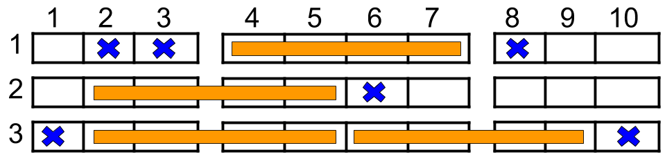

# 1386. 安排电影院座位

Medium · [力扣原题](https://leetcode.cn/problems/cinema-seat-allocation/)

| 作者 | 题解 | 动画讲解 |
|---|---|---|
| 灵茶山艾府 | [📄 题解](灵茶山艾府.md) | [▶︎ 1386 安排电影院座位 · 灵茶山艾府.mp4](1386%20安排电影院座位%20·%20灵茶山艾府.mp4) |
| yiduobo | [📄 题解](yiduobo.md) | [▶︎ 1386 安排电影院座位 · yiduobo.mp4](1386%20安排电影院座位%20·%20yiduobo.mp4) |

## 题目描述


如上图所示，电影院的观影厅中有 `n` 行座位，行编号从 1 到 `n` ，且每一行内总共有 10 个座位，列编号从 1 到 10 。

给定一个二维数组 `reservedSeats` ，其中 `reservedSeats[i] = [row_i, seat_i]` 表示第 `row_i` 行的座位 `seat_i` 已经被预定。

四人小组必须被安排在同一排的四个座位上。该小组可以坐在以下座位块之一：

- 座位 `2, 3, 4, 5`

- 座位 `4, 5, 6, 7`

- 座位 `6, 7, 8, 9`

只有当该块中的所有座位都 **没有** 被预订时，才能使用该块。每个座位 **最多** 只能分配给一个小组。

返回一个整数，表示可以分配的 **最大** 四人小组数量。

**示例 1：**



```

输入：n = 3, reservedSeats = [[1,2],[1,3],[1,8],[2,6],[3,1],[3,10]]
输出：4
解释：上图所示是最优的安排方案，总共可以安排 4 个家庭。蓝色的叉表示被预约的座位，橙色的连续座位表示一个 4 人家庭。
```

**示例 2：**

```

输入：n = 2, reservedSeats = [[2,1],[1,8],[2,6]]
输出：2
```

**示例 3：**

```

输入：n = 4, reservedSeats = [[4,3],[1,4],[4,6],[1,7]]
输出：4
```

**提示：**

- `1 <= n <= 10⁹`

- `1 <= reservedSeats.length <= min(10 * n, 10⁴)`

- `reservedSeats[i] == [row_i, seat_i]`

- `1 <= row_i <= n`

- `1 <= seat_i <= 10`

- 所有 `reservedSeats[i]` 都是互不相同的。

---
[↑ 返回 1300-1399](../README.md) · [总索引](../../../索引.md) · [仓库首页](../../../README.md)
