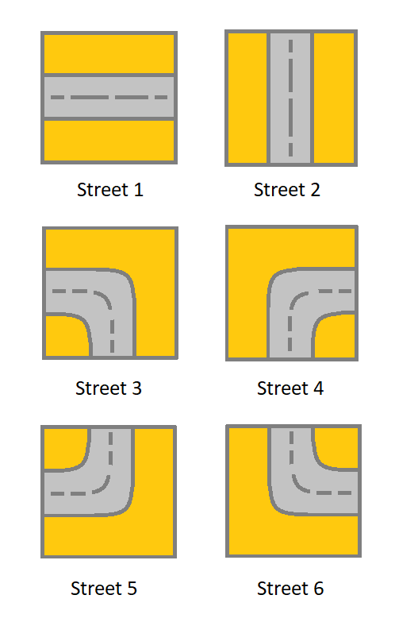
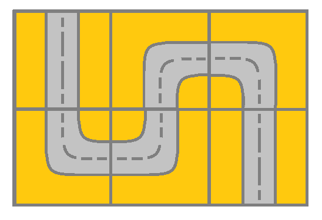
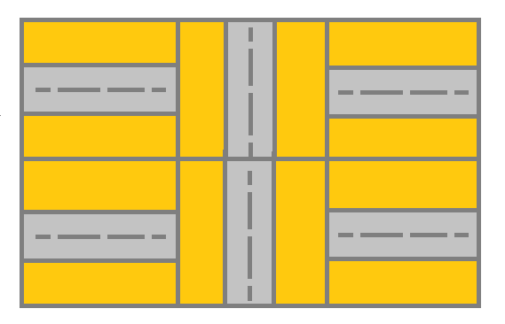

# 利用方向向量简化代码逻辑（Python/Java/C++/C/Go/JS/Rust）

> **[1391. 检查网格中是否存在有效路径](https://leetcode.cn/problems/check-if-there-is-a-valid-path-in-a-grid/solutions/3950394/li-yong-fang-xiang-xiang-liang-jian-hua-nzn2m/) · Medium · 难度分 1746**

> **所属题单**
> - [网格图 · 一、网格图 DFS](../../../刷题路径/灵神原版题单/网格图/一、网格图%20DFS.md)

> **题目描述**
> 给你一个 <em>m</em> x <em>n</em> 的网格 `grid`。网格里的每个单元都代表一条街道。`grid[i][j]` 的街道可以是：
>
> - **1** 表示连接左单元格和右单元格的街道。
>
> - **2** 表示连接上单元格和下单元格的街道。
>
> - **3** 表示连接左单元格和下单元格的街道。
>
> - **4** 表示连接右单元格和下单元格的街道。
>
> - **5** 表示连接左单元格和上单元格的街道。
>
> - **6** 表示连接右单元格和上单元格的街道。
>
> 
>
> 你最开始从左上角的单元格 `(0,0)` 开始出发，网格中的「有效路径」是指从左上方的单元格 `(0,0)` 开始、一直到右下方的 `(m-1,n-1)` 结束的路径。**该路径必须只沿着街道走**。
>
> **注意：**你 **不能** 变更街道。
>
> 如果网格中存在有效的路径，则返回 `true`，否则返回 `false` 。
>
> **示例 1：**
>
> 
>
> ```
> 输入：grid = [[2,4,3],[6,5,2]]
> 输出：true
> 解释：如图所示，你可以从 (0, 0) 开始，访问网格中的所有单元格并到达 (m - 1, n - 1) 。
> ```
>
> **示例 2：**
>
> 
>
> ```
> 输入：grid = [[1,2,1],[1,2,1]]
> 输出：false
> 解释：如图所示，单元格 (0, 0) 上的街道没有与任何其他单元格上的街道相连，你只会停在 (0, 0) 处。
> ```
>
> **示例 3：**
>
> ```
> 输入：grid = [[1,1,2]]
> 输出：false
> 解释：你会停在 (0, 1)，而且无法到达 (0, 2) 。
> ```
>
> **示例 4：**
>
> ```
> 输入：grid = [[1,1,1,1,1,1,3]]
> 输出：true
> ```
>
> **示例 5：**
>
> ```
> 输入：grid = [[2],[2],[2],[2],[2],[2],[6]]
> 输出：true
> ```
>
> **提示：**
>
> - `m == grid.length`
>
> - `n == grid[i].length`
>
> - `1 <= m, n <= 300`
>
> - `1 <= grid[i][j] <= 6`

> **题解**
> 我们需要解决两个关键问题：
>
> 1. 站在 $(x,y)$，下一步可以往哪些方向移动？
> 2. 如何判断相邻街道是否连通？示例 2 的街道不是连通的，无法移动。
>
> 对于第一个问题，我们可以创建一个方向向量数组，保存每种街道的移动方向。例如：
>
> - 站在街道 1，我们可以往左或者往右移动，对应的方向向量分别为 $(0,-1)$ 和 $(0,1)$。
> - 站在街道 3，我们可以往左或者往下移动，对应的方向向量分别为 $(0,-1)$ 和 $(1,0)$。
>
> 对于第二个问题，如果两条相邻街道可以**互相到达**，那么这两条街道就是连通的。
>
> - 如果街道 1 的右边是街道 3，我们可以从街道 1 往右移动到街道 3，也可以从街道 3 往左移动到街道 1。
> - 如果要从街道 1 往右移动，那么只要右边相邻街道能往左移动就行，也就是包含往左的方向向量 $(0,-1)$。
> - 一般地，如果从当前位置往 $(\textit{dx},\textit{dy})$ 方向移动到相邻街道，那么相邻街道必须包含相反的方向向量 $(-\textit{dx},-\textit{dy})$。
>
> ```python
> DIRS = (
>     (),
>     ((0, -1), (0, 1)),  # 站在街道 1，可以往左或者往右
>     ((-1, 0), (1, 0)),  # 站在街道 2，可以往上或者往下
>     ((0, -1), (1, 0)),  # 站在街道 3，可以往左或者往下
>     ((0, 1), (1, 0)),   # 站在街道 4，可以往右或者往下
>     ((0, -1), (-1, 0)), # 站在街道 5，可以往左或者往上
>     ((0, 1), (-1, 0)),  # 站在街道 6，可以往右或者往上
> )
>
> class Solution:
>     def hasValidPath(self, grid: list[list[int]]) -> bool:
>         m, n = len(grid), len(grid[0])
>         vis = [[False] * n for _ in range(m)]
>
>         def dfs(x: int, y: int) -> bool:
>             if x == m - 1 and y == n - 1:
>                 return True
>             vis[x][y] = True  # 标记 (x, y) 访问过，从而避免重复访问
>             for dx, dy in DIRS[grid[x][y]]:  # 枚举下一步往哪走
>                 i, j = x + dx, y + dy
>                 if 0 <= i < m and 0 <= j < n and not vis[i][j] and \
>                    (-dx, -dy) in DIRS[grid[i][j]] and dfs(i, j):
>                     return True
>             return False
>
>         return dfs(0, 0)
> ```
>
>
> #### 复杂度分析
>
> - 时间复杂度：$\mathcal{O}(mn)$，其中 $m$ 和 $n$ 分别是 $\textit{grid}$ 的行数和列数。
> - 空间复杂度：$\mathcal{O}(mn)$。
>
> ## 专题训练
>
> 见下面网格图题单的「**一、网格图 DFS**」。
>
> ## 分类题单
>
> [如何科学刷题？](https://leetcode.cn/circle/discuss/RvFUtj/)
>
> 1. [滑动窗口与双指针（定长/不定长/单序列/双序列/三指针/分组循环）](https://leetcode.cn/circle/discuss/0viNMK/)
> 2. [二分算法（二分答案/最小化最大值/最大化最小值/第K小）](https://leetcode.cn/circle/discuss/SqopEo/)
> 3. [单调栈（基础/矩形面积/贡献法/最小字典序）](https://leetcode.cn/circle/discuss/9oZFK9/)
> 4. [网格图（DFS/BFS/综合应用）](https://leetcode.cn/circle/discuss/YiXPXW/)
> 5. [位运算（基础/性质/拆位/试填/恒等式/思维）](https://leetcode.cn/circle/discuss/dHn9Vk/)
> 6. [图论算法（DFS/BFS/拓扑排序/基环树/最短路/最小生成树/网络流）](https://leetcode.cn/circle/discuss/01LUak/)
> 7. [动态规划（入门/背包/划分/状态机/区间/状压/数位/数据结构优化/树形/博弈/概率期望）](https://leetcode.cn/circle/discuss/tXLS3i/)
> 8. [常用数据结构（前缀和/差分/栈/队列/堆/字典树/并查集/树状数组/线段树）](https://leetcode.cn/circle/discuss/mOr1u6/)
> 9. [数学算法（数论/组合/概率期望/博弈/计算几何/随机算法）](https://leetcode.cn/circle/discuss/IYT3ss/)
> 10. [贪心与思维（基本贪心策略/反悔/区间/字典序/数学/思维/脑筋急转弯/构造）](https://leetcode.cn/circle/discuss/g6KTKL/)
> 11. [链表、树与回溯（前后指针/快慢指针/DFS/BFS/直径/LCA）](https://leetcode.cn/circle/discuss/K0n2gO/)
> 12. [字符串（KMP/Z函数/Manacher/字符串哈希/AC自动机/后缀数组/子序列自动机）](https://leetcode.cn/circle/discuss/SJFwQI/)
>
> [我的题解精选（已分类）](https://github.com/EndlessCheng/codeforces-go/blob/master/leetcode/SOLUTIONS.md)
>
> 欢迎关注 [B站@灵茶山艾府](https://space.bilibili.com/206214)
