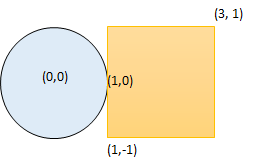

# 1401. 圆和矩形是否有重叠

Medium · 难度分 1709 · [力扣原题](https://leetcode.cn/problems/circle-and-rectangle-overlapping/)

所在刷题路径：灵神题单·数学算法

| 作者 | 题解 | 动画讲解 |
|---|---|---|
| 灵茶山艾府 | [📄 题解](灵茶山艾府.md) | [▶︎ 1401 圆和矩形是否有重叠 · 灵茶山艾府.mp4](1401%20圆和矩形是否有重叠%20·%20灵茶山艾府.mp4) |
| yiduobo | [📄 题解](yiduobo.md) | [▶︎ 1401 圆和矩形是否有重叠 · yiduobo.mp4](1401%20圆和矩形是否有重叠%20·%20yiduobo.mp4) |

## 题目描述

给你一个以 `(radius, xCenter, yCenter)` 表示的圆和一个与坐标轴平行的矩形 `(x1, y1, x2, y2)` ，其中 `(x1, y1)` 是矩形左下角的坐标，而 `(x2, y2)` 是右上角的坐标。

如果圆和矩形有重叠的部分，请你返回 `true` ，否则返回 `false` 。

换句话说，请你检测是否 **存在** 点 `(x_i, y_i)` ，它既在圆上也在矩形上（两者都包括点落在边界上的情况）。

**示例 1 ：**



```

输入：radius = 1, xCenter = 0, yCenter = 0, x1 = 1, y1 = -1, x2 = 3, y2 = 1
输出：true
解释：圆和矩形存在公共点 (1,0) 。
```

**示例 2 ：**

```

输入：radius = 1, xCenter = 1, yCenter = 1, x1 = 1, y1 = -3, x2 = 2, y2 = -1
输出：false
```

**示例 3 ：**


```

输入：radius = 1, xCenter = 0, yCenter = 0, x1 = -1, y1 = 0, x2 = 0, y2 = 1
输出：true
```

**提示：**

- `1 <= radius <= 2000`

- `-10⁴ <= xCenter, yCenter <= 10⁴`

- `-10⁴ <= x1 < x2 <= 10⁴`

- `-10⁴ <= y1 < y2 <= 10⁴`

---
[↑ 返回 1400-1499](../README.md) · [总索引](../../../索引.md) · [仓库首页](../../../README.md)
