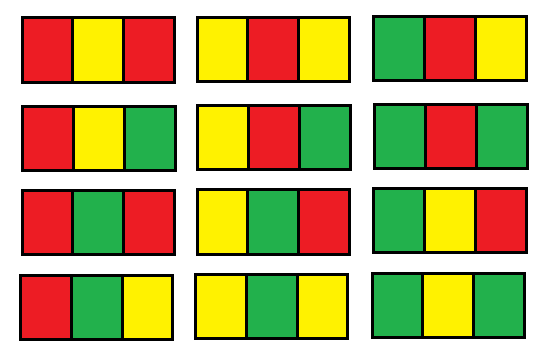

# 三种方法：记忆化搜索/递推/矩阵快速幂（Python/Java/C++/Go）

> **[1411. 给 N x 3 网格图涂色的方案数](https://leetcode.cn/problems/number-of-ways-to-paint-n-3-grid/solutions/3869310/san-chong-fang-fa-ji-yi-hua-sou-suo-di-t-tell/) · Hard · 难度分 1845**

> **所属题单**
> - [动态规划 · 九、状态压缩 DP（状压 DP）](../../../刷题路径/灵神原版题单/动态规划/九、状态压缩%20DP（状压%20DP）.md) · §9.5 轮廓线 DP
> - [动态规划 · 十一、优化 DP](../../../刷题路径/灵神原版题单/动态规划/十一、优化%20DP.md) · §11.6 矩阵快速幂优化 DP

> **题目描述**
> 你有一个 `n x 3` 的网格图 `grid` ，你需要用 **红，黄，绿** 三种颜色之一给每一个格子上色，且确保相邻格子颜色不同（也就是有相同水平边或者垂直边的格子颜色不同）。
>
> 给你网格图的行数 `n` 。
>
> 请你返回给 `grid` 涂色的方案数。由于答案可能会非常大，请你返回答案对 `10^9 + 7` 取余的结果。
>
> **示例 1：**
>
> ```
> 输入：n = 1
> 输出：12
> 解释：总共有 12 种可行的方法：
>
> 
> ```
>
> **示例 2：**
>
> ```
> 输入：n = 2
> 输出：54
> ```
>
> **示例 3：**
>
> ```
> 输入：n = 3
> 输出：246
> ```
>
> **示例 4：**
>
> ```
> 输入：n = 7
> 输出：106494
> ```
>
> **示例 5：**
>
> ```
> 输入：n = 5000
> 输出：30228214
> ```
>
> **提示：**
>
> - `n == grid.length`
>
> - `grid[i].length == 3`
>
> - `1 <= n <= 5000`

> **题解**
> ## 方法一：记忆化搜索（轮廓线 DP）
>
> 考虑**暴力搜索**，枚举每个格子涂哪种颜色。
>
> 从下往上涂色（这样可以在多组测试数据间复用记忆化的结果），我们需要知道：
>
> - 当前在给哪个格子涂色？用 $(i,j)$ 表示，即 $i$ 行 $j$ 列。
> - $i+1$ 行具体怎么涂色？用 $\textit{preRow}$ 表示。$(i,j)$ 的颜色不能等于 $(i+1,j)$ 的颜色。
> - $i$ 行具体怎么涂色？用 $\textit{curRow}$ 表示。$(i,j)$ 的颜色不能等于 $(i,j-1)$ 的颜色。
>
> 三种颜色分别用 $0,1,2$ 表示，存储一个格子的颜色信息需要 $2$ 个比特位，一行的颜色就需要 $2\cdot 3 = 6$ 个比特位。
>
> 注意取模。为什么可以在**中途取模**？原理见 [模运算的世界：当加减乘除遇上取模](https://leetcode.cn/circle/discuss/mDfnkW/)。
>
> ```python
> MOD = 1_000_000_007
>
> # (i, j)：当前位置 
> # pre_row：上一行（i+1 行）的颜色
> # cur_row：当前这一行已填入的颜色
> @cache  # 缓存装饰器，避免重复计算 dfs（一行代码实现记忆化）
> def dfs(i: int, j: int, pre_row: int, cur_row: int) -> int:
>     if i == 0:  # 所有格子都已涂色
>         return 1  # 找到一个合法方案
>
>     if j == 3:  # i 行已涂色
>         # 开始对 i-1 行涂色，cur_row 变成 pre_row
>         return dfs(i - 1, 0, cur_row, 0)
>
>     res = 0
>     for color in range(3):  # 枚举 (i, j) 的颜色 color
>         # 不能和下面相邻格子 (i+1, j) 颜色相同
>         # 不能和左侧相邻格子 (i, j-1) 颜色相同
>         if pre_row and color == pre_row >> (j * 2) & 3 or \
>                  j and color == cur_row >> ((j - 1) * 2) & 3:
>             continue
>         res += dfs(i, j + 1, pre_row, cur_row | (color << (j * 2)))
>     return res % MOD
>
> class Solution:
>     def numOfWays(self, n: int) -> int:
>         return dfs(n, 0, 0, 0)  # 从最后一行开始涂色
> ```
>
>
> #### 复杂度分析
>
> - 时间复杂度：$\mathcal{O}(nmk^{2m+1})$，其中 $m=3$ 是列数，$k=3$ 是颜色数。由于存在大量不合法的状态，复杂度不会跑满。
> - 空间复杂度：$\mathcal{O}(nmk^{2m})$。
>
> ## 方法二：递推
>
> 回顾方法一，总体上看，DP 过程是一个线性递推（从 $(n-1)\times 3$ 网格图最后一行的所有涂色方案线性转移到 $n\times 3$ 网格图的最后一行），所以必然有线性递推式。
>
> 定义 $f[n]$ 表示给 $n\times 3$ 网格图涂色的方案数。
>
> 根据 [Berlekamp-Massey 算法](https://zhuanlan.zhihu.com/p/1966417899825665440)，用方法一求出 $f$ 的连续若干项（具体多少在文章中有解释，本题只需 $4$ 项），就可以用 Berlekamp-Massey 算法直接得到线性递推式
>
> $$
> f[i] = 5\cdot f[i-1]-2\cdot f[i-2] \ \ (i \ge 3)
> $$
>
> 初始值 $f[1] = 12,\ f[2] = 54$。
>
> 也可以倒推出 $f[0]=3$，把 $f[0]$ 和 $f[1]$ 作为初始值。
>
> ```python
> class Solution:
>     def numOfWays(self, n: int) -> int:
>         MOD = 1_000_000_007
>         f = [0] * (n + 1)
>         f[0] = 3
>         f[1] = 12
>         for i in range(2, n + 1):
>             f[i] = (f[i - 1] * 5 - f[i - 2] * 2) % MOD
>         return f[n]
> ```
>
>
> #### 复杂度分析
>
> - 时间复杂度：$\mathcal{O}(n)$。
> - 空间复杂度：$\mathcal{O}(n)$。注：可以用滚动变量优化至 $\mathcal{O}(1)$。
>
> ## 方法三：矩阵快速幂
>
> 把方法二的递推式用矩阵乘法表示，即
>
> $$
> \begin{bmatrix}
> f[i] \\
> f[i-1] \\
> \end{bmatrix}
> = \begin{bmatrix}
> 5 & -2 \\
> 1 & 0 \\
> \end{bmatrix}
> \begin{bmatrix}
> f[i-1] \\
> f[i-2] \\
> \end{bmatrix}
> $$
>
> 把上式中的三个矩阵分别记作 $F[i],M,F[i-1]$，即
>
> $$
> F[i] = M\times F[i-1]
> $$
>
> 那么有
>
> $$
> \begin{aligned}
> F[n] &= M\times F[n-1]      \\
> &= M\times M\times F[n-2]        \\
> &= M\times M\times M\times  F[n-3]        \\
> &\ \ \vdots  \\
> &= M^{n-1}\times F[1] \\
> \end{aligned}
> $$
>
> 其中 $M^{n-1}$ 可以用**快速幂**计算，原理请看[【图解】一张图秒懂快速幂](../../0000-0099/0050%20Pow%28x,%20n%29/灵茶山艾府.md)。
>
> 初始值
>
> $$
> F[1] = \begin{bmatrix}
> f[1] \\
> f[0] \\
> \end{bmatrix}
> = \begin{bmatrix}
> 12 \\
> 3 \\
> \end{bmatrix}
> $$
>
> 答案为 $f[n]$，即 $F[n]$ 的第一项。
>
> ```python
> MOD = 1_000_000_007
>
> # a @ b，其中 @ 是矩阵乘法
> def mul(a: List[List[int]], b: List[List[int]]) -> List[List[int]]:
>     return [[sum(x * y for x, y in zip(row, col)) % MOD for col in zip(*b)]
>             for row in a]
>
> # a^n @ f0
> def pow_mul(a: List[List[int]], n: int, f0: List[List[int]]) -> List[List[int]]:
>     res = f0
>     while n:
>         if n & 1:
>             res = mul(a, res)
>         a = mul(a, a)
>         n >>= 1
>     return res
>
> class Solution:
>     def numOfWays(self, n: int) -> int:
>         m = [[5, -2], [1, 0]]
>         f1 = [[12], [3]]
>         fn = pow_mul(m, n - 1, f1)
>         return fn[0][0]
> ```
>
> > [!example]- NumPy
> > ```python
> > import numpy as np
> >
> > class Solution:
> >     def numOfWays(self, n: int) -> int:
> >         MOD = 1_000_000_007
> >         m = np.array([[5, -2], [1, 0]], dtype=object)
> >         f1 = np.array([12, 3], dtype=object)
> >         fn = np.linalg.matrix_power(m, n - 1) @ f1
> >         return fn[0] % MOD
> > ```
>
>
> #### 复杂度分析
>
> - 时间复杂度：$\mathcal{O}(\log n)$。
> - 空间复杂度：$\mathcal{O}(1)$。
>
> 注：也可以用 [Kitamasa 算法](https://zhuanlan.zhihu.com/p/1964051212304364939) 计算，在矩阵更大（递推式更长）时有优势。
>
> ## 相似题目
>
> - [1931. 用三种不同颜色为网格涂色](https://leetcode.cn/problems/painting-a-grid-with-three-different-colors/) 2170
> - [1659. 最大化网格幸福感](https://leetcode.cn/problems/maximize-grid-happiness/) 2655
>
> ## 专题训练
>
> 见下面动态规划题单的「**§9.5 轮廓线 DP**」和「**§11.6 矩阵快速幂优化 DP**」。
>
> ## 分类题单
>
> [如何科学刷题？](https://leetcode.cn/circle/discuss/RvFUtj/)
>
> 1. [滑动窗口与双指针（定长/不定长/单序列/双序列/三指针/分组循环）](https://leetcode.cn/circle/discuss/0viNMK/)
> 2. [二分算法（二分答案/最小化最大值/最大化最小值/第K小）](https://leetcode.cn/circle/discuss/SqopEo/)
> 3. [单调栈（基础/矩形面积/贡献法/最小字典序）](https://leetcode.cn/circle/discuss/9oZFK9/)
> 4. [网格图（DFS/BFS/综合应用）](https://leetcode.cn/circle/discuss/YiXPXW/)
> 5. [位运算（基础/性质/拆位/试填/恒等式/思维）](https://leetcode.cn/circle/discuss/dHn9Vk/)
> 6. [图论算法（DFS/BFS/拓扑排序/基环树/最短路/最小生成树/网络流）](https://leetcode.cn/circle/discuss/01LUak/)
> 7. [动态规划（入门/背包/划分/状态机/区间/状压/数位/数据结构优化/树形/博弈/概率期望）](https://leetcode.cn/circle/discuss/tXLS3i/)
> 8. [常用数据结构（前缀和/差分/栈/队列/堆/字典树/并查集/树状数组/线段树）](https://leetcode.cn/circle/discuss/mOr1u6/)
> 9. [数学算法（数论/组合/概率期望/博弈/计算几何/随机算法）](https://leetcode.cn/circle/discuss/IYT3ss/)
> 10. [贪心与思维（基本贪心策略/反悔/区间/字典序/数学/思维/脑筋急转弯/构造）](https://leetcode.cn/circle/discuss/g6KTKL/)
> 11. [链表、树与回溯（前后指针/快慢指针/DFS/BFS/直径/LCA）](https://leetcode.cn/circle/discuss/K0n2gO/)
> 12. [字符串（KMP/Z函数/Manacher/字符串哈希/AC自动机/后缀数组/子序列自动机）](https://leetcode.cn/circle/discuss/SJFwQI/)
>
> [我的题解精选（已分类）](https://github.com/EndlessCheng/codeforces-go/blob/master/leetcode/SOLUTIONS.md)
>
> 欢迎关注 [B站@灵茶山艾府](https://space.bilibili.com/206214)
