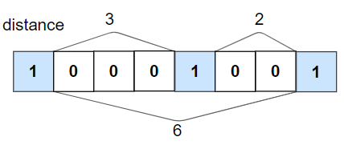
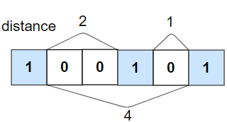

# 1437. 是否所有 1 都至少相隔 k 个元素

Easy · [力扣原题](https://leetcode.cn/problems/check-if-all-1s-are-at-least-length-k-places-away/)

| 作者 | 题解 | 动画讲解 |
|---|---|---|
| 灵茶山艾府 | [📄 题解](灵茶山艾府.md) | [▶︎ 动画（GIF）](1437%20是否所有%201%20都至少相隔%20k%20个元素%20·%20灵茶山艾府.gif) · [mp4 文件](1437%20是否所有%201%20都至少相隔%20k%20个元素%20·%20灵茶山艾府.mp4) |
| yiduobo | [📄 题解](yiduobo.md) | [▶︎ 动画（GIF）](1437%20是否所有%201%20都至少相隔%20k%20个元素%20·%20yiduobo.gif) · [mp4 文件](1437%20是否所有%201%20都至少相隔%20k%20个元素%20·%20yiduobo.mp4) |

## 动画讲解

> 动图会循环播放；想暂停、拖进度条请下载上面表格里的 mp4 文件。

### 灵茶山艾府


### yiduobo


## 题目描述

给你一个由若干 `0` 和 `1` 组成的数组 `nums` 以及整数 `k`。如果所有 `1` 都至少相隔 `k` 个元素，则返回 true ；否则，返回 `false` 。

**示例 1：**



```

输入：nums = [1,0,0,0,1,0,0,1], k = 2
输出：true
解释：每个 1 都至少相隔 2 个元素。
```

**示例 2：**



```

输入：nums = [1,0,0,1,0,1], k = 2
输出：false
解释：第二个 1 和第三个 1 之间只隔了 1 个元素。
```

**提示：**

- `1 <= nums.length <= 10⁵`

- `0 <= k <= nums.length`

- `nums[i]` 的值为 `0` 或 `1`

---
[↑ 返回 1400-1499](../README.md) · [总索引](../../../索引.md) · [仓库首页](../../../README.md)
