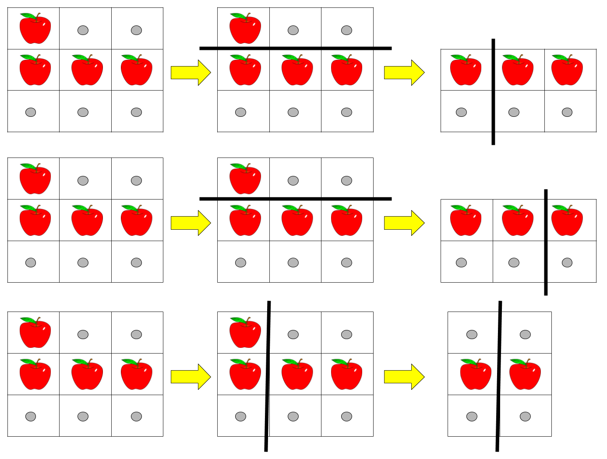

# 击败 100%！从递归到递推到优化，教你一步步思考动态规划！（Python/Java/C++/Go/JS）

> **[1444. 切披萨的方案数](https://leetcode.cn/problems/number-of-ways-of-cutting-a-pizza/solutions/2392051/ji-bai-100cong-di-gui-dao-di-tui-dao-you-dxz5/) · Hard · 难度分 2127**

> **所属题单**
> - [动态规划 · 七、其他线性 DP](../../../刷题路径/灵神原版题单/动态规划/七、其他线性%20DP.md) · §7.6 多维 DP

> **题目描述**
> 给你一个 `rows x cols` 大小的矩形披萨和一个整数 `k` ，矩形包含两种字符： `'A'` （表示苹果）和 `'.'` （表示空白格子）。你需要切披萨 `k-1` 次，得到 `k` 块披萨并送给别人。
>
> 切披萨的每一刀，先要选择是向垂直还是水平方向切，再在矩形的边界上选一个切的位置，将披萨一分为二。如果垂直地切披萨，那么需要把左边的部分送给一个人，如果水平地切，那么需要把上面的部分送给一个人。在切完最后一刀后，需要把剩下来的一块送给最后一个人。
>
> 请你返回确保每一块披萨包含 **至少** 一个苹果的切披萨方案数。由于答案可能是个很大的数字，请你返回它对 10^9 + 7 取余的结果。
>
> **示例 1：**
>
> 
>
> ```
> 输入：pizza = ["A..","AAA","..."], k = 3
> 输出：3
> 解释：上图展示了三种切披萨的方案。注意每一块披萨都至少包含一个苹果。
> ```
>
> **示例 2：**
>
> ```
> 输入：pizza = ["A..","AA.","..."], k = 3
> 输出：1
> ```
>
> **示例 3：**
>
> ```
> 输入：pizza = ["A..","A..","..."], k = 1
> 输出：1
> ```
>
> **提示：**
>
> - `1 <= rows, cols <= 50`
>
> - `rows == pizza.length`
>
> - `cols == pizza[i].length`
>
> - `1 <= k <= 10`
>
> - `pizza` 只包含字符 `'A'` 和 `'.'` 。

> **题解**
> ## 前置知识：动态规划入门
>
> [动态规划入门：从记忆化搜索到递推【基础算法精讲 17】](https://www.bilibili.com/video/BV1Xj411K7oF/)
>
> ## 前置知识：二维前缀和
>
> 我们需要快速计算子矩形的元素之和。
>
> [【图解】二维前缀和](https://leetcode.cn/circle/discuss/UUuRex/)
>
> ## 一、启发思考：寻找子问题
>
> 题目说：「如果垂直地切披萨，那么需要把左边的部分送给一个人；如果水平地切，那么需要把上面的部分送给一个人。」
>
> 我们来看第一刀怎么切。设 $\textit{pizza}$ 有 $m$ 行 $n$ 列，分类讨论：
>
> - 如果垂直地切，那么枚举「左边的部分」的宽度 $w$，送人后，剩下的是一个 $m$ 行 $n-w$ 列的矩形，还需切 $k-2$ 刀。
> - 如果水平地切，那么枚举「上面的部分」的高度 $h$，送人后，剩下的是一个 $m-h$ 行 $n$ 列的矩形，还需切 $k-2$ 刀。
>
> 无论怎么切，我们得到的都是**和原问题相似的、规模更小的子问题**，所以可以用**递归**解决。
>
> > 注：动态规划有「选或不选」和「枚举选哪个」这两种基本思考方式。在做题时，可根据题目要求，选择适合题目的一种来思考。本题用到的是「枚举选哪个」。
>
> ## 二、递归怎么写：状态定义与状态转移方程
>
> 按照题目的切法，我们要处理的子矩形，右下角总是 $(m-1,n-1)$，所以只需要知道子矩形左上角的位置，就确定了子矩形。
>
> 定义 $\textit{dfs}(c,i,j)$ 表示把左上角在 $(i,j)$ 右下角在 $(m-1,n-1)$ 的子矩形切 $c$ 刀，每块都包含至少一个苹果的方案数。
>
> 如果 $c\ge 1$，分类讨论：
>
> - 如果垂直地切，枚举 $j_2$（切出的宽度是 $j_2-j$），剩下的子矩形左上角在 $(i,j_2)$，还需切 $c-1$ 刀，即 $\textit{dfs}(c-1,i,j_2)$。
> - 如果水平地切，枚举 $i_2$（切出的高度是 $i_2-i$），剩下的子矩形左上角在 $(i_2,j)$，还需切 $c-1$ 刀，即 $\textit{dfs}(c-1,i_2,j)$。
>
> 累加这些方案，得
>
> $$
> \textit{dfs}(c,i,j) = \sum_{j<j_2<n} \textit{dfs}(c-1,i,j_2) +  \sum_{i<i_2<m} \textit{dfs}(c-1,i_2,j)
> $$
>
> 上式中，对于 $j_2$ 还需要满足左上角在 $(i,j)$ 右下角在 $(m-1,j_2-1)$ 的子矩形有苹果，对于 $i_2$ 还需要满足左上角在 $(i,j)$ 右下角在 $(i_2-1,n-1)$ 的子矩形有苹果。
>
> 递归边界：$c=0$ 时，无法切分了，如果左上角在 $(i,j)$ 右下角在 $(m-1,n-1)$ 的子矩形有苹果则返回 $1$，表示找到了一个合法方案，否则不合法，返回 $0$。
>
> 递归入口：$\textit{dfs}(k-1,0,0)$，也就是答案。
>
> 本题还需要对 $10^9+7$ 取模，不了解的同学请看文末的讲解。
>
> ```python
> # 会超时的递归代码
> class Solution:
>     def ways(self, pizza: List[str], k: int) -> int:
>         MOD = 10 ** 9 + 7
>         ms = MatrixSum(pizza)
>         m, n = len(pizza), len(pizza[0])
>         def dfs(c: int, i: int, j: int) -> int:
>             if c == 0:  # 递归边界：无法再切了
>                 return 1 if ms.query(i, j, m, n) else 0
>             res = 0
>             for j2 in range(j + 1, n):  # 垂直切
>                 if ms.query(i, j, m, j2):  # 有苹果
>                     res += dfs(c - 1, i, j2)
>             for i2 in range(i + 1, m):  # 水平切
>                 if ms.query(i, j, i2, n):  # 有苹果
>                     res += dfs(c - 1, i2, j)
>             return res % MOD
>         return dfs(k - 1, 0, 0)
>
> # 二维前缀和模板（'A' 视作 1，'.' 视作 0）
> class MatrixSum:
>     def __init__(self, matrix: List[str]):
>         m, n = len(matrix), len(matrix[0])
>         s = [[0] * (n + 1) for _ in range(m + 1)]
>         for i, row in enumerate(matrix):
>             for j, x in enumerate(row):
>                 s[i + 1][j + 1] = s[i + 1][j] + s[i][j + 1] - s[i][j] + (x == 'A')
>         self.s = s
>
>     # 返回左上角在 (r1,c1) 右下角在 (r2-1,c2-1) 的子矩阵元素和（类似前缀和的左闭右开）
>     def query(self, r1: int, c1: int, r2: int, c2: int) -> int:
>         return self.s[r2][c2] - self.s[r2][c1] - self.s[r1][c2] + self.s[r1][c1]
> ```
>
>
> #### 复杂度分析
>
> - 时间复杂度：$\mathcal{O}(mn+(m+n)^k)$，其中 $m$ 和 $n$ 分别为 $\textit{pizza}$ 的行数和列数。二维前缀和需要 $\mathcal{O}(mn)$ 的时间。搜索树可以近似为一棵 $m+n$ 叉树，树高为 $\mathcal{O}(k)$，所以节点个数为 $\mathcal{O}((m+n)^k)$，递归相当于遍历这棵搜索树，需要 $\mathcal{O}((m+n)^k)$ 的时间。
> - 空间复杂度：$\mathcal{O}(mn+k)$。二维前缀和需要 $\mathcal{O}(mn)$ 的空间，递归需要 $\mathcal{O}(k)$ 的栈空间。
>
> ## 三、递归 + 记录返回值 = 记忆化搜索
>
> 上面的做法太慢了，怎么优化呢？
>
> 想象披萨上面全是苹果。「先切掉第一行再切掉第一列」和「先切掉第一列再切掉第一行」，都会递归到 $\textit{dfs}(k-3,1,1)$。
>
> 一叶知秋，整个递归中有大量重复递归调用（递归入参相同）。由于递归函数没有副作用，同样的入参无论计算多少次，算出来的结果都是一样的，因此可以用**记忆化搜索**来优化：
>
> - 如果一个状态（递归入参）是第一次遇到，那么可以在返回前，把状态及其结果记到一个 $\textit{memo}$ 数组（或哈希表）中。
> - 如果一个状态不是第一次遇到（$\textit{memo}$ 中保存的结果不等于 $\textit{memo}$ 的初始值），那么可以直接返回 $\textit{memo}$ 中保存的结果。
>
> **注意**：$\textit{memo}$ 数组的**初始值**一定不能等于要记忆化的值！例如初始值设置为 $0$，并且要记忆化的 $\textit{dfs}(c,i,j)$ 也等于 $0$，那就没法判断 $0$ 到底表示第一次遇到这个状态，还是表示之前遇到过了。初始值一般设为 $-1$。
>
> > 注：Python 用户可以无视上面这段，直接用 `@cache` 装饰器。
>
> ```python
> class Solution:
>     def ways(self, pizza: List[str], k: int) -> int:
>         MOD = 10 ** 9 + 7
>         ms = MatrixSum(pizza)
>         m, n = len(pizza), len(pizza[0])
>         @cache  # 缓存装饰器，避免重复计算 dfs 的结果
>         def dfs(c: int, i: int, j: int) -> int:
>             if c == 0:
>                 return 1 if ms.query(i, j, m, n) else 0
>             res = 0
>             for j2 in range(j + 1, n):  # 垂直切
>                 if ms.query(i, j, m, j2):  # 有苹果
>                     res += dfs(c - 1, i, j2)
>             for i2 in range(i + 1, m):  # 水平切
>                 if ms.query(i, j, i2, n):  # 有苹果
>                     res += dfs(c - 1, i2, j)
>             return res % MOD
>         return dfs(k - 1, 0, 0)
>
> # 二维前缀和模板（'A' 视作 1，'.' 视作 0）
> class MatrixSum:
>     def __init__(self, matrix: List[str]):
>         m, n = len(matrix), len(matrix[0])
>         s = [[0] * (n + 1) for _ in range(m + 1)]
>         for i, row in enumerate(matrix):
>             for j, x in enumerate(row):
>                 s[i + 1][j + 1] = s[i + 1][j] + s[i][j + 1] - s[i][j] + (x == 'A')
>         self.s = s
>
>     # 返回左上角在 (r1,c1) 右下角在 (r2-1,c2-1) 的子矩阵元素和（类似前缀和的左闭右开）
>     def query(self, r1: int, c1: int, r2: int, c2: int) -> int:
>         return self.s[r2][c2] - self.s[r2][c1] - self.s[r1][c2] + self.s[r1][c1]
> ```
>
>
> #### 复杂度分析
>
> - 时间复杂度：$\mathcal{O}(kmn(m+n))$，其中 $m$ 和 $n$ 分别为 $\textit{pizza}$ 的行数和列数。动态规划的时间复杂度 $=$ 状态个数 $\times$ 单个状态的计算时间。本题中状态个数等于 $\mathcal{O}(kmn)$，单个状态的计算时间为 $\mathcal{O}(m+n)$，所以动态规划的时间复杂度为 $\mathcal{O}(kmn(m+n))$。
> - 空间复杂度：$\mathcal{O}(kmn)$。即状态个数。
>
> ## 四、1:1 翻译成递推
>
> 我们可以去掉递归中的「递」，只保留「归」的部分，即自底向上计算。
>
> 做法：
>
> - $\textit{dfs}$ 改成 $f$ 数组；
> - 递归改成循环（每个参数都对应一层循环）；
> - 递归边界改成 $f$ 数组的初始值。
>
> > 相当于之前是用递归去计算每个状态，现在是（按照某种顺序）枚举并计算每个状态。
>
> 具体来说，$f[c][i][j]$ 的含义和 $\textit{dfs}(c,i,j)$ 的含义是一致的，都表示把左上角在 $(i,j)$ 右下角在 $(m-1,n-1)$ 的子矩形切 $c$ 刀，每块都包含至少一个苹果的方案数。
>
> 相应的递推式（状态转移方程）也和 $\textit{dfs}$ 的一致：
>
> $$
> f[c][i][j] = \sum_{j<j_2<n} f[c-1][i][j_2] +  \sum_{i<i_2<m} f[c-1][i_2][j]
> $$
>
> 初始值和递归边界是一样的：如果左上角在 $(i,j)$ 右下角在 $(m-1,n-1)$ 的子矩形有苹果，则 $f[0][i][j]=1$，表示找到了一个合法方案；否则不合法，$f[0][i][j]=0$。
>
> 答案为 $f[k-1][0][0]$，翻译自 $\textit{dfs}(k-1,0,0)$。
>
> #### 答疑
>
> **问**：如何思考循环顺序？什么时候要正序枚举，什么时候要倒序枚举？
>
> **答**：这里有一个通用的做法：盯着状态转移方程，想一想，要计算出 $f[c][i][j]$，必须先把 $f[c-1][\cdot][\cdot]$ 算出来，那么只有 $c$ 从小到大枚举才能做到。对于 $i$ 和 $j$ 来说，由于在计算 $f[c][i][j]$ 的时候，$f[c-1][\cdot][\cdot]$ 已经全部计算完毕，所以 $i$ 和 $j$ 无论是正序还是倒序枚举都可以。
>
> ```python
> class Solution:
>     def ways(self, pizza: List[str], k: int) -> int:
>         MOD = 10 ** 9 + 7
>         ms = MatrixSum(pizza)
>         m, n = len(pizza), len(pizza[0])
>         f = [[[0] * n for _ in range(m)] for _ in range(k)]
>         # 把递归代码 1:1 翻译成递推
>         for c in range(k):
>             for i in range(m):
>                 for j in range(n):
>                     if c == 0:
>                         f[c][i][j] = 1 if ms.query(i, j, m, n) else 0
>                         continue
>                     res = 0
>                     for j2 in range(j + 1, n):  # 垂直切
>                         if ms.query(i, j, m, j2):  # 有苹果
>                             res += f[c - 1][i][j2]
>                     for i2 in range(i + 1, m):  # 水平切
>                         if ms.query(i, j, i2, n):  # 有苹果
>                             res += f[c - 1][i2][j]
>                     f[c][i][j] = res % MOD
>         return f[-1][0][0]
>
> # 二维前缀和模板（'A' 视作 1，'.' 视作 0）
> class MatrixSum:
>     def __init__(self, matrix: List[str]):
>         m, n = len(matrix), len(matrix[0])
>         s = [[0] * (n + 1) for _ in range(m + 1)]
>         for i, row in enumerate(matrix):
>             for j, x in enumerate(row):
>                 s[i + 1][j + 1] = s[i + 1][j] + s[i][j + 1] - s[i][j] + (x == 'A')
>         self.s = s
>
>     # 返回左上角在 (r1,c1) 右下角在 (r2-1,c2-1) 的子矩阵元素和（类似前缀和的左闭右开）
>     def query(self, r1: int, c1: int, r2: int, c2: int) -> int:
>         return self.s[r2][c2] - self.s[r2][c1] - self.s[r1][c2] + self.s[r1][c1]
> ```
>
>
> #### 复杂度分析
>
> - 时间复杂度：$\mathcal{O}(kmn(m+n))$，其中 $m$ 和 $n$ 分别为 $\textit{pizza}$ 的行数和列数。动态规划的时间复杂度 $=$ 状态个数 $\times$ 单个状态的计算时间。本题中状态个数等于 $\mathcal{O}(kmn)$，单个状态的计算时间为 $\mathcal{O}(m+n)$，所以动态规划的时间复杂度为 $\mathcal{O}(kmn(m+n))$。
> - 空间复杂度：$\mathcal{O}(kmn)$。即状态个数。
>
> ## 五、终极优化
>
> #### 1) 时间优化
>
> 下面把从 $(i,j)$ 到 $(m-1,j)$ 这一列看成是当前这块矩形的「左边界」，把从 $(i,j)$ 到 $(i,n-1)$ 这一行看成是当前这块矩形的「上边界」。
>
> 想一想，如果左边界没有苹果，那么必不可能切出这一列。在左上角为 $(i,j+1)$ 的所有切分方案的左侧增加这一列，就得到了左上角为 $(i,j)$ 的切分方案数！即 $f[c][i][j] = f[c][i][j+1]$。
>
> 同理，如果上边界没有苹果，那么在左上角为 $(i+1,j)$ 的所有切分方案的上方增加这一行，就得到了左上角为 $(i,j)$ 的切分方案数，即 $f[c][i][j] = f[c][i+1][j]$。
>
> 如果左边界和上边界都有苹果呢？
>
> 那就意味着**无论这一刀怎么切，切出来的送人的那一块披萨一定有苹果**！
>
> 再看一眼这个递推式：
>
> $$
> f[c][i][j] = \sum_{j<j_2<n} f[c-1][i][j_2] +  \sum_{i<i_2<m} f[c-1][i_2][j]
> $$
>
> $j_2$ 和 $i_2$ 没有其它约束了，要计算的就是 $f[c-1]$ 第 $i$ 行的**后缀和**，以及第 $f[c-1]$ 第 $j$ 列的**后缀和**。这可以预处理出来，或者一边计算 $f[c][i][j]$ 一边更新后缀和。
>
> 综上，每个 $f[c][i][j]$ 只需要 $\mathcal{O}(1)$ 的时间就能算出来！
>
> 此外，将二维前缀和改成二维后缀和，用 $\textit{sum}[i][j]$ 表示左上角在 $(i,j)$ 右下角在 $(m-1,n-1)$ 的子矩阵和。
>
> - 如果 $\textit{sum}[i][j] = \textit{sum}[i][j+1]$，说明左边界没有苹果。
> - 如果 $\textit{sum}[i][j] = \textit{sum}[i+1][j]$，说明上边界没有苹果。
>
> 这样判断，相比计算子矩阵和更快。
>
> #### 2) 空间优化
>
> 观察上面的状态转移方程，在计算 $f[c]$ 时，只会用到 $f[c-1]$，不会用到小于 $c-1$ 的更早的状态。
>
> 类似 [0-1 背包](https://www.bilibili.com/video/BV16Y411v7Y6/)，我们可以去掉第一个维度，反复利用同一个二维数组。注意 $i$ 和 $j$ 需要倒序遍历，这一是为了计算后缀和，二是为了避免状态被覆盖（道理和 0-1 背包是一样的）。
>
> 有了这些优化后，我们就可以击败 100% 了（截至本文发布时）。
>
> > Java 可以稳定击败 100%。其它语言有时间波动，如果没有击败 100% 可以多提交几次。
>
> ```python
> class Solution:
>     def ways(self, pizza: List[str], k: int) -> int:
>         MOD = 10 ** 9 + 7
>         m, n = len(pizza), len(pizza[0])
>         s = [[0] * (n + 1) for _ in range(m + 1)]  # 二维后缀和
>         f = [[0] * (n + 1) for _ in range(m + 1)]
>         for i in range(m - 1, -1, -1):
>             for j in range(n - 1, -1, -1):
>                 s[i][j] = s[i][j + 1] + s[i + 1][j] - s[i + 1][j + 1] + (pizza[i][j] == 'A')
>                 if s[i][j]: f[i][j] = 1  # 初始值
>
>         for _ in range(1, k):
>             col_s = [0] * n  # col_s[j] 表示 f 第 j 列的后缀和
>             for i in range(m - 1, -1, -1):
>                 row_s = 0  # f[i] 的后缀和
>                 for j in range(n - 1, -1, -1):
>                     tmp = f[i][j]
>                     if s[i][j] == s[i][j + 1]:  # 左边界没有苹果
>                         f[i][j] = f[i][j + 1]
>                     elif s[i][j] == s[i + 1][j]:  # 上边界没有苹果
>                         f[i][j] = f[i + 1][j]
>                     else:  # 左边界上边界都有苹果，那么无论怎么切都有苹果
>                         f[i][j] = (row_s + col_s[j]) % MOD
>                     row_s += tmp
>                     col_s[j] += tmp
>         return f[0][0]
> ```
>
>
> #### 复杂度分析
>
> - 时间复杂度：$\mathcal{O}(kmn)$，其中 $m$ 和 $n$ 分别为 $\textit{pizza}$ 的行数和列数。动态规划的时间复杂度 $=$ 状态个数 $\times$ 单个状态的计算时间。本题中状态个数等于 $\mathcal{O}(kmn)$，单个状态的计算时间为 $\mathcal{O}(1)$，所以动态规划的时间复杂度为 $\mathcal{O}(kmn)$。
> - 空间复杂度：$\mathcal{O}(mn)$。
>
> ## 思考题
>
> 1. 如果没有切割次数的限制呢？只要求披萨上一定要有苹果。
> 2. 如果不要求披萨上一定要有苹果，切 $x$ 刀有多少种方案？
>
> 欢迎在评论区发表你的思路。
>
> ## 附：模运算
>
> 如果让你计算 $1234\cdot 6789$ 的**个位数**，你会如何计算？
>
> 由于只有个位数会影响到乘积的个位数，那么 $4\cdot 9=36$ 的个位数 $6$ 就是答案。
>
> 对于 $1234+6789$ 的个位数，同理，$4+9=13$ 的个位数 $3$ 就是答案。
>
> 你能把这个结论抽象成数学等式吗？
>
> 一般地，涉及到取模的题目，通常会用到如下等式（上面计算的是 $m=10$）：
>
> $$
> (a+b)\bmod m = ((a\bmod m) + (b\bmod m)) \bmod m
> $$
>
> $$
> (a\cdot b) \bmod m=((a\bmod m)\cdot  (b\bmod m)) \bmod m
> $$
>
> 证明：根据**带余除法**，任意整数 $a$ 都可以表示为 $a=km+r$，这里 $r$ 相当于 $a\bmod m$。那么设 $a=k_1m+r_1,\ b=k_2m+r_2$。
>
> 第一个等式：
>
> $$
> \begin{aligned}
> &\ (a+b) \bmod m\\
> =&\ ((k_1+k_2) m+r_1+r_2)\bmod m\\
> =&\ (r_1+r_2)\bmod m\\
> =&\ ((a\bmod m) + (b\bmod m)) \bmod m
> \end{aligned}
> $$
>
> 第二个等式：
>
> $$
> \begin{aligned}
> &\ (a\cdot b) \bmod m\\
> =&\ (k_1k_2m^2+(k_1r_2+k_2r_1)m+r_1r_2)\bmod m\\
> =&\ (r_1r_2)\bmod m\\
> =&\ ((a\bmod m)\cdot  (b\bmod m)) \bmod m
> \end{aligned}
> $$
>
> **根据这两个恒等式，可以随意地对代码中的加法和乘法的结果取模**。
>
> ---
>
> [往期每日一题题解（按 tag 分类）](https://github.com/EndlessCheng/codeforces-go/blob/master/leetcode/SOLUTIONS.md)
>
> 欢迎关注 [B站@灵茶山艾府](https://space.bilibili.com/206214)
