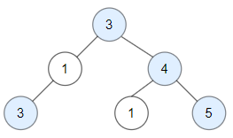

# 简洁写法（Python/Java/C++/Go/JS）

> **[1448. 统计二叉树中好节点的数目](https://leetcode.cn/problems/count-good-nodes-in-binary-tree/solutions/2403677/jian-ji-xie-fa-pythonjavacgojs-by-endles-gwxt/) · Medium · 难度分 1360**

> **所属题单**
> - [链表、二叉树与回溯 · 二、二叉树](../../../刷题路径/灵神原版题单/链表、二叉树与回溯/二、二叉树.md) · §2.2 自顶向下 DFS（先序遍历）

> **题目描述**
> 给你一棵根为 `root` 的二叉树，请你返回二叉树中好节点的数目。
>
> 「好节点」X 定义为：从根到该节点 X 所经过的节点中，没有任何节点的值大于 X 的值。
>
> **示例 1：**
>
> 
>
> ```
> 输入：root = [3,1,4,3,null,1,5]
> 输出：4
> 解释：图中蓝色节点为好节点。
> 根节点 (3) 永远是个好节点。
> 节点 4 -> (3,4) 是路径中的最大值。
> 节点 5 -> (3,4,5) 是路径中的最大值。
> 节点 3 -> (3,1,3) 是路径中的最大值。
> ```
>
> **示例 2：**
>
> 
>
> ```
> 输入：root = [3,3,null,4,2]
> 输出：3
> 解释：节点 2 -> (3, 3, 2) 不是好节点，因为 "3" 比它大。
> ```
>
> **示例 3：**
>
> ```
> 输入：root = [1]
> 输出：1
> 解释：根节点是好节点。
> ```
>
> **提示：**
>
> - 二叉树中节点数目范围是 `[1, 10^5]` 。
>
> - 每个节点权值的范围是 `[-10^4, 10^4]` 。

> **题解**
> ## 前置知识
>
> [看到递归就晕？带你理解递归的本质！【基础算法精讲 09】](https://www.bilibili.com/video/BV1UD4y1Y769/)
>
> ## 算法
>
> 递归递归，先「递」后「归」。
>
> 我们可以在向下递归的同时，额外维护一个参数 $\textit{mx}$ 表示从根节点到当前节点之前，路径上的最大节点值。
>
> - 如果当前节点为空，到达递归边界，返回 $0$。
> - 递归左子树 `goodNodes(root.left, max(mx, root.val))`，获取左子树的好节点个数 $\textit{left}$。
> - 递归右子树 `goodNodes(root.right, max(mx, root.val))`，获取右子树的好节点个数 $\textit{right}$。
> - 如果当前节点是好节点，即 `mx <= root.val`，那么返回 $\textit{left}+\textit{right}+1$。否则返回 $\textit{left}+\textit{right}$。
>
> ```python
> class Solution:
>     def goodNodes(self, root: TreeNode, mx=-inf) -> int:
>         if root is None:
>             return 0
>         left = self.goodNodes(root.left, max(mx, root.val))
>         right = self.goodNodes(root.right, max(mx, root.val))
>         return left + right + (mx <= root.val)
> ```
>
>
> #### 复杂度分析
>
> - 时间复杂度：$\mathcal{O}(n)$，其中 $n$ 为二叉树的节点个数。每个节点都会递归恰好一次。
> - 空间复杂度：$\mathcal{O}(n)$。最坏情况下，二叉树是一条链，递归需要 $\mathcal{O}(n)$ 的栈空间。
>
> #### 练习题
>
> - [100. 相同的树](https://leetcode.cn/problems/same-tree/)
> - [101. 对称二叉树](https://leetcode.cn/problems/symmetric-tree/)
> - [110. 平衡二叉树](https://leetcode.cn/problems/balanced-binary-tree/)
>
> 练习题的讲解请看[【基础算法精讲 10】](https://www.bilibili.com/video/BV18M411z7bb/)
>
> [往期每日一题题解（按 tag 分类）](https://github.com/EndlessCheng/codeforces-go/blob/master/leetcode/SOLUTIONS.md)
