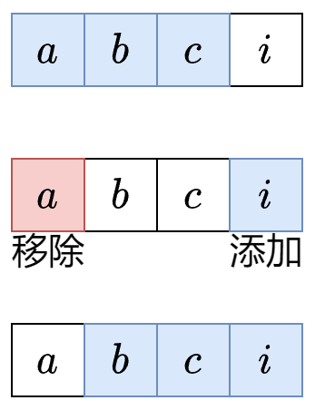

# 【套路】教你解决定长滑窗！适用于所有定长滑窗题目！（Python/Java/C++/C/Go/JS/Rust）

> **[1456. 定长子串中元音的最大数目](https://leetcode.cn/problems/maximum-number-of-vowels-in-a-substring-of-given-length/solutions/2809359/tao-lu-jiao-ni-jie-jue-ding-chang-hua-ch-fzfo/) · Medium · 难度分 1263**

> **所属题单**
> - [滑动窗口与双指针 · 一、定长滑动窗口](../../../刷题路径/灵神原版题单/滑动窗口与双指针/一、定长滑动窗口.md) · §1.1 基础

> **题目描述**
> 给你字符串 `s` 和整数 `k` 。
>
> 请返回字符串 `s` 中长度为 `k` 的单个子字符串中可能包含的最大元音字母数。
>
> 英文中的 **元音字母** 为（`a`, `e`, `i`, `o`, `u`）。
>
> **示例 1：**
>
> ```
> 输入：s = "abciiidef", k = 3
> 输出：3
> 解释：子字符串 "iii" 包含 3 个元音字母。
> ```
>
> **示例 2：**
>
> ```
> 输入：s = "aeiou", k = 2
> 输出：2
> 解释：任意长度为 2 的子字符串都包含 2 个元音字母。
> ```
>
> **示例 3：**
>
> ```
> 输入：s = "leetcode", k = 3
> 输出：2
> 解释："lee"、"eet" 和 "ode" 都包含 2 个元音字母。
> ```
>
> **示例 4：**
>
> ```
> 输入：s = "rhythms", k = 4
> 输出：0
> 解释：字符串 s 中不含任何元音字母。
> ```
>
> **示例 5：**
>
> ```
> 输入：s = "tryhard", k = 4
> 输出：1
> ```
>
> **提示：**
>
> - `1 <= s.length <= 10^5`
>
> - `s` 由小写英文字母组成
>
> - `1 <= k <= s.length`

> **题解**
> ## 核心思想
>
> 我们要计算所有长度**恰好**为 $k$ 的子串中，最多可以包含多少个元音字母。
>
> 暴力枚举所有子串？时间复杂度是 $\mathcal{O}(nk)$，太慢了。能否 $\mathcal{O}(1)$ 计算子串的元音个数？
>
> 这是可以做到的，对于下图的字符串 $\texttt{abci}$，假如我们已经计算出了子串 $\texttt{abc}$ 的元音个数，那么从子串 $\texttt{abc}$ 到子串 $\texttt{bci}$，只需要考虑移除（离开窗口）的字母 $\texttt{a}$ 是不是元音，以及添加（进入窗口）的字母 $\texttt{i}$ 是不是元音即可，因为中间的字母 $\texttt{b}$ 和 $\texttt{c}$ 都在这两个子串中。
>
> 
>
> ## 举例
>
> 示例 1，$s = \texttt{abciiidef},\ k = 3$。
>
> 1. 从左到右遍历 $s$。
> 2. 首先统计前 $k-1=2$ 个字母的元音个数，这有 $1$ 个。
> 3. $s[2]=\texttt{c}$ 进入窗口，此时找到了第一个长为 $k$ 的子串 $\texttt{abc}$，现在元音个数有 $1$ 个，更新答案最大值。然后 $s[0]=\texttt{a}$ 离开窗口，现在元音个数有 $0$ 个。
> 4. $s[3]=\texttt{i}$ 进入窗口，此时找到了第二个长为 $k$ 的子串 $\texttt{bci}$，现在元音个数有 $1$ 个，更新答案最大值。然后 $s[1]=\texttt{b}$ 离开窗口，现在元音个数有 $1$ 个。
> 5. $s[4]=\texttt{i}$ 进入窗口，此时找到了第三个长为 $k$ 的子串 $\texttt{cii}$，现在元音个数有 $2$ 个，更新答案最大值。然后 $s[2]=\texttt{c}$ 离开窗口，现在元音个数有 $2$ 个。
> 6. $s[5]=\texttt{i}$ 进入窗口，此时找到了第四个长为 $k$ 的子串 $\texttt{iii}$，现在元音个数有 $3$ 个，更新答案最大值。然后 $s[3]=\texttt{i}$ 离开窗口，现在元音个数有 $2$ 个。
> 7. $s[6]=\texttt{d}$ 进入窗口，此时找到了第五个长为 $k$ 的子串 $\texttt{iid}$，现在元音个数有 $2$ 个，更新答案最大值。然后 $s[4]=\texttt{i}$ 离开窗口，现在元音个数有 $1$ 个。
> 8. $s[7]=\texttt{e}$ 进入窗口，此时找到了第六个长为 $k$ 的子串 $\texttt{ide}$，现在元音个数有 $2$ 个，更新答案最大值。然后 $s[5]=\texttt{i}$ 离开窗口，现在元音个数有 $1$ 个。
> 9. $s[8]=\texttt{f}$ 进入窗口，此时找到了第七个长为 $k$ 的子串 $\texttt{def}$，现在元音个数有 $1$ 个，更新答案最大值。遍历结束。
>
> ## 定长滑窗套路
>
> 窗口右端点在 $i$ 时，由于窗口长度为 $k$，所以窗口左端点为 $i-k+1$。
>
> 我总结成三步：**入-更新答案-出**。
>
> 1. **入**：下标为 $i$ 的元素进入窗口，更新相关统计量（本题为窗口内的元音个数）。如果窗口左端点 $i-k+1<0$，说明尚未形成第一个窗口，重复第一步。
> 2. **更新答案**：此时窗口长度为 $k$，符合题目要求，用相关统计量（本题为窗口内的元音个数）更新答案。
> 3. **出**：下标为 $i-k+1$ 的元素离开窗口，更新相关统计量（本题为窗口内的元音个数），为下一个循环做准备。**注**：元素离开窗口后，窗口长度为 $k-1$。下一轮循环元素进入窗口后，窗口长度为 $k$。
>
> 以上三步适用于所有定长滑窗题目。
>
> ## 答疑
>
> **问**：为什么窗口右端点为 $i$ 的时候，左端点是 $i-k+1$？
>
> **答**：对于窗口（闭区间）$[L,R]$ 来说，$[L,R]$ 里面的元素个数为 $R-L+1$。比如 $[2,5]$ 里面有 $2,3,4,5$ 一共 $5-2+1=4$ 个数。如果窗口长度为 $k$，即 $R-L+1=k$，解得 $L=R-k+1$。所以右端点为 $R$ 的时候，左端点为 $R-k+1$。
>
> ```python
> class Solution:
>     def maxVowels(self, s: str, k: int) -> int:
>         ans = vowel = 0
>         for i, c in enumerate(s):  # 枚举窗口右端点 i
>             # 1. 右端点进入窗口
>             if c in "aeiou":
>                 vowel += 1
>
>             left = i - k + 1  # 窗口左端点
>             if left < 0:  # 窗口长度不足 k，尚未形成第一个窗口
>                 continue
>
>             # 2. 更新答案
>             ans = max(ans, vowel)
>
>             # 3. 左端点离开窗口，为下一个循环做准备
>             if s[left] in "aeiou":
>                 vowel -= 1
>         return ans
> ```
>
>
> ## 优化
>
> 答案的最大值是 $k$，即窗口中全是元音。
>
> 如果发现答案等于 $k$，由于答案无法再变大，可以退出循环。
>
> ```python
> class Solution:
>     def maxVowels(self, s: str, k: int) -> int:
>         ans = vowel = 0
>         for i, c in enumerate(s):  # 枚举窗口右端点 i
>             # 1. 右端点进入窗口
>             if c in "aeiou":
>                 vowel += 1
>
>             left = i - k + 1  # 窗口左端点
>             if left < 0:  # 窗口长度不足 k，尚未形成第一个窗口
>                 continue
>
>             # 2. 更新答案
>             ans = max(ans, vowel)
>             if ans == k:  # 答案已经等于理论最大值
>                 break  # 无需再循环
>
>             # 3. 左端点离开窗口，为下一个循环做准备
>             if s[left] in "aeiou":
>                 vowel -= 1
>         return ans
> ```
>
>
> #### 复杂度分析
>
> - 时间复杂度：$\mathcal{O}(n)$，其中 $n$ 是 $s$ 的长度。
> - 空间复杂度：$\mathcal{O}(1)$。
>
> ## 分类题单
>
> [如何科学刷题？](https://leetcode.cn/circle/discuss/RvFUtj/)
>
> 1. [滑动窗口与双指针（定长/不定长/单序列/双序列/三指针/分组循环）](https://leetcode.cn/circle/discuss/0viNMK/)
> 2. [二分算法（二分答案/最小化最大值/最大化最小值/第K小）](https://leetcode.cn/circle/discuss/SqopEo/)
> 3. [单调栈（基础/矩形面积/贡献法/最小字典序）](https://leetcode.cn/circle/discuss/9oZFK9/)
> 4. [网格图（DFS/BFS/综合应用）](https://leetcode.cn/circle/discuss/YiXPXW/)
> 5. [位运算（基础/性质/拆位/试填/恒等式/思维）](https://leetcode.cn/circle/discuss/dHn9Vk/)
> 6. [图论算法（DFS/BFS/拓扑排序/基环树/最短路/最小生成树/网络流）](https://leetcode.cn/circle/discuss/01LUak/)
> 7. [动态规划（入门/背包/划分/状态机/区间/状压/数位/数据结构优化/树形/博弈/概率期望）](https://leetcode.cn/circle/discuss/tXLS3i/)
> 8. [常用数据结构（前缀和/差分/栈/队列/堆/字典树/并查集/树状数组/线段树）](https://leetcode.cn/circle/discuss/mOr1u6/)
> 9. [数学算法（数论/组合/概率期望/博弈/计算几何/随机算法）](https://leetcode.cn/circle/discuss/IYT3ss/)
> 10. [贪心与思维（基本贪心策略/反悔/区间/字典序/数学/思维/脑筋急转弯/构造）](https://leetcode.cn/circle/discuss/g6KTKL/)
> 11. [链表、二叉树与回溯（前后指针/快慢指针/DFS/BFS/直径/LCA/一般树）](https://leetcode.cn/circle/discuss/K0n2gO/)
> 12. [字符串（KMP/Z函数/Manacher/字符串哈希/AC自动机/后缀数组/子序列自动机）](https://leetcode.cn/circle/discuss/SJFwQI/)
>
> [我的题解精选（已分类）](https://github.com/EndlessCheng/codeforces-go/blob/master/leetcode/SOLUTIONS.md)
>
> 欢迎关注 [B站@灵茶山艾府](https://space.bilibili.com/206214)
