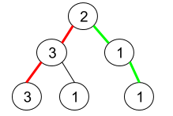
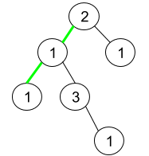

# 1457. 二叉树中的伪回文路径

Medium · 难度分 1405 · [力扣原题](https://leetcode.cn/problems/pseudo-palindromic-paths-in-a-binary-tree/)

所在刷题路径：灵神题单·链表树与回溯

| 作者 | 题解 | 动画讲解 |
|---|---|---|
| 灵茶山艾府 | [📄 题解](灵茶山艾府.md) | [▶︎ 动画（GIF）](1457%20二叉树中的伪回文路径%20·%20灵茶山艾府.gif) · [mp4 文件](1457%20二叉树中的伪回文路径%20·%20灵茶山艾府.mp4) |
| yiduobo | [📄 题解](yiduobo.md) | [▶︎ 动画（GIF）](1457%20二叉树中的伪回文路径%20·%20yiduobo.gif) · [mp4 文件](1457%20二叉树中的伪回文路径%20·%20yiduobo.mp4) |

## 动画讲解

> 动图会循环播放；想暂停、拖进度条请下载上面表格里的 mp4 文件。

### 灵茶山艾府


### yiduobo


## 题目描述

给你一棵二叉树，每个节点的值为 1 到 9 。我们称二叉树中的一条路径是 「**伪回文**」的，当它满足：路径经过的所有节点值的排列中，存在一个回文序列。

请你返回从根到叶子节点的所有路径中 **伪回文** 路径的数目。

**示例 1：**



```

输入：root = [2,3,1,3,1,null,1]
输出：2
解释：上图为给定的二叉树。总共有 3 条从根到叶子的路径：红色路径 [2,3,3] ，绿色路径 [2,1,1] 和路径 [2,3,1] 。
     在这些路径中，只有红色和绿色的路径是伪回文路径，因为红色路径 [2,3,3] 存在回文排列 [3,2,3] ，绿色路径 [2,1,1] 存在回文排列 [1,2,1] 。
```

**示例 2：**



```

输入：root = [2,1,1,1,3,null,null,null,null,null,1]
输出：1
解释：上图为给定二叉树。总共有 3 条从根到叶子的路径：绿色路径 [2,1,1] ，路径 [2,1,3,1] 和路径 [2,1] 。
     这些路径中只有绿色路径是伪回文路径，因为 [2,1,1] 存在回文排列 [1,2,1] 。
```

**示例 3：**

```

输入：root = [9]
输出：1
```

**提示：**

- 给定二叉树的节点数目在范围 `[1, 10⁵]` 内

- `1 <= Node.val <= 9`

---
[↑ 返回 1400-1499](../README.md) · [总索引](../../../索引.md) · [仓库首页](../../../README.md)
