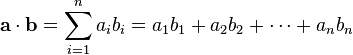

# 1458. 两个子序列的最大点积

Hard · 难度分 1824 · [力扣原题](https://leetcode.cn/problems/max-dot-product-of-two-subsequences/)

所在刷题路径：灵神核心路线、灵神题单·动态规划

| 作者 | 题解 | 动画讲解 |
|---|---|---|
| 灵茶山艾府 | [📄 题解](灵茶山艾府.md) | [▶︎ 动画（GIF）](1458%20两个子序列的最大点积%20·%20灵茶山艾府.gif) · [mp4 文件](1458%20两个子序列的最大点积%20·%20灵茶山艾府.mp4) |
| yiduobo | [📄 题解](yiduobo.md) | [▶︎ 动画（GIF）](1458%20两个子序列的最大点积%20·%20yiduobo.gif) · [mp4 文件](1458%20两个子序列的最大点积%20·%20yiduobo.mp4) |

## 动画讲解

> 动图会循环播放；想暂停、拖进度条请下载上面表格里的 mp4 文件。

### 灵茶山艾府


### yiduobo


## 题目描述

给你两个数组 `nums1` 和 `nums2` 。

请你返回 `nums1` 和 `nums2` 中两个长度相同的 **非空** 子序列的最大点积。

数组的非空子序列是通过删除原数组中某些元素（可能一个也不删除）后剩余数字组成的序列，但不能改变数字间相对顺序。比方说，`[2,3,5]` 是 `[1,2,3,4,5]` 的一个子序列而 `[1,5,3]` 不是。

**示例 1：**

```

输入：nums1 = [2,1,-2,5], nums2 = [3,0,-6]
输出：18
解释：从 nums1 中得到子序列 [2,-2] ，从 nums2 中得到子序列 [3,-6] 。
它们的点积为 (2*3 + (-2)*(-6)) = 18 。
```

**示例 2：**

```

输入：nums1 = [3,-2], nums2 = [2,-6,7]
输出：21
解释：从 nums1 中得到子序列 [3] ，从 nums2 中得到子序列 [7] 。
它们的点积为 (3*7) = 21 。
```

**示例 3：**

```

输入：nums1 = [-1,-1], nums2 = [1,1]
输出：-1
解释：从 nums1 中得到子序列 [-1] ，从 nums2 中得到子序列 [1] 。
它们的点积为 -1 。
```

**提示：**

- `1 <= nums1.length, nums2.length <= 500`

- `-1000 <= nums1[i], nums2[i] <= 1000`

**点积：**

```

定义 a = [a₁, a₂,…, a_n] 和 b = [b₁, b₂,…, b_n] 的点积为：



这里的 Σ 指示总和符号。
```

---
[↑ 返回 1400-1499](../README.md) · [总索引](../../../索引.md) · [仓库首页](../../../README.md)
