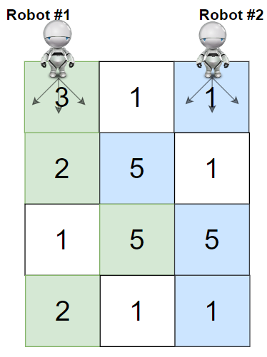
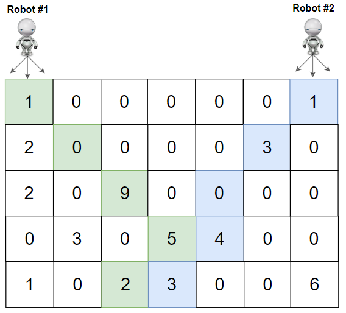

# 教你一步步思考 DP：从记忆化搜索到递推到空间优化！（Python/Java/C++/Go/JS/Rust）

> **[1463. 摘樱桃 II](https://leetcode.cn/problems/cherry-pickup-ii/solutions/2768158/jiao-ni-yi-bu-bu-si-kao-dpcong-ji-yi-hua-i70v/) · Hard**

> **所属题单**
> - [动态规划 · 二、网格图 DP](../../../刷题路径/灵神原版题单/动态规划/二、网格图%20DP.md) · §2.2 进阶

> **题目描述**
> 给你一个 `rows x cols` 的矩阵 `grid` 来表示一块樱桃地。 `grid` 中每个格子的数字表示你能获得的樱桃数目。
>
> 你有两个机器人帮你收集樱桃，机器人 1 从左上角格子 `(0,0)` 出发，机器人 2 从右上角格子 `(0, cols-1)` 出发。
>
> 请你按照如下规则，返回两个机器人能收集的最多樱桃数目：
>
> - 从格子 `(i,j)` 出发，机器人可以移动到格子 `(i+1, j-1)`，`(i+1, j)` 或者 `(i+1, j+1)` 。
>
> - 当一个机器人经过某个格子时，它会把该格子内所有的樱桃都摘走，然后这个位置会变成空格子，即没有樱桃的格子。
>
> - 当两个机器人同时到达同一个格子时，它们中只有一个可以摘到樱桃。
>
> - 两个机器人在任意时刻都不能移动到 `grid` 外面。
>
> - 两个机器人最后都要到达 `grid` 最底下一行。
>
> **示例 1：**
>
> 
>
> ```
> 输入：grid = [[3,1,1],[2,5,1],[1,5,5],[2,1,1]]
> 输出：24
> 解释：机器人 1 和机器人 2 的路径在上图中分别用绿色和蓝色表示。
> 机器人 1 摘的樱桃数目为 (3 + 2 + 5 + 2) = 12 。
> 机器人 2 摘的樱桃数目为 (1 + 5 + 5 + 1) = 12 。
> 樱桃总数为： 12 + 12 = 24 。
> ```
>
> **示例 2：**
>
> 
>
> ```
> 输入：grid = [[1,0,0,0,0,0,1],[2,0,0,0,0,3,0],[2,0,9,0,0,0,0],[0,3,0,5,4,0,0],[1,0,2,3,0,0,6]]
> 输出：28
> 解释：机器人 1 和机器人 2 的路径在上图中分别用绿色和蓝色表示。
> 机器人 1 摘的樱桃数目为 (1 + 9 + 5 + 2) = 17 。
> 机器人 2 摘的樱桃数目为 (1 + 3 + 4 + 3) = 11 。
> 樱桃总数为： 17 + 11 = 28 。
> ```
>
> **示例 3：**
>
> ```
> 输入：grid = [[1,0,0,3],[0,0,0,3],[0,0,3,3],[9,0,3,3]]
> 输出：22
> ```
>
> **示例 4：**
>
> ```
> 输入：grid = [[1,1],[1,1]]
> 输出：4
> ```
>
> **提示：**
>
> - `rows == grid.length`
>
> - `cols == grid[i].length`
>
> - `2 <= rows, cols <= 70`
>
> - `0 <= grid[i][j] <= 100 `

> **题解**
> ## 一、寻找子问题
>
> 
>
> 看示例 1，把两个机器人分别叫做 A 和 B。
>
> 我们要解决的原问题是：A 从 $(0,0)$ 出发，B 从 $(0,2)$ 出发，到达最后一行，可以得到的樱桃个数的最大值。
>
> 考虑 A 和 B 第一步怎么走，例如：
>
> - 如果 A 第一步从 $(0,0)$ 走到 $(1,0)$，B 第一步从 $(0,2)$ 走到 $(1,1)$，那么接下来要解决的问题是：A 从 $(1,0)$ 出发，B 从 $(1,1)$ 出发，到达最后一行，可以得到的樱桃个数的最大值。
> - 如果 A 第一步从 $(0,0)$ 走到 $(1,1)$，B 第一步从 $(0,2)$ 也走到 $(1,1)$，那么接下来要解决的问题是：A 和 B 都从 $(1,1)$ 出发，到达最后一行，可以得到的樱桃个数的最大值。
>
> 这些都是**和原问题相似的、规模更小的子问题**，所以可以用**递归**解决。
>
> > 注：动态规划有「选或不选」和「枚举选哪个」两种基本思考方式。在做题时，可根据题目要求，选择适合题目的一种来思考。本题用到的是「枚举选哪个」，也就是枚举机器人往哪个方向走。
>
> ## 二、状态定义与状态转移方程
>
> 定义 $\textit{dfs}(i,j,k)$ 表示 A 从 $(i,j)$ 出发，B 从 $(i,k)$ 出发，到达最后一行，可以得到的樱桃个数的最大值。
>
> 考虑 A 和 B 第一步怎么走，一共有 $3\times 3 = 9$ 种情况，例如其中一种情况为：
>
> - A 往下走，B 往左下走，那么问题变成 A 从 $(i+1,j)$ 出发，B 从 $(i+1,k-1)$ 出发，到达最后一行，可以得到的樱桃个数的最大值，即 $\textit{dfs}(i+1,j,k-1)$。
>
> 这九种情况取最大值，再加上 $\textit{grid}[i][j]$ 和 $\textit{grid}[i][k]$（$j=k$ 时只加一个），就得到了 $\textit{dfs}(i,j,k)$，即
>
> $$
> \textit{dfs}(i,j,k) = \textit{val} + \max
> \begin{cases}
> \textit{dfs}(i+1,j-1,k-1),\textit{dfs}(i+1,j-1,k),\textit{dfs}(i+1,j-1,k+1),\\
> \textit{dfs}(i+1,j,k-1),\textit{dfs}(i+1,j,k),\textit{dfs}(i+1,j,k+1),\\
> \textit{dfs}(i+1,j+1,k-1),\textit{dfs}(i+1,j+1,k),\textit{dfs}(i+1,j+1,k+1)
> \end{cases}
> $$
>
> 其中
>
> $$
> \textit{val} =
> \begin{cases}
> \textit{grid}[i][j] + \textit{grid}[i][k],\ &j\ne k\\
> \textit{grid}[i][j],\ &j=k
> \end{cases}
> $$
>
> 设 $m$ 和 $n$ 分别为 $\textit{grid}$ 的行数和列数。
>
> 递归边界：如果 $i=m,j<0,j\ge n,k<0,k\ge n$ 中的任何一个成立（出界），返回 $0$。也可以对 $i=m$ 的情况返回 $0$，其余出界情况返回 $-\infty$。
>
> 递归入口：$\textit{dfs}(0,0,n-1)$，也就是答案。
>
> ## 三、递归搜索 + 保存递归返回值 = 记忆化搜索
>
> 考虑到整个递归过程中有大量重复递归调用（递归入参相同）。由于递归函数没有副作用，同样的入参无论计算多少次，算出来的结果都是一样的，因此可以用**记忆化搜索**来优化：
>
> - 如果一个状态（递归入参）是第一次遇到，那么可以在返回前，把状态及其结果记到一个 $\textit{memo}$ 数组中。
> - 如果一个状态不是第一次遇到（$\textit{memo}$ 中保存的结果不等于 $\textit{memo}$ 的初始值），那么可以直接返回 $\textit{memo}$ 中保存的结果。
>
> **注意**：$\textit{memo}$ 数组的**初始值**一定不能等于要记忆化的值！例如初始值设置为 $0$，并且要记忆化的 $\textit{dfs}(i,j,k)$ 也等于 $0$，那就没法判断 $0$ 到底表示第一次遇到这个状态，还是表示之前遇到过了，从而导致记忆化失效。一般把初始值设置为 $-1$。
>
> > Python 用户可以无视上面这段，直接用 `@cache` 装饰器。
>
> 具体请看视频讲解 [动态规划入门：从记忆化搜索到递推](https://www.bilibili.com/video/BV1Xj411K7oF/)，其中包含如何把记忆化搜索 1:1 翻译成递推的技巧。
>
> ```python
> class Solution:
>     def cherryPickup(self, grid: List[List[int]]) -> int:
>         m, n = len(grid), len(grid[0])
>         @cache  # 缓存装饰器，避免重复计算 dfs 的结果（记忆化）
>         def dfs(i: int, j: int, k: int) -> int:
>             if i == m or j < 0 or j >= n or k < 0 or k >= n:
>                 return 0
>             return max(dfs(i + 1, j2, k2) for j2 in (j - 1, j, j + 1) for k2 in (k - 1, k, k + 1)) + \
>                    grid[i][j] + (grid[i][k] if k != j else 0)
>         return dfs(0, 0, n - 1)
> ```
>
>
> #### 复杂度分析
>
> - 时间复杂度：$\mathcal{O}(mn^2)$，其中 $m$ 和 $n$ 分别为 $\textit{grid}$ 的行数和列数。由于每个状态只会计算一次，动态规划的时间复杂度 $=$ 状态个数 $\times$ 单个状态的计算时间。本题状态个数等于 $\mathcal{O}(mn^2)$，单个状态的计算时间为 $\mathcal{O}(1)$，所以动态规划的时间复杂度为 $\mathcal{O}(mn^2)$。
> - 空间复杂度：$\mathcal{O}(mn^2)$。保存多少状态，就需要多少空间。
>
> ## 四、1:1 翻译成递推
>
> 我们可以去掉递归中的「递」，只保留「归」的部分，即自底向上计算。
>
> 具体来说，$f[i][j][k]$ 的定义和 $\textit{dfs}(i,j,k)$ 的定义是一样的，都表示 A 从 $(i,j)$ 出发，B 从 $(i,k)$ 出发，到达最后一行，可以得到的樱桃个数的最大值。
>
> 相应的递推式（状态转移方程）也和 $\textit{dfs}$ 一样：
>
> $$
> f[i][j][k] = \textit{val} + \max
> \begin{cases}
> f[i+1][j-1][k-1],f[i+1][j-1][k]f[i+1][j-1][k+1],\\
> f[i+1][j][k-1],f[i+1][j][k],f[i+1][j][k+1],\\
> f[i+1][j+1][k-1],f[i+1][j+1][k],f[i+1][j+1][k+1]
> \end{cases}
> $$
>
> 其中
>
> $$
> \textit{val} =
> \begin{cases}
> \textit{grid}[i][j] + \textit{grid}[i][k],\ &j\ne k\\
> \textit{grid}[i][j],\ &j=k
> \end{cases}
> $$
>
> 但是，这种定义方式**没有状态能表示递归边界**，即 $j=-1,\ k=-1$ 这种出界的情况。
>
> 解决办法：在每个 $f[i]$ 的最左边和最上边各插入一排状态，那么其余状态全部向右和向下偏移一位，把 $f[i][j][k]$ 改为 $f[i][j+1][k+1]$。
>
> 修改后 $f[i][j+1][k+1]$ 表示 A 从 $(i,j)$ 出发，B 从 $(i,k)$ 出发，到达最后一行，可以得到的樱桃个数的最大值。
>
> 修改后的递推式为
>
> $$
> f[i][j+1][k+1] = \textit{val} + \max
> \begin{cases}
> f[i+1][j][k],f[i+1][j][k+1],f[i+1][j][k+2],\\
> f[i+1][j+1][k],f[i+1][j+1][k+1],f[i+1][j+1][k+2],\\
> f[i+1][j+2][k],f[i+1][j+2][k+1],f[i+1][j+2][k+2]
> \end{cases}
> $$
>
> 注意我们只在 $f$ 数组上插入了状态，这只会影响 $f$ 的下标，$\textit{val}$ 的计算方式不变。
>
> 初始值 $f[i][j][k]= 0$。
>
> 答案为 $f[0][1][n]$。
>
> ### 循环范围
>
> 代码实现时，我们还需要讨论清楚 $j$ 和 $k$ 的范围。
>
> 对于 A 来说，即使从 $(0,0)$ 开始，每一步都往右下走，也不会出现 $j>i$ 的情况，所以 $j$ 的范围为
>
> $$
> 0 \le j \le \min(n-1, i)
> $$
>
> 对于 B 来说，即使从 $(0,n-1)$ 开始，每一步都往左下走，也不会出现 $k < n-1-i$ 的情况，所以 $k$ 的范围为
>
> $$
> \max(0, n-1-i) \le k \le n-1
> $$
>
> 进一步地，我们可以假定 A 走的是两条路径的左轮廓，B 走的是两条路径的右轮廓（求并集后看不出区别），所以只需计算 $k\ge j$ 的状态。
>
> 这样转换后可以发现，A 和 B 走到同一个格子是没有意义的。如果走到同一个格子 $(i,j)$，那么 A 也可以走到 $(i,j-1)$ 或者 B 也可以走到 $(i,j+1)$，从而得到更多的樱桃，所以只需计算 $k > j$ 的状态。
>
> 所以 $k$ 的范围可以进一步缩小为
>
> $$
> \max(j+1, n-1-i) \le k \le n-1
> $$
>
> 如此转换后，状态转移方程中的 $\textit{val} = \textit{grid}[i][j] + \textit{grid}[i][k]$。
>
> ```python
> class Solution:
>     def cherryPickup(self, grid: List[List[int]]) -> int:
>         m, n = len(grid), len(grid[0])
>         f = [[[0] * (n + 2) for _ in range(n + 2)] for _ in range(m + 1)]
>         for i in range(m - 1, -1, -1):
>             for j in range(min(n, i + 1)):
>                 for k in range(max(j + 1, n - 1 - i), n):
>                     f[i][j + 1][k + 1] = max(
>                         f[i + 1][j][k], f[i + 1][j][k + 1], f[i + 1][j][k + 2],
>                         f[i + 1][j + 1][k], f[i + 1][j + 1][k + 1], f[i + 1][j + 1][k + 2],
>                         f[i + 1][j + 2][k], f[i + 1][j + 2][k + 1], f[i + 1][j + 2][k + 2],
>                     ) + grid[i][j] + grid[i][k]
>         return f[0][1][n]
> ```
>
>
> #### 复杂度分析
>
> - 时间复杂度：$\mathcal{O}(mn^2)$，其中 $m$ 和 $n$ 分别为 $\textit{grid}$ 的行数和列数。
> - 空间复杂度：$\mathcal{O}(mn^2)$。
>
> ## 五、空间优化：滚动数组
>
> 观察上面的状态转移方程，在计算 $f[i]$ 时，只会用到 $f[i+1]$，不会用到 $> i+1$ 的状态。
>
> 我们可以用两个二维数组滚动计算，用 $\textit{cur}$ 表示 $f[i]$，$\textit{pre}$ 表示 $f[i+1]$，状态转移方程改为
>
> $$
> \textit{cur}[j+1][k+1] = \textit{val} + \max
> \begin{cases}
> \textit{pre}[j][k],\textit{pre}[j][k+1],\textit{pre}[j][k+2],\\
> \textit{pre}[j+1][k],\textit{pre}[j+1][k+1],\textit{pre}[j+1][k+2],\\
> \textit{pre}[j+2][k],\textit{pre}[j+2][k+1],\textit{pre}[j+2][k+2]
> \end{cases}
> $$
>
> 从 $i$ 枚举到 $i-1$ 之前，交换 $\textit{cur}$ 和 $\textit{pre}$，相当于把 $\textit{cur}$ 变成对 $i-1$ 而言的 $\textit{pre}$。
>
> ```python
> class Solution:
>     def cherryPickup(self, grid: List[List[int]]) -> int:
>         m, n = len(grid), len(grid[0])
>         pre = [[0] * (n + 2) for _ in range(n + 2)]
>         cur = [[0] * (n + 2) for _ in range(n + 2)]
>         for i in range(m - 1, -1, -1):
>             for j in range(min(n, i + 1)):
>                 for k in range(max(j + 1, n - 1 - i), n):
>                     cur[j + 1][k + 1] = max(
>                         pre[j][k], pre[j][k + 1], pre[j][k + 2],
>                         pre[j + 1][k], pre[j + 1][k + 1], pre[j + 1][k + 2],
>                         pre[j + 2][k], pre[j + 2][k + 1], pre[j + 2][k + 2],
>                     ) + grid[i][j] + grid[i][k]
>             pre, cur = cur, pre  # 下一个 i 的 pre 是 cur
>         return pre[1][n]
> ```
>
>
> #### 复杂度分析
>
> - 时间复杂度：$\mathcal{O}(mn^2)$，其中 $m$ 和 $n$ 分别为 $\textit{grid}$ 的行数和列数。
> - 空间复杂度：$\mathcal{O}(n^2)$。
>
> ## 分类题单
>
> 1. [滑动窗口（定长/不定长/多指针）](https://leetcode.cn/circle/discuss/0viNMK/)
> 2. [二分算法（二分答案/最小化最大值/最大化最小值/第K小）](https://leetcode.cn/circle/discuss/SqopEo/)
> 3. [单调栈（矩形系列/字典序最小/贡献法）](https://leetcode.cn/circle/discuss/9oZFK9/)
> 4. [网格图（DFS/BFS/综合应用）](https://leetcode.cn/circle/discuss/YiXPXW/)
> 5. [位运算（基础/性质/拆位/试填/恒等式/贪心/脑筋急转弯）](https://leetcode.cn/circle/discuss/dHn9Vk/)
> 6. [图论算法（DFS/BFS/拓扑排序/最短路/最小生成树/二分图/基环树/欧拉路径）](https://leetcode.cn/circle/discuss/01LUak/)
> 7. [动态规划（入门/背包/状态机/划分/区间/状压/数位/数据结构优化/树形/博弈/概率期望）](https://leetcode.cn/circle/discuss/tXLS3i/)
> 8. [常用数据结构（前缀和/差分/栈/队列/堆/字典树/并查集/树状数组/线段树）](https://leetcode.cn/circle/discuss/mOr1u6/)
>
> 欢迎关注 [B站@灵茶山艾府](https://space.bilibili.com/206214)
>
> [我的题解精选（已分类）](https://github.com/EndlessCheng/codeforces-go/blob/master/leetcode/SOLUTIONS.md)
