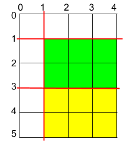

# 1465. 切割后面积最大的蛋糕

Medium · [力扣原题](https://leetcode.cn/problems/maximum-area-of-a-piece-of-cake-after-horizontal-and-vertical-cuts/)

| 作者 | 题解 | 动画讲解 |
|---|---|---|
| 灵茶山艾府 | [📄 题解](灵茶山艾府.md) | [▶︎ 1465 切割后面积最大的蛋糕 · 灵茶山艾府.mp4](1465%20切割后面积最大的蛋糕%20·%20灵茶山艾府.mp4) |
| yiduobo | [📄 题解](yiduobo.md) | [▶︎ 1465 切割后面积最大的蛋糕 · yiduobo.mp4](1465%20切割后面积最大的蛋糕%20·%20yiduobo.mp4) |

## 题目描述

矩形蛋糕的高度为 `h` 且宽度为 `w`，给你两个整数数组 `horizontalCuts` 和 `verticalCuts`，其中：

-  `horizontalCuts[i]` 是从矩形蛋糕顶部到第  `i` 个水平切口的距离

- `verticalCuts[j]` 是从矩形蛋糕的左侧到第 `j` 个竖直切口的距离

请你按数组 <em>`horizontalCuts`</em> 和 <em>`verticalCuts`</em> 中提供的水平和竖直位置切割后，请你找出 **面积最大** 的那份蛋糕，并返回其 **面积** 。由于答案可能是一个很大的数字，因此需要将结果 **对** `10⁹ + 7` **取余** 后返回。

**示例 1：**


```

输入：h = 5, w = 4, horizontalCuts = [1,2,4], verticalCuts = [1,3]
输出：4
解释：上图所示的矩阵蛋糕中，红色线表示水平和竖直方向上的切口。切割蛋糕后，绿色的那份蛋糕面积最大。
```

**示例 2：**



```

输入：h = 5, w = 4, horizontalCuts = [3,1], verticalCuts = [1]
输出：6
解释：上图所示的矩阵蛋糕中，红色线表示水平和竖直方向上的切口。切割蛋糕后，绿色和黄色的两份蛋糕面积最大。
```

**示例 3：**

```

输入：h = 5, w = 4, horizontalCuts = [3], verticalCuts = [3]
输出：9
```

**提示：**

- `2 <= h, w <= 10⁹`

- `1 <= horizontalCuts.length <= min(h - 1, 10⁵)`

- `1 <= verticalCuts.length <= min(w - 1, 10⁵)`

- `1 <= horizontalCuts[i] < h`

- `1 <= verticalCuts[i] < w`

- 题目数据保证 `horizontalCuts` 中的所有元素各不相同

- 题目数据保证 `verticalCuts` 中的所有元素各不相同

---
[↑ 返回 1400-1499](../README.md) · [总索引](../../../索引.md) · [仓库首页](../../../README.md)
