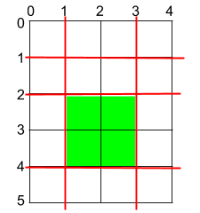

# 横切和竖切是互相独立的（Python/Java/C++/Go/JS/Rust）

> **[1465. 切割后面积最大的蛋糕](https://leetcode.cn/problems/maximum-area-of-a-piece-of-cake-after-horizontal-and-vertical-cuts/solutions/2500330/heng-qie-he-shu-qie-shi-hu-xiang-du-li-d-gywp/) · Medium**

> **题目描述**
> 矩形蛋糕的高度为 `h` 且宽度为 `w`，给你两个整数数组 `horizontalCuts` 和 `verticalCuts`，其中：
>
> -  `horizontalCuts[i]` 是从矩形蛋糕顶部到第  `i` 个水平切口的距离
>
> - `verticalCuts[j]` 是从矩形蛋糕的左侧到第 `j` 个竖直切口的距离
>
> 请你按数组 <em>`horizontalCuts`</em> 和 <em>`verticalCuts`</em> 中提供的水平和竖直位置切割后，请你找出 **面积最大** 的那份蛋糕，并返回其 **面积** 。由于答案可能是一个很大的数字，因此需要将结果 **对** `10⁹ + 7` **取余** 后返回。
>
> **示例 1：**
>
> 
>
> ```
>
> 输入：h = 5, w = 4, horizontalCuts = [1,2,4], verticalCuts = [1,3]
> 输出：4
> 解释：上图所示的矩阵蛋糕中，红色线表示水平和竖直方向上的切口。切割蛋糕后，绿色的那份蛋糕面积最大。
> ```
>
> **示例 2：**
>
> 
>
> ```
>
> 输入：h = 5, w = 4, horizontalCuts = [3,1], verticalCuts = [1]
> 输出：6
> 解释：上图所示的矩阵蛋糕中，红色线表示水平和竖直方向上的切口。切割蛋糕后，绿色和黄色的两份蛋糕面积最大。
> ```
>
> **示例 3：**
>
> ```
>
> 输入：h = 5, w = 4, horizontalCuts = [3], verticalCuts = [3]
> 输出：9
> ```
>
> **提示：**
>
> - `2 <= h, w <= 10⁹`
>
> - `1 <= horizontalCuts.length <= min(h - 1, 10⁵)`
>
> - `1 <= verticalCuts.length <= min(w - 1, 10⁵)`
>
> - `1 <= horizontalCuts[i] < h`
>
> - `1 <= verticalCuts[i] < w`
>
> - 题目数据保证 `horizontalCuts` 中的所有元素各不相同
>
> - 题目数据保证 `verticalCuts` 中的所有元素各不相同

> **题解**
> 为了算出两个**相邻**切口的距离，把 $\textit{horizontalCuts}$ 和 $\textit{verticalCuts}$ 从小到大排序。
>
> 
>
> 排序后，任意蛋糕都可以由两个相邻的水平切口和两个相邻的竖直切口决定（边界也算切口）。例如示例 1，水平切口 $2,4$ 和竖直切口 $1,3$ 就决定了面积最大的那份蛋糕。
>
> 所以蛋糕的面积可以表示为
>
> $$
> (\textit{horizontalCuts}[i] - \textit{horizontalCuts}[i-1])\cdot (\textit{verticalCuts}[j] - \textit{verticalCuts}[j-1])
> $$
>
> 由于相乘的两项是**互相独立**的，只需要分别算出 $\textit{horizontalCuts}[i] - \textit{horizontalCuts}[i-1]$ 的最大值和 $\textit{verticalCuts}[j] - \textit{verticalCuts}[j-1]$ 的最大值，就得到了蛋糕面积的最大值。
>
> 也可以这样理解，先横着切，那么间隔最大的那两刀，就决定了最大的那**条**蛋糕，它包含着最终面积最大的那份蛋糕。接下来只需要知道竖着切时，两刀的最大间隔是多少，就知道了蛋糕的最大面积。
>
> ```python
> class Solution:
>     def maxArea(self, h: int, w: int, horizontalCuts: List[int], verticalCuts: List[int]) -> int:
>         horizontalCuts = [0] + sorted(horizontalCuts) + [h]
>         verticalCuts = [0] + sorted(verticalCuts) + [w]
>         max_h = max(q - p for p, q in pairwise(horizontalCuts))
>         max_w = max(q - p for p, q in pairwise(verticalCuts))
>         return max_h * max_w % (10 ** 9 + 7)
> ```
>
>
> #### 复杂度分析
>
> - 时间复杂度：$\mathcal{O}(n\log n + m\log m)$，其中 $n$ 为 $\textit{horizontalCuts}$ 的长度，$m$ 为 $\textit{verticalCuts}$ 的长度。瓶颈在排序上。
> - 空间复杂度：$\mathcal{O}(n)$ 或 $\mathcal{O}(1)$。
>
> 欢迎关注 [B站@灵茶山艾府](https://space.bilibili.com/206214)
>
> 更多精彩题解，请看 [往期题解精选（已分类）](https://github.com/EndlessCheng/codeforces-go/blob/master/leetcode/SOLUTIONS.md)
