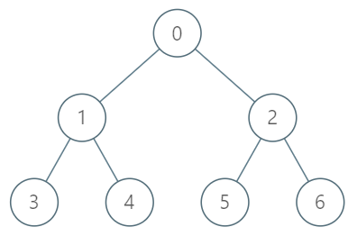

# 1483. 树节点的第 K 个祖先

Hard · 难度分 2115 · [力扣原题](https://leetcode.cn/problems/kth-ancestor-of-a-tree-node/)

所在刷题路径：灵神题单·链表树与回溯

| 作者 | 题解 | 动画讲解 |
|---|---|---|
| 灵茶山艾府 | [📄 题解](灵茶山艾府.md) | [▶︎ 动画（GIF）](1483%20树节点的第%20K%20个祖先%20·%20灵茶山艾府.gif) · [mp4 文件](1483%20树节点的第%20K%20个祖先%20·%20灵茶山艾府.mp4) |
| yiduobo | [📄 题解](yiduobo.md) | [▶︎ 动画（GIF）](1483%20树节点的第%20K%20个祖先%20·%20yiduobo.gif) · [mp4 文件](1483%20树节点的第%20K%20个祖先%20·%20yiduobo.mp4) |

## 动画讲解

> 动图会循环播放；想暂停、拖进度条请下载上面表格里的 mp4 文件。

### 灵茶山艾府


### yiduobo


## 题目描述

给你一棵树，树上有 `n` 个节点，按从 `0` 到 `n-1` 编号。树以父节点数组的形式给出，其中 `parent[i]` 是节点 `i` 的父节点。树的根节点是编号为 `0` 的节点。

树节点的第 <em>`k`</em> 个祖先节点是从该节点到根节点路径上的第 `k` 个节点。

实现 `TreeAncestor` 类：

- `TreeAncestor（int n， int[] parent）` 对树和父数组中的节点数初始化对象。

- `getKthAncestor``(int node, int k)` 返回节点 `node` 的第 `k` 个祖先节点。如果不存在这样的祖先节点，返回 `-1` 。

**示例 1：**



```

输入：
["TreeAncestor","getKthAncestor","getKthAncestor","getKthAncestor"]
[[7,[-1,0,0,1,1,2,2]],[3,1],[5,2],[6,3]]

输出：
[null,1,0,-1]

解释：
TreeAncestor treeAncestor = new TreeAncestor(7, [-1, 0, 0, 1, 1, 2, 2]);

treeAncestor.getKthAncestor(3, 1);  // 返回 1 ，它是 3 的父节点
treeAncestor.getKthAncestor(5, 2);  // 返回 0 ，它是 5 的祖父节点
treeAncestor.getKthAncestor(6, 3);  // 返回 -1 因为不存在满足要求的祖先节点
```

**提示：**

- `1 <= k <= n <= 5 * 10⁴`

- `parent[0] == -1` 表示编号为 `0` 的节点是根节点。

- 对于所有的 `0 < i < n` ，`0 <= parent[i] < n` 总成立

- `0 <= node < n`

- 至多查询 `5 * 10⁴` 次

---
[↑ 返回 1400-1499](../README.md) · [总索引](../../../索引.md) · [仓库首页](../../../README.md)
