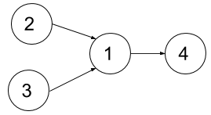

# 1494. 并行课程 II

Hard · [力扣原题](https://leetcode.cn/problems/parallel-courses-ii/)

所在刷题路径：灵神题单·动态规划

| 作者 | 题解 | 动画讲解 |
|---|---|---|
| 灵茶山艾府 | [📄 题解](灵茶山艾府.md) | [▶︎ 1494 并行课程 II · 灵茶山艾府.mp4](1494%20并行课程%20II%20·%20灵茶山艾府.mp4) |
| yiduobo | [📄 题解](yiduobo.md) | [▶︎ 1494 并行课程 II · yiduobo.mp4](1494%20并行课程%20II%20·%20yiduobo.mp4) |

## 题目描述

给你一个整数 `n` 表示某所大学里课程的数目，编号为 `1` 到 `n` ，数组 `relations` 中， `relations[i] = [x_i, y_i]`  表示一个先修课的关系，也就是课程 `x_i` 必须在课程 `y_i`<sub> </sub>之前上。同时你还有一个整数 `k` 。

在一个学期中，你 **最多** 可以同时上 `k` 门课，前提是这些课的先修课在之前的学期里已经上过了。

请你返回上完所有课最少需要多少个学期。题目保证一定存在一种上完所有课的方式。

**示例 1：**



```

输入：n = 4, relations = [[2,1],[3,1],[1,4]], k = 2
输出：3
解释：上图展示了题目输入的图。在第一个学期中，我们可以上课程 2 和课程 3 。然后第二个学期上课程 1 ，第三个学期上课程 4 。
```

**示例 2：**


```

输入：n = 5, relations = [[2,1],[3,1],[4,1],[1,5]], k = 2
输出：4
解释：上图展示了题目输入的图。一个最优方案是：第一学期上课程 2 和 3，第二学期上课程 4 ，第三学期上课程 1 ，第四学期上课程 5 。
```

**示例 3：**

```

输入：n = 11, relations = [], k = 2
输出：6
```

**提示：**

- `1 <= n <= 15`

- `1 <= k <= n`

- `0 <= relations.length <= n * (n-1) / 2`

- `relations[i].length == 2`

- `1 <= x_i, y_i <= n`

- `x_i != y_i`

- 所有先修关系都是不同的，也就是说 `relations[i] != relations[j]` 。

- 题目输入的图是个有向无环图。

---
[↑ 返回 1400-1499](../README.md) · [总索引](../../../索引.md) · [仓库首页](../../../README.md)
