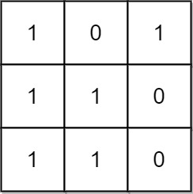

# 1504. 统计全 1 子矩形

Medium · [力扣原题](https://leetcode.cn/problems/count-submatrices-with-all-ones/)

所在刷题路径：灵神题单·单调栈

| 作者 | 题解 | 动画讲解 |
|---|---|---|
| 灵茶山艾府 | [📄 题解](灵茶山艾府.md) | [▶︎ 动画（GIF）](1504%20统计全%201%20子矩形%20·%20灵茶山艾府.gif) · [mp4 文件](1504%20统计全%201%20子矩形%20·%20灵茶山艾府.mp4) |
| yiduobo | [📄 题解](yiduobo.md) | [▶︎ 动画（GIF）](1504%20统计全%201%20子矩形%20·%20yiduobo.gif) · [mp4 文件](1504%20统计全%201%20子矩形%20·%20yiduobo.mp4) |

## 动画讲解

> 动图会循环播放；想暂停、拖进度条请下载上面表格里的 mp4 文件。

### 灵茶山艾府


### yiduobo


## 题目描述

给你一个 `m x n` 的二进制矩阵 `mat` ，请你返回有多少个 **子矩形** 的元素全部都是 1 。

**示例 1：**



```

输入：mat = [[1,0,1],[1,1,0],[1,1,0]]
输出：13
解释：
有 6 个 1x1 的矩形。
有 2 个 1x2 的矩形。
有 3 个 2x1 的矩形。
有 1 个 2x2 的矩形。
有 1 个 3x1 的矩形。
矩形数目总共 = 6 + 2 + 3 + 1 + 1 = 13 。
```

**示例 2：**


```

输入：mat = [[0,1,1,0],[0,1,1,1],[1,1,1,0]]
输出：24
解释：
有 8 个 1x1 的子矩形。
有 5 个 1x2 的子矩形。
有 2 个 1x3 的子矩形。
有 4 个 2x1 的子矩形。
有 2 个 2x2 的子矩形。
有 2 个 3x1 的子矩形。
有 1 个 3x2 的子矩形。
矩形数目总共 = 8 + 5 + 2 + 4 + 2 + 2 + 1 = 24 。
```

**提示：**

- `1 <= m, n <= 150`

- `mat[i][j]` 仅包含 `0` 或 `1`

---
[↑ 返回 1500-1599](../README.md) · [总索引](../../../索引.md) · [仓库首页](../../../README.md)
