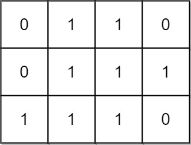
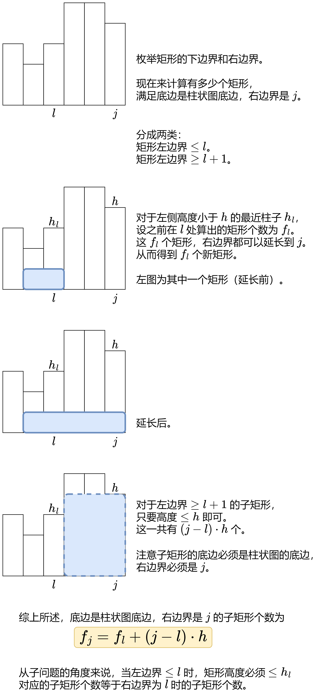

# 【图解】两种方法：枚举上下边界 / 单调栈（Python/Java/C++/Go）

> **[1504. 统计全 1 子矩形](https://leetcode.cn/problems/count-submatrices-with-all-ones/solutions/3704971/omn-dan-diao-zhan-pythonjavacgo-by-endle-jf8l/) · Medium**

> **所属题单**
> - [单调栈 · 二、矩形](../../../刷题路径/灵神原版题单/单调栈/二、矩形.md)

> **题目描述**
> 给你一个 `m x n` 的二进制矩阵 `mat` ，请你返回有多少个 **子矩形** 的元素全部都是 1 。
>
> **示例 1：**
>
> 
>
> ```
>
> 输入：mat = [[1,0,1],[1,1,0],[1,1,0]]
> 输出：13
> 解释：
> 有 6 个 1x1 的矩形。
> 有 2 个 1x2 的矩形。
> 有 3 个 2x1 的矩形。
> 有 1 个 2x2 的矩形。
> 有 1 个 3x1 的矩形。
> 矩形数目总共 = 6 + 2 + 3 + 1 + 1 = 13 。
> ```
>
> **示例 2：**
>
> 
>
> ```
>
> 输入：mat = [[0,1,1,0],[0,1,1,1],[1,1,1,0]]
> 输出：24
> 解释：
> 有 8 个 1x1 的子矩形。
> 有 5 个 1x2 的子矩形。
> 有 2 个 1x3 的子矩形。
> 有 4 个 2x1 的子矩形。
> 有 2 个 2x2 的子矩形。
> 有 2 个 3x1 的子矩形。
> 有 1 个 3x2 的子矩形。
> 矩形数目总共 = 8 + 5 + 2 + 4 + 2 + 2 + 1 = 24 。
> ```
>
> **提示：**
>
> - `1 <= m, n <= 150`
>
> - `mat[i][j]` 仅包含 `0` 或 `1`

> **题解**
> ## 方法一：枚举子矩形的上下边界
>
> 枚举子矩形的上下边界，统计每一列的 $1$ 的个数，把原问题「压缩」为一维数组上的问题。
>
> 
>
> 在示例 2 中，假设现在枚举到子矩形的上边界为 $0$ 行，下边界为 $1$ 行，即 $\textit{mat}$ 的前两行。子矩形的高 $h=2$。
>
> 统计每一列的 $1$ 的个数，得到一个一维数组 $a=[0,2,2,1]$。我们要找的子矩形，就是 $a$ 的子数组。由于全 $1$ 子矩形的每一列都是 $1$，所以子数组的每一项都得是子矩形的高 $h=2$。问题变成：
>
> - 统计 $a$ 的全 $h$ 子数组的数目。
>
> 做法同 [2348. 全 0 子数组的数目](https://leetcode.cn/problems/number-of-zero-filled-subarrays/)。
>
> 代码实现时，外层循环枚举上边界，内层循环枚举下边界。当下边界 $\textit{bottom}$ 加一时，只需把每个 $a[j]$ 都增加相应的 $\textit{mat}[\textit{bottom}][j]$，无需整个重新统计。
>
> ```python
> class Solution:
>     def numSubmat(self, mat: List[List[int]]) -> int:
>         m, n = len(mat), len(mat[0])
>         ans = 0
>         for top in range(m):  # 枚举上边界
>             a = [0] * n
>             for bottom in range(top, m):  # 枚举下边界
>                 h = bottom - top + 1  # 高
>                 # 2348. 全 h 子数组的数目
>                 last = -1
>                 for j in range(n):
>                     a[j] += mat[bottom][j]  # 把 bottom 这一行的值加到 a 中
>                     if a[j] != h:
>                         last = j  # 记录上一个非 h 元素的位置
>                     else:
>                         ans += j - last
>         return ans
> ```
>
>
> #### 复杂度分析
>
> - 时间复杂度：$\mathcal{O}(m^2n)$，其中 $m$ 和 $n$ 分别为 $\textit{mat}$ 的行数和列数。
> - 空间复杂度：$\mathcal{O}(n)$。
>
> ## 方法二：单调栈
>
> **前置题目**：[85. 最大矩形](https://leetcode.cn/problems/maximal-rectangle/)，接着 [我的题解](../../0000-0099/0085%20最大矩形/灵茶山艾府.md) 继续讲。
>
> 枚举子矩形的**右下角**（枚举底边，枚举右边界），有多少个对应的子矩形？
>
> 
>
> 举个例子。
>
> 
>
> 在示例 2 中，当我们枚举到最后一行时，柱子高度为 $\textit{heights}=[1,3,3,0]$。然后枚举子矩形的右边界：
>
> - 右边界为 $j=0$，子矩形只有 $1$ 个。
> - 右边界为 $j=1$，子矩形分成两类：
>   - 左边界 $<1$。在右边界为 $j=0$ 时我们算出这有 $1$ 个，现在将其右边界扩展到 $j=1$，得到 $1$ 个新的子矩形。
>   - 左边界 $\ge 1$。左边界只能是 $1$，矩形高度有 $1,2,3$ 共 $3$ 种，有 $1\times 3=3$ 个子矩形。
> - 右边界为 $j=2$，子矩形分成两类：
>     - 左边界 $<1$。在右边界为 $j=0$ 时我们算出这有 $1$ 个，现在将其右边界扩展到 $j=2$，得到 $1$ 个新的子矩形。
>     - 左边界 $\ge 1$。左边界可以是 $1,2$ 共 $2$ 种，矩形高度有 $1,2,3$ 共 $3$ 种，有 $2\times 3=6$ 个子矩形。
> - 右边界为 $j=3$，高度为 $0$，没有子矩形。
>
> 一般地，用 [单调栈](https://www.bilibili.com/video/BV1VN411J7S7/) 计算小于 $\textit{heights}[j]$ 的左边最近柱子的位置 $\textit{left}$，把子矩形分成两类：
>
> - 左边界 $\le \textit{left}$。假设在右边界为 $j=\textit{left}$ 时我们算出这有 $f$ 个，现在将其右边界扩展到 $j$，得到 $f$ 个新的子矩形。
> - 左边界 $> \textit{left}$。矩形左边界可以是 $\textit{left}+1,\textit{left}+2,\ldots,j$，共 $j-\textit{left}$ 种；矩形高度可以是 $1,2,\ldots,\textit{heights}[j]$，共 $\textit{heights}[j]$ 种。所以有 $(j-\textit{left})\cdot \textit{heights}[j]$ 个子矩形。
> - 二者相加，就是右边界在 $j$ 的子矩形个数。加到答案中。
>
> ```python
> class Solution:
>     def numSubmat(self, mat: List[List[int]]) -> int:
>         heights = [0] * len(mat[0])
>         ans = 0
>         for row in mat:
>             for j, x in enumerate(row):
>                 if x == 0:
>                     heights[j] = 0
>                 else:
>                     heights[j] += 1
>
>             # (j, f, heights[j])
>             st = [(-1, 0, -1)]  # 哨兵，方便处理 left=-1 的情况
>             for j, h in enumerate(heights):
>                 while st[-1][2] >= h:
>                     st.pop()
>                 left, f, _ = st[-1]
>                 # 计算底边为 row，右边界为 j 的子矩形个数
>                 # 左边界 <= left 的矩形，每个矩形的右边界都可以扩展到 j，一共有 f 个
>                 # 左边界 >  left 的矩形，左边界有 j-left 种，高度有 h 种，一共有 (j-left)*h 个
>                 f += (j - left) * h
>                 ans += f
>                 st.append((j, f, h))
>         return ans
> ```
>
>
> #### 复杂度分析
>
> - 时间复杂度：$\mathcal{O}(mn)$，其中 $m$ 和 $n$ 分别为 $\textit{mat}$ 的行数和列数。
> - 空间复杂度：$\mathcal{O}(n)$。
>
> ## 相似题目
>
> 见下面单调栈题单的「**二、矩形**」。
>
> ## 分类题单
>
> [如何科学刷题？](https://leetcode.cn/circle/discuss/RvFUtj/)
>
> 1. [滑动窗口与双指针（定长/不定长/单序列/双序列/三指针/分组循环）](https://leetcode.cn/circle/discuss/0viNMK/)
> 2. [二分算法（二分答案/最小化最大值/最大化最小值/第K小）](https://leetcode.cn/circle/discuss/SqopEo/)
> 3. [单调栈（基础/矩形面积/贡献法/最小字典序）](https://leetcode.cn/circle/discuss/9oZFK9/)
> 4. [网格图（DFS/BFS/综合应用）](https://leetcode.cn/circle/discuss/YiXPXW/)
> 5. [位运算（基础/性质/拆位/试填/恒等式/思维）](https://leetcode.cn/circle/discuss/dHn9Vk/)
> 6. [图论算法（DFS/BFS/拓扑排序/基环树/最短路/最小生成树/网络流）](https://leetcode.cn/circle/discuss/01LUak/)
> 7. [动态规划（入门/背包/划分/状态机/区间/状压/数位/数据结构优化/树形/博弈/概率期望）](https://leetcode.cn/circle/discuss/tXLS3i/)
> 8. [常用数据结构（前缀和/差分/栈/队列/堆/字典树/并查集/树状数组/线段树）](https://leetcode.cn/circle/discuss/mOr1u6/)
> 9. [数学算法（数论/组合/概率期望/博弈/计算几何/随机算法）](https://leetcode.cn/circle/discuss/IYT3ss/)
> 10. [贪心与思维（基本贪心策略/反悔/区间/字典序/数学/思维/脑筋急转弯/构造）](https://leetcode.cn/circle/discuss/g6KTKL/)
> 11. [链表、二叉树与回溯（前后指针/快慢指针/DFS/BFS/直径/LCA/一般树）](https://leetcode.cn/circle/discuss/K0n2gO/)
> 12. [字符串（KMP/Z函数/Manacher/字符串哈希/AC自动机/后缀数组/子序列自动机）](https://leetcode.cn/circle/discuss/SJFwQI/)
>
> [我的题解精选（已分类）](https://github.com/EndlessCheng/codeforces-go/blob/master/leetcode/SOLUTIONS.md)
>
> 欢迎关注 [B站@灵茶山艾府](https://space.bilibili.com/206214)
