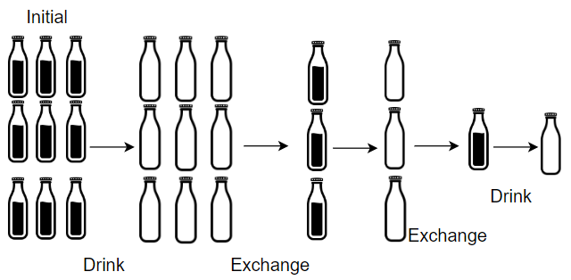
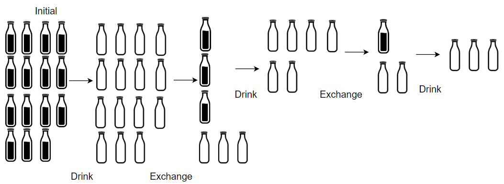

# 两种方法：模拟 / O(1) 数学公式（Python/Java/C++/C/Go/JS/Rust）

> **[1518. 换水问题](https://leetcode.cn/problems/water-bottles/solutions/3789838/liang-chong-fang-fa-mo-ni-o1-shu-xue-gon-m6ns/) · Easy**

> **题目描述**
> 超市正在促销，你可以用 `numExchange` 个空水瓶从超市兑换一瓶水。最开始，你一共购入了 `numBottles` 瓶水。
>
> 如果喝掉了水瓶中的水，那么水瓶就会变成空的。
>
> 给你两个整数 `numBottles` 和 `numExchange` ，返回你 **最多** 可以喝到多少瓶水。
>
> **示例 1：**
>
> 
>
> ```
>
> 输入：numBottles = 9, numExchange = 3
> 输出：13
> 解释：你可以用 3 个空瓶兑换 1 瓶水。
> 所以最多能喝到 9 + 3 + 1 = 13 瓶水。
> ```
>
> **示例 2：**
>
> 
>
> ```
>
> 输入：numBottles = 15, numExchange = 4
> 输出：19
> 解释：你可以用 4 个空瓶兑换 1 瓶水。
> 所以最多能喝到 15 + 3 + 1 = 19 瓶水。
> ```
>
> **提示：**
>
> - `1 <= numBottles <= 100`
>
> - `2 <= numExchange <= 100`

> **题解**
> ## 方法一：模拟
>
> 根据题意，如果 $\textit{numBottles}\ge \textit{numExchange}$，那么我们可以用 $\textit{numExchange}$ 瓶水换 $1$ 瓶水，在这个过程中：
>
> - 我们喝了 $\textit{numExchange}$ 瓶水。
> - 我们手中持有的水瓶个数减少了 $\textit{numExchange}$，然后增加了 $1$。相当于把 $\textit{numBottles}$ 减少了 $\textit{numExchange}-1$。
>
> 按照上述过程模拟，循环直到 $\textit{numBottles} < \textit{numExchange}$。
>
> 最后，把剩下的 $\textit{numBottles}$ 瓶水全部喝完。
>
> ```python
> class Solution:
>     def numWaterBottles(self, numBottles: int, numExchange: int) -> int:
>         ans = 0
>         while numBottles >= numExchange:
>             ans += numExchange  # 吨吨吨~
>             numBottles -= numExchange - 1
>         return ans + numBottles
> ```
>
>
> #### 复杂度分析
>
> - 时间复杂度：$\mathcal{O}\left(\dfrac{\textit{numBottles}}{\textit{numExchange}}\right)$。
> - 空间复杂度：$\mathcal{O}(1)$。
>
> ## 方法二：数学公式
>
> 上面代码循环了多少次，就额外得到了多少瓶水。
>
> 所以答案为 $\textit{numBottles}$ 加上循环次数。
>
> 设 $k$ 为上面代码的循环次数（额外得到的水瓶数）。循环 $k$ 次后剩余瓶子数小于 $\textit{numExchange}$，即
>
> $$
> \textit{numBottles} - k\cdot(\textit{numExchange} - 1) < \textit{numExchange}
> $$
>
> 解得
>
> $$
> k > \dfrac{\textit{numBottles} - \textit{numExchange}}{\textit{numExchange} - 1}
> $$
>
> 由于 $k$ 是整数，所以 $k$ 为
>
> $$
> \left\lfloor\dfrac{\textit{numBottles} - \textit{numExchange}}{\textit{numExchange} - 1}\right\rfloor + 1 = \left\lfloor\dfrac{\textit{numBottles} - 1}{\textit{numExchange} - 1}\right\rfloor
> $$
>
> 所以我们可以通过兑换，多喝 $\left\lfloor\dfrac{\textit{numBottles} - 1}{\textit{numExchange} - 1}\right\rfloor$ 瓶水，所以答案为
>
> $$
> \textit{numBottles} + \left\lfloor\dfrac{\textit{numBottles} - 1}{\textit{numExchange} - 1}\right\rfloor
> $$
>
> ```python
> class Solution:
>     def numWaterBottles(self, numBottles: int, numExchange: int) -> int:
>         return numBottles + (numBottles - 1) // (numExchange - 1)
> ```
>
>
> #### 复杂度分析
>
> - 时间复杂度：$\mathcal{O}(1)$。
> - 空间复杂度：$\mathcal{O}(1)$。
>
> ## 分类题单
>
> [如何科学刷题？](https://leetcode.cn/circle/discuss/RvFUtj/)
>
> 1. [滑动窗口与双指针（定长/不定长/单序列/双序列/三指针/分组循环）](https://leetcode.cn/circle/discuss/0viNMK/)
> 2. [二分算法（二分答案/最小化最大值/最大化最小值/第K小）](https://leetcode.cn/circle/discuss/SqopEo/)
> 3. [单调栈（基础/矩形面积/贡献法/最小字典序）](https://leetcode.cn/circle/discuss/9oZFK9/)
> 4. [网格图（DFS/BFS/综合应用）](https://leetcode.cn/circle/discuss/YiXPXW/)
> 5. [位运算（基础/性质/拆位/试填/恒等式/思维）](https://leetcode.cn/circle/discuss/dHn9Vk/)
> 6. [图论算法（DFS/BFS/拓扑排序/基环树/最短路/最小生成树/网络流）](https://leetcode.cn/circle/discuss/01LUak/)
> 7. [动态规划（入门/背包/划分/状态机/区间/状压/数位/数据结构优化/树形/博弈/概率期望）](https://leetcode.cn/circle/discuss/tXLS3i/)
> 8. [常用数据结构（前缀和/差分/栈/队列/堆/字典树/并查集/树状数组/线段树）](https://leetcode.cn/circle/discuss/mOr1u6/)
> 9. [数学算法（数论/组合/概率期望/博弈/计算几何/随机算法）](https://leetcode.cn/circle/discuss/IYT3ss/)
> 10. [贪心与思维（基本贪心策略/反悔/区间/字典序/数学/思维/脑筋急转弯/构造）](https://leetcode.cn/circle/discuss/g6KTKL/)
> 11. [链表、二叉树与回溯（前后指针/快慢指针/DFS/BFS/直径/LCA/一般树）](https://leetcode.cn/circle/discuss/K0n2gO/)
> 12. [字符串（KMP/Z函数/Manacher/字符串哈希/AC自动机/后缀数组/子序列自动机）](https://leetcode.cn/circle/discuss/SJFwQI/)
>
> [我的题解精选（已分类）](https://github.com/EndlessCheng/codeforces-go/blob/master/leetcode/SOLUTIONS.md)
>
> 欢迎关注 [B站@灵茶山艾府](https://space.bilibili.com/206214)
