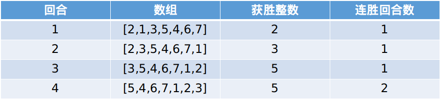

# 模拟，附若干进阶问题（Python/Java/C++/C/Go/JS/Rust）

> **[1535. 找出数组游戏的赢家](https://leetcode.cn/problems/find-the-winner-of-an-array-game/solutions/2773465/mo-ni-fu-ruo-gan-jin-jie-wen-ti-pythonja-zx17/) · Medium**

> **题目描述**
> 给你一个由 **不同** 整数组成的整数数组 `arr` 和一个整数 `k` 。
>
> 每回合游戏都在数组的前两个元素（即 `arr[0]` 和 `arr[1]` ）之间进行。比较 `arr[0]` 与 `arr[1]` 的大小，较大的整数将会取得这一回合的胜利并保留在位置 `0` ，较小的整数移至数组的末尾。当一个整数赢得 `k` 个连续回合时，游戏结束，该整数就是比赛的 **赢家** 。
>
> 返回赢得比赛的整数。
>
> 题目数据 **保证** 游戏存在赢家。
>
> **示例 1：**
>
> ```
> 输入：arr = [2,1,3,5,4,6,7], k = 2
> 输出：5
> 解释：一起看一下本场游戏每回合的情况：
>
> 
>
> 因此将进行 4 回合比赛，其中 5 是赢家，因为它连胜 2 回合。
> ```
>
> **示例 2：**
>
> ```
> 输入：arr = [3,2,1], k = 10
> 输出：3
> 解释：3 将会在前 10 个回合中连续获胜。
> ```
>
> **示例 3：**
>
> ```
> 输入：arr = [1,9,8,2,3,7,6,4,5], k = 7
> 输出：9
> ```
>
> **示例 4：**
>
> ```
> 输入：arr = [1,11,22,33,44,55,66,77,88,99], k = 1000000000
> 输出：99
> ```
>
> **提示：**
>
> - `2 <= arr.length <= 10^5`
>
> - `1 <= arr[i] <= 10^6`
>
> - `arr` 所含的整数 **各不相同** 。
>
> - `1 <= k <= 10^9`

> **题解**
> 由于较小的元素会移至数组的末尾，在重新遇到被移至数组末尾的元素之前，$\textit{arr}$ 的每个元素都会被访问到。
>
> 考察游戏执行的流程，本质上是在从左到右遍历 $\textit{arr}$，求数组最大值（打擂台）。我们要找**首个**连续 $k$ 回合都是最大值的数。
>
> 示例 1 的 $\textit{arr}=[2,1,3,5,4,6,7],\ k=2$，从左到右遍历的过程中，历史最大值依次为 $2,3,5,6,7$，其中元素 $5$ 是首个连续 $k$ 回合都是最大值的数。
>
> > 注：如果把下标 $0$ 也算上的话，$\textit{arr}[0]=2$ 要连续 $k+1=3$ 个回合都是最大值才能算作答案。
>
> 如果遍历完 $\textit{arr}$ 也没找到这样的数，那么答案就是 $\textit{arr}$ 的最大值 $\textit{mx}$，因为此时比 $\textit{mx}$ 小的数都会移到 $\textit{mx}$ 的右边，所以后面比大小都是 $\textit{mx}$ 胜利。
>
> 具体算法如下：
>
> 1. 初始化 $\textit{mx}=\textit{arr}[0],\ \textit{win}=0$，从 $\textit{arr}[1]$ 开始遍历数组。其中 $\textit{win}$ 用来统计 $\textit{mx}$ 连续多少个回合是最大值（获胜）。
> 2. 如果 $\textit{arr}[i]>\textit{mx}$，更新 $\textit{mx}=\textit{arr}[i]$ 以及 $\textit{win}=0$。
> 3. 把 $\textit{win}$ 加一，如果 $\textit{win}=k$ 就退出循环。
> 4. 遍历结束（或者中途退出循环），返回 $\textit{mx}$。
>
> > 注：由于从 $\textit{arr}[1]$ 开始遍历没法用 foreach 语法糖，也可以初始化 $\textit{win}=-1$，从 $\textit{arr}[0]$ 开始遍历。
>
> ```python
> class Solution:
>     def getWinner(self, arr: List[int], k: int) -> int:
>         mx = arr[0]
>         win = -1  # 对于 arr[0] 来说，需要连续 k+1 个回合都是最大值
>         for x in arr:
>             if x > mx:  # 新的最大值
>                 mx = x
>                 win = 0
>             win += 1  # 获胜回合 +1
>             if win == k:
>                 break
>         return mx
> ```
>
>
> #### 复杂度分析
>
> - 时间复杂度：$\mathcal{O}(n)$，其中 $n$ 为 $\textit{nums}$ 的长度。
> - 空间复杂度：$\mathcal{O}(1)$。
>
> ## 进阶问题
>
> 1. 返回一个长为 $n$ 的数组 $\textit{answer}$，其中 $\textit{answer}[i]$ 等于删除 $\textit{arr}[i]$ 后，剩余 $n-1$ 个数按照原题计算出的答案。输入保证 $n\ge 3$。
> 2. 在原问题的基础上，额外输入一个长为 $q\ (q \le 10^5)$ 的询问数组 $\textit{queries}$，其中 $\textit{queries}[i] = [\textit{left}_i, \textit{right}_i]$。返回一个长为 $q$ 的数组 $\textit{answer}$，其中 $\textit{answer}[i]$ 等于把 $\textit{arr}$ 的下标在 $[\textit{left}_i, \textit{right}_i]$ 的这一段连续子数组，按照原题计算出的答案。保证子数组长度至少为 $2$。
> 3. 在 2 的基础上，如果还可以修改 $\textit{arr}[i]$，要怎么做？（单点修改，保证修改后 $\textit{arr}$ 元素仍然互不相同。）
>
> 欢迎在评论区分享你的思路/代码。
>
> ## 分类题单
>
> [如何科学刷题？](https://leetcode.cn/circle/discuss/RvFUtj/)
>
> 1. [滑动窗口与双指针（定长/不定长/单序列/双序列/三指针/分组循环）](https://leetcode.cn/circle/discuss/0viNMK/)
> 2. [二分算法（二分答案/最小化最大值/最大化最小值/第K小）](https://leetcode.cn/circle/discuss/SqopEo/)
> 3. [单调栈（基础/矩形面积/贡献法/最小字典序）](https://leetcode.cn/circle/discuss/9oZFK9/)
> 4. [网格图（DFS/BFS/综合应用）](https://leetcode.cn/circle/discuss/YiXPXW/)
> 5. [位运算（基础/性质/拆位/试填/恒等式/思维）](https://leetcode.cn/circle/discuss/dHn9Vk/)
> 6. [图论算法（DFS/BFS/拓扑排序/基环树/最短路/最小生成树/网络流）](https://leetcode.cn/circle/discuss/01LUak/)
> 7. [动态规划（入门/背包/划分/状态机/区间/状压/数位/数据结构优化/树形/博弈/概率期望）](https://leetcode.cn/circle/discuss/tXLS3i/)
> 8. [常用数据结构（前缀和/差分/栈/队列/堆/字典树/并查集/树状数组/线段树）](https://leetcode.cn/circle/discuss/mOr1u6/)
> 9. [数学算法（数论/组合/概率期望/博弈/计算几何/随机算法）](https://leetcode.cn/circle/discuss/IYT3ss/)
> 10. [贪心与思维（基本贪心策略/反悔/区间/字典序/数学/思维/脑筋急转弯/构造）](https://leetcode.cn/circle/discuss/g6KTKL/)
> 11. [链表、树与回溯（前后指针/快慢指针/DFS/BFS/直径/LCA）](https://leetcode.cn/circle/discuss/K0n2gO/)
> 12. [字符串（KMP/Z函数/Manacher/字符串哈希/AC自动机/后缀数组/子序列自动机）](https://leetcode.cn/circle/discuss/SJFwQI/)
>
> [我的题解精选（已分类）](https://github.com/EndlessCheng/codeforces-go/blob/master/leetcode/SOLUTIONS.md)
>
> 欢迎关注 [B站@灵茶山艾府](https://space.bilibili.com/206214)
