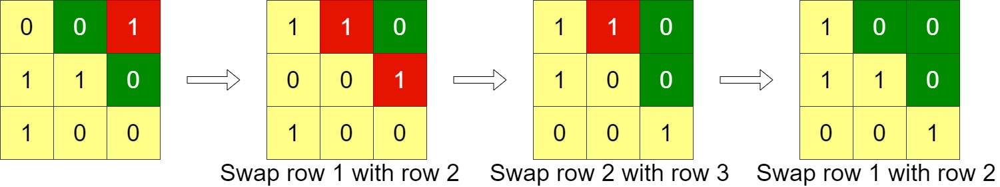
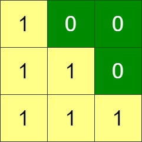

# 冒泡排序（Python/Java/C++/C/Go/JS/Rust）

> **[1536. 排布二进制网格的最少交换次数](https://leetcode.cn/problems/minimum-swaps-to-arrange-a-binary-grid/solutions/3904289/mou-pao-pai-xu-pythonjavaccgojsrust-by-e-m30j/) · Medium · 难度分 1881**

> **所属题单**
> - [贪心算法 · 一、贪心策略](../../../刷题路径/灵神原版题单/贪心算法/一、贪心策略.md) · §1.4 从最左/最右开始贪心

> **题目描述**
> 给你一个 `n x n` 的二进制网格 `grid`，每一次操作中，你可以选择网格的 **相邻两行** 进行交换。
>
> 一个符合要求的网格需要满足主对角线以上的格子全部都是 **0** 。
>
> 请你返回使网格满足要求的最少操作次数，如果无法使网格符合要求，请你返回 **-1** 。
>
> 主对角线指的是从 `(1, 1)` 到 `(n, n)` 的这些格子。
>
> **示例 1：**
>
> 
>
> ```
> 输入：grid = [[0,0,1],[1,1,0],[1,0,0]]
> 输出：3
> ```
>
> **示例 2：**
>
> 
>
> ```
> 输入：grid = [[0,1,1,0],[0,1,1,0],[0,1,1,0],[0,1,1,0]]
> 输出：-1
> 解释：所有行都是一样的，交换相邻行无法使网格符合要求。
> ```
>
> **示例 3：**
>
> 
>
> ```
> 输入：grid = [[1,0,0],[1,1,0],[1,1,1]]
> 输出：0
> ```
>
> **提示：**
>
> - `n == grid.length`
>
> - `n == grid[i].length`
>
> - `1 <= n <= 200`
>
> - `grid[i][j]` 要么是 `0` 要么是 `1` 。

> **题解**
> 设 $\textit{tailZeros}[i]$ 为 $\textit{grid}[i]$ 的尾零个数。示例 1 的 $\textit{tailZeros} = [0,1,2]$，我们要通过交换，让尾零个数变成 $[\ge 2,\ge 1,\ge 0]$。
>
> 问题等价于：
>
> - 交换 $\textit{tailZeros}$ 中的相邻元素，使得 $\textit{tailZeros}[i]\ge n-1-i$，至少要交换多少次？
>
> 这可以贪心地做：从左到右，找第一个满足 $\textit{tailZeros}[i] \ge n-1$ 的数，交换到第一个位置；然后找第一个满足 $\textit{tailZeros}[i] \ge n-2$ 的数，交换到第二个位置；依此类推。
>
> 为什么要选最近的？假设下标 $p$ 和 $q$ 都可以换到下标 $0$。由于越靠后，$\textit{tailZeros}[i]\ge n-1-i$ 这个约束越**宽松**，所以能换到下标 $0$，也能换到后面所有的下标，所以下标 $p$ 和 $q$ 能发挥的作用是一样的。既然一样，谁离下标 $0$ 更近就选谁换过去。
>
> 由于 $\textit{tailZeros}[n-1]\ge 0$ 一定成立，所以外层循环只需循环到 $i=n-2$。
>
> ```python
> class Solution:
>     def minSwaps(self, grid: List[List[int]]) -> int:
>         # 预处理每一行的尾零个数
>         n = len(grid)
>         tail_zeros = [n] * n
>         for i in range(n):
>             for j in range(n - 1, -1, -1):
>                 if grid[i][j]:
>                     tail_zeros[i] = n - 1 - j
>                     break
>
>         ans = 0
>         for i in range(n - 1):
>             need_zeros = n - 1 - i
>             for j in range(i, n):
>                 if tail_zeros[j] >= need_zeros:
>                     ans += j - i
>                     # 从 j 换到 i，原来 [i, j-1] 中的数据全体右移一位
>                     tail_zeros[i + 1: j + 1] = tail_zeros[i: j]
>                     break
>             else:  # 没找到符合要求的 tail_zeros[j]
>                 return -1
>         return ans
> ```
>
>
> #### 复杂度分析
>
> - 时间复杂度：$\mathcal{O}(n^2)$，其中 $n$ 是 $\textit{grid}$ 的行数和列数。
> - 空间复杂度：$\mathcal{O}(n)$。
>
> ## 专题训练
>
> 见下面贪心题单的「**§1.4 从最左/最右开始贪心**」。
>
> ## 分类题单
>
> [如何科学刷题？](https://leetcode.cn/circle/discuss/RvFUtj/)
>
> 1. [滑动窗口与双指针（定长/不定长/单序列/双序列/三指针/分组循环）](https://leetcode.cn/circle/discuss/0viNMK/)
> 2. [二分算法（二分答案/最小化最大值/最大化最小值/第K小）](https://leetcode.cn/circle/discuss/SqopEo/)
> 3. [单调栈（基础/矩形面积/贡献法/最小字典序）](https://leetcode.cn/circle/discuss/9oZFK9/)
> 4. [网格图（DFS/BFS/综合应用）](https://leetcode.cn/circle/discuss/YiXPXW/)
> 5. [位运算（基础/性质/拆位/试填/恒等式/思维）](https://leetcode.cn/circle/discuss/dHn9Vk/)
> 6. [图论算法（DFS/BFS/拓扑排序/基环树/最短路/最小生成树/网络流）](https://leetcode.cn/circle/discuss/01LUak/)
> 7. [动态规划（入门/背包/划分/状态机/区间/状压/数位/数据结构优化/树形/博弈/概率期望）](https://leetcode.cn/circle/discuss/tXLS3i/)
> 8. [常用数据结构（前缀和/差分/栈/队列/堆/字典树/并查集/树状数组/线段树）](https://leetcode.cn/circle/discuss/mOr1u6/)
> 9. [数学算法（数论/组合/概率期望/博弈/计算几何/随机算法）](https://leetcode.cn/circle/discuss/IYT3ss/)
> 10. [贪心与思维（基本贪心策略/反悔/区间/字典序/数学/思维/脑筋急转弯/构造）](https://leetcode.cn/circle/discuss/g6KTKL/)
> 11. [链表、树与回溯（前后指针/快慢指针/DFS/BFS/直径/LCA）](https://leetcode.cn/circle/discuss/K0n2gO/)
> 12. [字符串（KMP/Z函数/Manacher/字符串哈希/AC自动机/后缀数组/子序列自动机）](https://leetcode.cn/circle/discuss/SJFwQI/)
>
> [我的题解精选（已分类）](https://github.com/EndlessCheng/codeforces-go/blob/master/leetcode/SOLUTIONS.md)
>
> 欢迎关注 [B站@灵茶山艾府](https://space.bilibili.com/206214)
