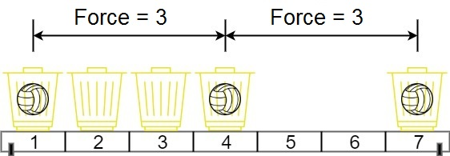

# 二分答案（Python/Java/C++/C/Go/JS/Rust）

> **[1552. 两球之间的磁力](https://leetcode.cn/problems/magnetic-force-between-two-balls/solutions/3067631/er-fen-da-an-pythonjavaccgojsrust-by-end-hb9o/) · Medium · 难度分 2517**

> **所属题单**
> - [二分算法 · 二、二分答案](../../../刷题路径/灵神原版题单/二分算法/二、二分答案.md) · §2.5 最大化最小值

> **题目描述**
> 在代号为 C-137 的地球上，Rick 发现如果他将两个球放在他新发明的篮子里，它们之间会形成特殊形式的磁力。Rick 有 `n` 个空的篮子，第 `i` 个篮子的位置在 `position[i]` ，Morty 想把 `m` 个球放到这些篮子里，使得任意两球间 **最小磁力** 最大。
>
> 已知两个球如果分别位于 `x` 和 `y` ，那么它们之间的磁力为 `|x - y|` 。
>
> 给你一个整数数组 `position` 和一个整数 `m` ，请你返回最大化的最小磁力。
>
> **示例 1：**
>
> 
>
> ```
> 输入：position = [1,2,3,4,7], m = 3
> 输出：3
> 解释：将 3 个球分别放入位于 1，4 和 7 的三个篮子，两球间的磁力分别为 [3, 3, 6]。最小磁力为 3 。我们没办法让最小磁力大于 3 。
> ```
>
> **示例 2：**
>
> ```
> 输入：position = [5,4,3,2,1,1000000000], m = 2
> 输出：999999999
> 解释：我们使用位于 1 和 1000000000 的篮子时最小磁力最大。
> ```
>
> **提示：**
>
> - `n == position.length`
>
> - `2 <= n <= 10^5`
>
> - `1 <= position[i] <= 10^9`
>
> - 所有 `position` 中的整数 **互不相同** 。
>
> - `2 <= m <= position.length`

> **题解**
> 本题和 [2517. 礼盒的最大甜蜜度](https://leetcode.cn/problems/maximum-tastiness-of-candy-basket/) 是一样的，请看 [我的题解](../../2500-2599/2517%20礼盒的最大甜蜜度/灵茶山艾府.md)。
