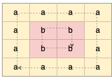
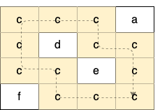
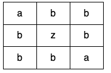

# 网格图 DFS（Python/Java/C++/Go）

> **[1559. 二维网格图中探测环](https://leetcode.cn/problems/detect-cycles-in-2d-grid/solutions/3952785/wang-ge-tu-dfspythonjavacgo-by-endlessch-dbxw/) · Medium · 难度分 1838**

> **所属题单**
> - [网格图 · 一、网格图 DFS](../../../刷题路径/灵神原版题单/网格图/一、网格图%20DFS.md)

> **题目描述**
> 给你一个二维字符网格数组 `grid` ，大小为 `m x n` ，你需要检查 `grid` 中是否存在 **相同值** 形成的环。
>
> 一个环是一条开始和结束于同一个格子的长度 **大于等于 4** 的路径。对于一个给定的格子，你可以移动到它上、下、左、右四个方向相邻的格子之一，可以移动的前提是这两个格子有 **相同的值** 。
>
> 同时，你也不能回到上一次移动时所在的格子。比方说，环  `(1, 1) -> (1, 2) -> (1, 1)` 是不合法的，因为从 `(1, 2)` 移动到 `(1, 1)` 回到了上一次移动时的格子。
>
> 如果 `grid` 中有相同值形成的环，请你返回 `true` ，否则返回 `false` 。
>
> **示例 1：**
>
> 
>
> ```
> 输入：grid = [["a","a","a","a"],["a","b","b","a"],["a","b","b","a"],["a","a","a","a"]]
> 输出：true
> 解释：如下图所示，有 2 个用不同颜色标出来的环：
>
> 
> ```
>
> **示例 2：**
>
> 
>
> ```
> 输入：grid = [["c","c","c","a"],["c","d","c","c"],["c","c","e","c"],["f","c","c","c"]]
> 输出：true
> 解释：如下图所示，只有高亮所示的一个合法环：
>
> 
> ```
>
> **示例 3：**
>
> 
>
> ```
> 输入：grid = [["a","b","b"],["b","z","b"],["b","b","a"]]
> 输出：false
> ```
>
> **提示：**
>
> - `m == grid.length`
>
> - `n == grid[i].length`
>
> - `1 <= m <= 500`
>
> - `1 <= n <= 500`
>
> - `grid` 只包含小写英文字母。

> **题解**
> 在 DFS 的过程中，如果发现了一个之前访问过的同值格子，那么：
>
> - 如果我们从 $(x,y)$ 移动一步到 $(i,j)$，再从 $(i,j)$ 移动一步到 $(x,y)$，这的确是个环，但长度只有 $2$，不满足要求。所以我们规定，**不能立刻回头**。在 DFS 的过程中，额外传入上一步的位置 $(\textit{px},\textit{py})$，并禁止从当前位置移动到上一步的位置。
> - 如果我们从 $(x,y)$ 移动一步到 $(i,j)$，且 $(i,j)\ne (\textit{px},\textit{py})$，且 $(i,j)$ 之前访问过，那么就找到了一个长度至少为 $4$ 的环。
>
> **问**：有没有可能，环长是 $3$？
>
> **答**：对于（四连通的）网格图，这是不可能的。把网格图看成国际象棋棋盘，每走一步，所处格子的颜色切换成另一种颜色。对于一个环，从环上的一点出发，只有走偶数步后，所处格子的颜色才和起始格子的颜色相同。所以对于（四连通的）网格图，**环长一定是偶数**。只要不立刻回头，环长至少为 $4$。
>
> ```python
> class Solution:
>     def containsCycle(self, grid: List[List[str]]) -> bool:
>         m, n = len(grid), len(grid[0])
>         vis = [[False] * n for _ in range(m)]
>
>         def dfs(x: int, y: int, px: int, py: int) -> bool:
>             vis[x][y] = True
>             for i, j in (x, y - 1), (x, y + 1), (x - 1, y), (x + 1, y):  # 枚举移动方向
>                 if ((i != px or j != py) and  # (i, j) 不是上一步的格子 (px, py)
>                     0 <= i < m and 0 <= j < n and  # (i, j) 没有出界
>                     grid[i][j] == grid[x][y] and  # (i, j) 和 (x, y) 的格子值相同
>                     (vis[i][j] or dfs(i, j, x, y))):  # 如果之前访问过 (i, j)，那么找到了环，否则继续递归找
>                     return True
>             return False
>
>         for i in range(m):
>             for j in range(n):
>                 if not vis[i][j] and dfs(i, j, -1, -1):
>                     return True
>         return False
> ```
>
>
> #### 复杂度分析
>
> - 时间复杂度：$\mathcal{O}(mn)$，其中 $m$ 和 $n$ 分别是 $\textit{grid}$ 的行数和列数。
> - 空间复杂度：$\mathcal{O}(mn)$。
>
> ## 专题训练
>
> 见下面网格图题单的「**一、网格图 DFS**」。
>
> ## 分类题单
>
> [如何科学刷题？](https://leetcode.cn/circle/discuss/RvFUtj/)
>
> 1. [滑动窗口与双指针（定长/不定长/单序列/双序列/三指针/分组循环）](https://leetcode.cn/circle/discuss/0viNMK/)
> 2. [二分算法（二分答案/最小化最大值/最大化最小值/第K小）](https://leetcode.cn/circle/discuss/SqopEo/)
> 3. [单调栈（基础/矩形面积/贡献法/最小字典序）](https://leetcode.cn/circle/discuss/9oZFK9/)
> 4. [网格图（DFS/BFS/综合应用）](https://leetcode.cn/circle/discuss/YiXPXW/)
> 5. [位运算（基础/性质/拆位/试填/恒等式/思维）](https://leetcode.cn/circle/discuss/dHn9Vk/)
> 6. [图论算法（DFS/BFS/拓扑排序/基环树/最短路/最小生成树/网络流）](https://leetcode.cn/circle/discuss/01LUak/)
> 7. [动态规划（入门/背包/划分/状态机/区间/状压/数位/数据结构优化/树形/博弈/概率期望）](https://leetcode.cn/circle/discuss/tXLS3i/)
> 8. [常用数据结构（前缀和/差分/栈/队列/堆/字典树/并查集/树状数组/线段树）](https://leetcode.cn/circle/discuss/mOr1u6/)
> 9. [数学算法（数论/组合/概率期望/博弈/计算几何/随机算法）](https://leetcode.cn/circle/discuss/IYT3ss/)
> 10. [贪心与思维（基本贪心策略/反悔/区间/字典序/数学/思维/脑筋急转弯/构造）](https://leetcode.cn/circle/discuss/g6KTKL/)
> 11. [链表、树与回溯（前后指针/快慢指针/DFS/BFS/直径/LCA）](https://leetcode.cn/circle/discuss/K0n2gO/)
> 12. [字符串（KMP/Z函数/Manacher/字符串哈希/AC自动机/后缀数组/子序列自动机）](https://leetcode.cn/circle/discuss/SJFwQI/)
>
> [我的题解精选（已分类）](https://github.com/EndlessCheng/codeforces-go/blob/master/leetcode/SOLUTIONS.md)
>
> 欢迎关注 [B站@灵茶山艾府](https://space.bilibili.com/206214)
