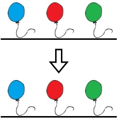

# 贪心，每段保留最大的（Python/Java/C++/C/Go/JS/Rust）

> **[1578. 使绳子变成彩色的最短时间](https://leetcode.cn/problems/minimum-time-to-make-rope-colorful/solutions/3808739/tan-xin-mei-duan-bao-liu-zui-da-de-pytho-4xln/) · Medium · 难度分 1574**

> **所属题单**
> - [滑动窗口与双指针 · 六、分组循环](../../../刷题路径/灵神原版题单/滑动窗口与双指针/六、分组循环.md)
> - [贪心算法 · 一、贪心策略](../../../刷题路径/灵神原版题单/贪心算法/一、贪心策略.md) · §1.1 从最小/最大开始贪心

> **题目描述**
> Alice 把 `n` 个气球排列在一根绳子上。给你一个下标从 **0** 开始的字符串 `colors` ，其中 `colors[i]` 是第 `i` 个气球的颜色。
>
> Alice 想要把绳子装扮成 **五颜六色的** ，且她不希望两个连续的气球涂着相同的颜色，所以她喊来 Bob 帮忙。Bob 可以从绳子上移除一些气球使绳子变成 **彩色** 。给你一个 **下标从 0 开始** 的整数数组 `neededTime` ，其中 `neededTime[i]` 是 Bob 从绳子上移除第 `i` 个气球需要的时间（以秒为单位）。
>
> 返回 Bob 使绳子变成 **彩色** 需要的 **最少时间** 。
>
> **示例 1：**
>
> 
>
> ```
>
> 输入：colors = "abaac", neededTime = [1,2,3,4,5]
> 输出：3
> 解释：在上图中，'a' 是蓝色，'b' 是红色且 'c' 是绿色。
> Bob 可以移除下标 2 的蓝色气球。这将花费 3 秒。
> 移除后，不存在两个连续的气球涂着相同的颜色。总时间 = 3 。
> ```
>
> **示例 2：**
>
> 
>
> ```
>
> 输入：colors = "abc", neededTime = [1,2,3]
> 输出：0
> 解释：绳子已经是彩色的，Bob 不需要从绳子上移除任何气球。
> ```
>
> **示例 3：**
>
> 
>
> ```
>
> 输入：colors = "aabaa", neededTime = [1,2,3,4,1]
> 输出：2
> 解释：Bob 会移除下标 0 和下标 4 处的气球。这两个气球各需要 1 秒来移除。
> 移除后，不存在两个连续的气球涂着相同的颜色。总时间 = 1 + 1 = 2 。
> ```
>
> **提示：**
>
> - `n == colors.length == neededTime.length`
>
> - `1 <= n <= 10⁵`
>
> - `1 <= neededTime[i] <= 10⁴`
>
> - `colors` 仅由小写英文字母组成

> **题解**
> 为了不让相邻气球颜色相同，对于 $\textit{colors}$ 的每个连续同色段，只能保留一个气球。
>
> 贪心地，保留其中耗时最大的气球。
>
> 答案为 $\textit{neededTime}$ 的总和，减去每段的最大耗时。
>
> ```python
> class Solution:
>     def minCost(self, colors: str, neededTime: List[int]) -> int:
>         ans = max_t = 0
>         for i, t in enumerate(neededTime):
>             ans += t
>             if t > max_t:  # 手写 if 比调用 max 快
>                 max_t = t
>             if i == len(colors) - 1 or colors[i] != colors[i + 1]:
>                 # 遍历到了连续同色段的末尾
>                 ans -= max_t  # 保留耗时最大的气球
>                 max_t = 0  # 准备计算下一段的最大耗时
>         return ans
> ```
>
>
> #### 复杂度分析
>
> - 时间复杂度：$\mathcal{O}(n)$，其中 $n$ 是 $\textit{colors}$ 的长度。
> - 空间复杂度：$\mathcal{O}(1)$。
>
> ## 专题训练
>
> 见下面双指针题单的「**六、分组循环**」。
>
> ## 分类题单
>
> [如何科学刷题？](https://leetcode.cn/circle/discuss/RvFUtj/)
>
> 1. [滑动窗口与双指针（定长/不定长/单序列/双序列/三指针/分组循环）](https://leetcode.cn/circle/discuss/0viNMK/)
> 2. [二分算法（二分答案/最小化最大值/最大化最小值/第K小）](https://leetcode.cn/circle/discuss/SqopEo/)
> 3. [单调栈（基础/矩形面积/贡献法/最小字典序）](https://leetcode.cn/circle/discuss/9oZFK9/)
> 4. [网格图（DFS/BFS/综合应用）](https://leetcode.cn/circle/discuss/YiXPXW/)
> 5. [位运算（基础/性质/拆位/试填/恒等式/思维）](https://leetcode.cn/circle/discuss/dHn9Vk/)
> 6. [图论算法（DFS/BFS/拓扑排序/基环树/最短路/最小生成树/网络流）](https://leetcode.cn/circle/discuss/01LUak/)
> 7. [动态规划（入门/背包/划分/状态机/区间/状压/数位/数据结构优化/树形/博弈/概率期望）](https://leetcode.cn/circle/discuss/tXLS3i/)
> 8. [常用数据结构（前缀和/差分/栈/队列/堆/字典树/并查集/树状数组/线段树）](https://leetcode.cn/circle/discuss/mOr1u6/)
> 9. [数学算法（数论/组合/概率期望/博弈/计算几何/随机算法）](https://leetcode.cn/circle/discuss/IYT3ss/)
> 10. [贪心与思维（基本贪心策略/反悔/区间/字典序/数学/思维/脑筋急转弯/构造）](https://leetcode.cn/circle/discuss/g6KTKL/)
> 11. [链表、二叉树与回溯（前后指针/快慢指针/DFS/BFS/直径/LCA/一般树）](https://leetcode.cn/circle/discuss/K0n2gO/)
> 12. [字符串（KMP/Z函数/Manacher/字符串哈希/AC自动机/后缀数组/子序列自动机）](https://leetcode.cn/circle/discuss/SJFwQI/)
>
> [我的题解精选（已分类）](https://github.com/EndlessCheng/codeforces-go/blob/master/leetcode/SOLUTIONS.md)
>
> 欢迎关注 [B站@灵茶山艾府](https://space.bilibili.com/206214)
