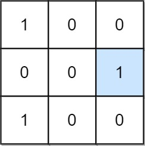
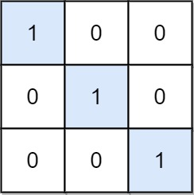

# 简单题，简单做，O(N^2) 时间 O(1) 空间（Python/Java/C++/Go）

> **[1582. 二进制矩阵中的特殊位置](https://leetcode.cn/problems/special-positions-in-a-binary-matrix/solutions/3913464/jian-dan-ti-jian-dan-zuo-omn-shi-jian-o1-lv87/) · Easy**

> **题目描述**
> 给定一个 `m x n` 的二进制矩阵 `mat`，返回矩阵 `mat` 中特殊位置的数量。
>
> 如果位置 `(i, j)` 满足 `mat[i][j] == 1` 并且行 `i` 与列 `j` 中的所有其他元素都是 `0`（行和列的下标从 **0** 开始计数），那么它被称为 **特殊** 位置。
>
> **示例 1：**
>
> 
>
> ```
>
> 输入：mat = [[1,0,0],[0,0,1],[1,0,0]]
> 输出：1
> 解释：位置 (1, 2) 是一个特殊位置，因为 mat[1][2] == 1 且第 1 行和第 2 列的其他所有元素都是 0。
> ```
>
> **示例 2：**
>
> 
>
> ```
>
> 输入：mat = [[1,0,0],[0,1,0],[0,0,1]]
> 输出：3
> 解释：位置 (0, 0)，(1, 1) 和 (2, 2) 都是特殊位置。
> ```
>
> **提示：**
>
> - `m == mat.length`
>
> - `n == mat[i].length`
>
> - `1 <= m, n <= 100`
>
> - `mat[i][j]` 是 `0` 或 `1`。

> **题解**
> 对于矩阵的每一行，如果这一行只有一个 $1$，那么遍历 $1$ 所在的那一列，如果也只有一个 $1$，则把答案加一。
>
> ```python
> class Solution:
>     def numSpecial(self, mat: List[List[int]]) -> int:
>         ans = 0
>         for row in mat:
>             if sum(row) != 1:
>                 continue
>             j = row.index(1)
>             # 计算 j 列的元素和，必须恰好是 1
>             if sum(row[j] for row in mat) == 1:
>                 ans += 1
>         return ans
> ```
>
>
> 优化，中途退出循环的写法：
>
> ```python
> class Solution:
>     def numSpecial(self, mat: List[List[int]]) -> int:
>         ans = 0
>         for row in mat:
>             col = -1
>             for j, x in enumerate(row):
>                 if x == 0:
>                     continue
>                 if col >= 0:  # 这一行有多个 1
>                     col = -1
>                     break  # 检查下一行
>                 col = j  # 记录 1 的列号
>             if col < 0:
>                 continue
>
>             seen1 = 0
>             for r in mat:
>                 if r[col] == 0:
>                     continue
>                 if seen1:  # 这一列有多个 1
>                     seen1 = 0
>                     break  # 检查下一行
>                 seen1 = 1  # 这一列有 1
>             ans += seen1
>         return ans
> ```
>
>
> #### 复杂度分析
>
> - 时间复杂度：$\mathcal{O}(m(n+m))$，其中 $m$ 和 $n$ 分别是 $\textit{grid}$ 的行数和列数。
> - 空间复杂度：$\mathcal{O}(1)$。
>
> ## 分类题单
>
> [如何科学刷题？](https://leetcode.cn/circle/discuss/RvFUtj/)
>
> 1. [滑动窗口与双指针（定长/不定长/单序列/双序列/三指针/分组循环）](https://leetcode.cn/circle/discuss/0viNMK/)
> 2. [二分算法（二分答案/最小化最大值/最大化最小值/第K小）](https://leetcode.cn/circle/discuss/SqopEo/)
> 3. [单调栈（基础/矩形面积/贡献法/最小字典序）](https://leetcode.cn/circle/discuss/9oZFK9/)
> 4. [网格图（DFS/BFS/综合应用）](https://leetcode.cn/circle/discuss/YiXPXW/)
> 5. [位运算（基础/性质/拆位/试填/恒等式/思维）](https://leetcode.cn/circle/discuss/dHn9Vk/)
> 6. [图论算法（DFS/BFS/拓扑排序/基环树/最短路/最小生成树/网络流）](https://leetcode.cn/circle/discuss/01LUak/)
> 7. [动态规划（入门/背包/划分/状态机/区间/状压/数位/数据结构优化/树形/博弈/概率期望）](https://leetcode.cn/circle/discuss/tXLS3i/)
> 8. [常用数据结构（前缀和/差分/栈/队列/堆/字典树/并查集/树状数组/线段树）](https://leetcode.cn/circle/discuss/mOr1u6/)
> 9. [数学算法（数论/组合/概率期望/博弈/计算几何/随机算法）](https://leetcode.cn/circle/discuss/IYT3ss/)
> 10. [贪心与思维（基本贪心策略/反悔/区间/字典序/数学/思维/脑筋急转弯/构造）](https://leetcode.cn/circle/discuss/g6KTKL/)
> 11. [链表、树与回溯（前后指针/快慢指针/DFS/BFS/直径/LCA）](https://leetcode.cn/circle/discuss/K0n2gO/)
> 12. [字符串（KMP/Z函数/Manacher/字符串哈希/AC自动机/后缀数组/子序列自动机）](https://leetcode.cn/circle/discuss/SJFwQI/)
>
> [我的题解精选（已分类）](https://github.com/EndlessCheng/codeforces-go/blob/master/leetcode/SOLUTIONS.md)
