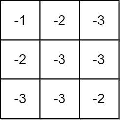
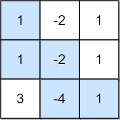
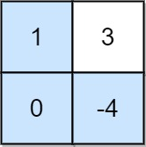

# 1594. 矩阵的最大非负积

Medium · 难度分 1807 · [力扣原题](https://leetcode.cn/problems/maximum-non-negative-product-in-a-matrix/)

所在刷题路径：灵神核心路线、灵神题单·动态规划

| 作者 | 题解 | 动画讲解 |
|---|---|---|
| 灵茶山艾府 | [📄 题解](灵茶山艾府.md) | [▶︎ 动画（GIF）](1594%20矩阵的最大非负积%20·%20灵茶山艾府.gif) · [mp4 文件](1594%20矩阵的最大非负积%20·%20灵茶山艾府.mp4) |
| yiduobo | [📄 题解](yiduobo.md) | [▶︎ 动画（GIF）](1594%20矩阵的最大非负积%20·%20yiduobo.gif) · [mp4 文件](1594%20矩阵的最大非负积%20·%20yiduobo.mp4) |

## 动画讲解

> 动图会循环播放；想暂停、拖进度条请下载上面表格里的 mp4 文件。

### 灵茶山艾府


### yiduobo


## 题目描述

给你一个大小为 `m x n` 的矩阵 `grid` 。最初，你位于左上角 `(0, 0)` ，每一步，你可以在矩阵中 **向右** 或 **向下** 移动。

在从左上角 `(0, 0)` 开始到右下角 `(m - 1, n - 1)` 结束的所有路径中，找出具有 **最大非负积** 的路径。路径的积是沿路径访问的单元格中所有整数的乘积。

返回 **最大非负积** 对 **`10⁹ + 7`** **取余** 的结果。如果最大积为 **负数** ，则返回 `-1` 。

**注意，**取余是在得到最大积之后执行的。

**示例 1：**



```

输入：grid = [[-1,-2,-3],[-2,-3,-3],[-3,-3,-2]]
输出：-1
解释：从 (0, 0) 到 (2, 2) 的路径中无法得到非负积，所以返回 -1 。
```

**示例 2：**



```

输入：grid = [[1,-2,1],[1,-2,1],[3,-4,1]]
输出：8
解释：最大非负积对应的路径如图所示 (1 * 1 * -2 * -4 * 1 = 8)
```

**示例 3：**



```

输入：grid = [[1,3],[0,-4]]
输出：0
解释：最大非负积对应的路径如图所示 (1 * 0 * -4 = 0)
```

**提示：**

- `m == grid.length`

- `n == grid[i].length`

- `1 <= m, n <= 15`

- `-4 <= grid[i][j] <= 4`

---
[↑ 返回 1500-1599](../README.md) · [总索引](../../../索引.md) · [仓库首页](../../../README.md)
