# 没有思路？一个动画秒懂！附优化写法（Python/Java/C++/Go）

> **[1605. 给定行和列的和求可行矩阵](https://leetcode.cn/problems/find-valid-matrix-given-row-and-column-sums/solutions/2166773/mei-you-si-lu-yi-ge-dong-hua-miao-dong-f-eezj/) · Medium · 难度分 1868**

> **所属题单**
> - [贪心算法 · 六、构造题](../../../刷题路径/灵神原版题单/贪心算法/六、构造题.md)

> **题目描述**
> 给你两个非负整数数组 `rowSum` 和 `colSum` ，其中 `rowSum[i]` 是二维矩阵中第 `i` 行元素的和， `colSum[j]` 是第 `j` 列元素的和。换言之你不知道矩阵里的每个元素，但是你知道每一行和每一列的和。
>
> 请找到大小为 `rowSum.length x colSum.length` 的任意 **非负整数** 矩阵，且该矩阵满足 `rowSum` 和 `colSum` 的要求。
>
> 请你返回任意一个满足题目要求的二维矩阵，题目保证存在 **至少一个** 可行矩阵。
>
> **示例 1：**
>
> ```
>
> 输入：rowSum = [3,8], colSum = [4,7]
> 输出：[[3,0],
>       [1,7]]
> 解释：
> 第 0 行：3 + 0 = 3 == rowSum[0]
> 第 1 行：1 + 7 = 8 == rowSum[1]
> 第 0 列：3 + 1 = 4 == colSum[0]
> 第 1 列：0 + 7 = 7 == colSum[1]
> 行和列的和都满足题目要求，且所有矩阵元素都是非负的。
> 另一个可行的矩阵为：[[1,2],
>                   [3,5]]
> ```
>
> **示例 2：**
>
> ```
>
> 输入：rowSum = [5,7,10], colSum = [8,6,8]
> 输出：[[0,5,0],
>       [6,1,0],
>       [2,0,8]]
> ```
>
> **示例 3：**
>
> ```
>
> 输入：rowSum = [14,9], colSum = [6,9,8]
> 输出：[[0,9,5],
>       [6,0,3]]
> ```
>
> **示例 4：**
>
> ```
>
> 输入：rowSum = [1,0], colSum = [1]
> 输出：[[1],
>       [0]]
> ```
>
> **示例 5：**
>
> ```
>
> 输入：rowSum = [0], colSum = [0]
> 输出：[[0]]
> ```
>
> **提示：**
>
> - `1 <= rowSum.length, colSum.length <= 500`
>
> - `0 <= rowSum[i], colSum[i] <= 10⁸`
>
> - `sum(rowSum) == sum(colSum)`

> **题解**
> 用示例 2 来演示：
>
> <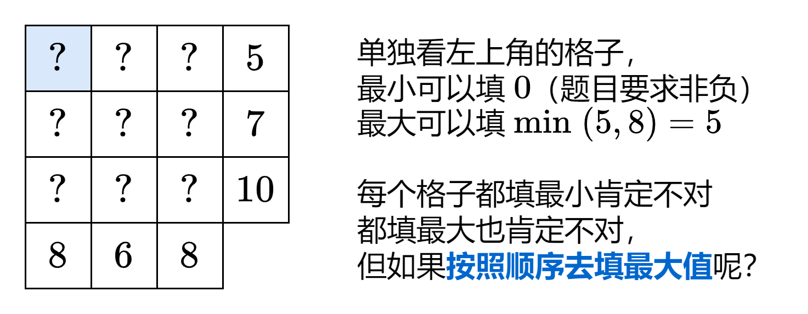,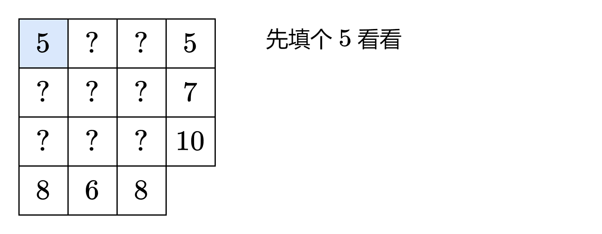,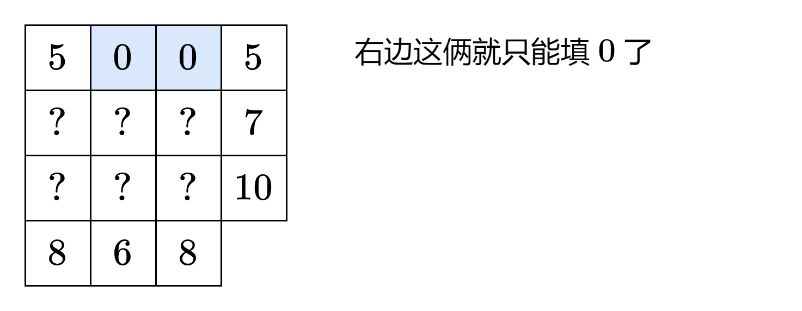,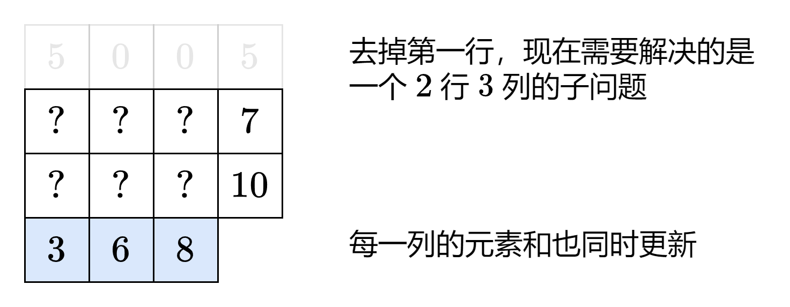,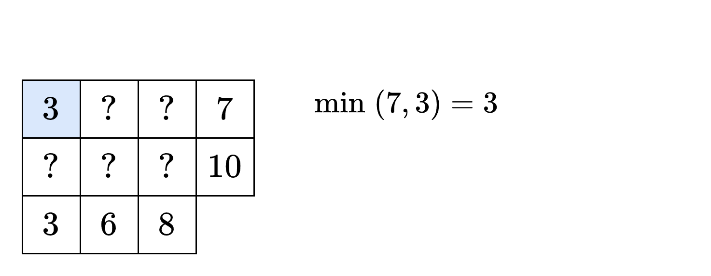,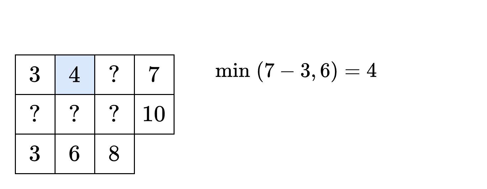,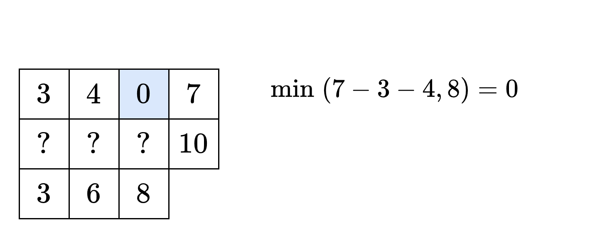,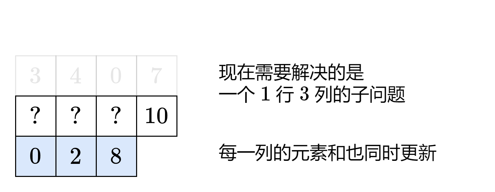,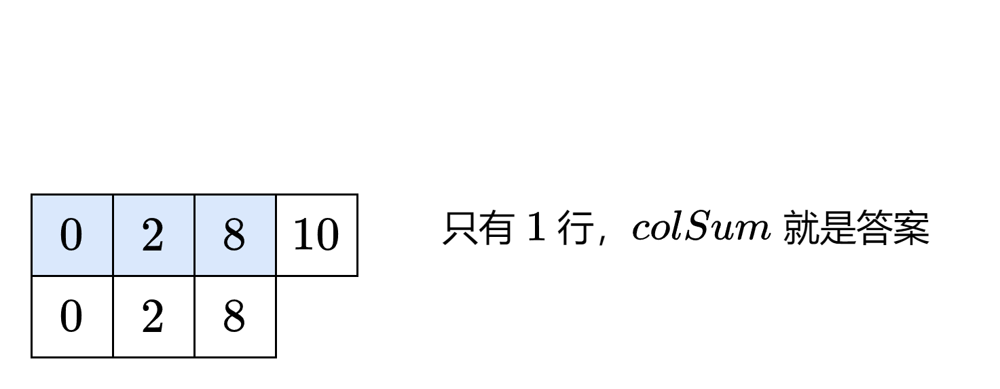,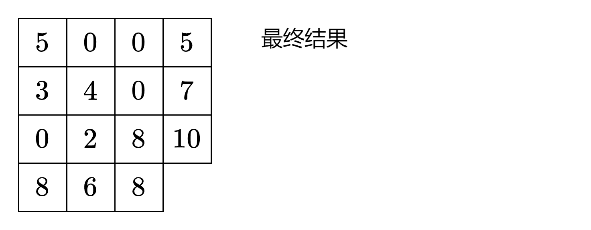>
>
> ### 答疑
>
> **问**：如何证明该构造方案一定能得到满足题目要求的矩阵？
>
> **答**：设生成的矩阵为 $\textit{mat}$。对于只有 $1$ 行的情况，构造 $\textit{mat}[0][j] = \textit{colSum}[j]$，由于题目保证 `sum(rowSum) == sum(colSum)`，所以只有 $1$ 行的 $\textit{mat}$ 是满足题目要求的。
>
> 对于一个有 $m$ 行的矩阵 $\textit{mat}$，上述构造方案可以满足 $\textit{mat}$ 第一行的 $\textit{rowSum}$，且构造的数字不超过相应的 $\textit{colSum}$，从而转换成一个 $m-1$ 行的子问题。由于原问题转换成子问题后，`sum(rowSum) == sum(colSum)` 是不变的，只要 $m-1$ 行的 $\textit{mat}$ 是满足题目要求的，那么 $m$ 行的 $\textit{mat}$ 也是满足题目要求的。
>
> 根据数学归纳法，$m$ 行的 $\textit{mat}$ 是满足题目要求的。
>
> ```python
> class Solution:
>     def restoreMatrix(self, rowSum: List[int], colSum: List[int]) -> List[List[int]]:
>         m, n = len(rowSum), len(colSum)
>         mat = [[0] * n for _ in range(m)]
>         for i, rs in enumerate(rowSum):
>             for j, cs in enumerate(colSum):
>                 mat[i][j] = x = min(rs, cs)
>                 rs -= x
>                 colSum[j] -= x
>         return mat
> ```
>
>
> ### 优化
>
> 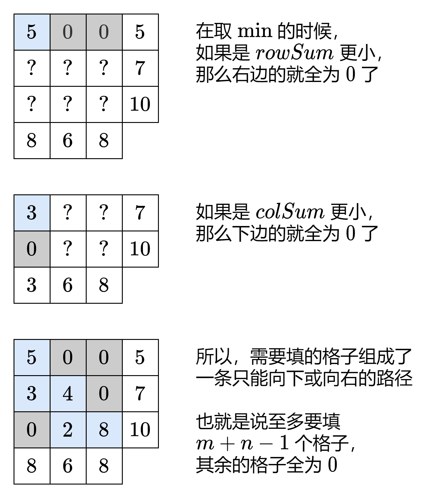
>
> 也可以这样理解：从左上角出发，每次要么去掉一行，要么去掉一列。同样根据数学归纳法，可以证明该做法的正确性。
>
> ```python
> class Solution:
>     def restoreMatrix(self, rowSum: List[int], colSum: List[int]) -> List[List[int]]:
>         m, n = len(rowSum), len(colSum)
>         mat = [[0] * n for _ in range(m)]
>         i = j = 0  # 从左上角出发
>         while i < m and j < n:
>             rs, cs = rowSum[i], colSum[j]
>             if rs < cs:
>                 mat[i][j] = rs  # 去掉第 i 行
>                 colSum[j] -= rs
>                 i += 1  # 往下走
>             else:
>                 mat[i][j] = cs  # 去掉第 j 列
>                 rowSum[i] -= cs
>                 j += 1  # 往右走
>         return mat
> ```
>
>
> ### 复杂度分析
>
> - 时间复杂度：$O(mn)$，其中 $m$ 为矩阵行数，即 $\textit{rowSum}$ 的长度；$n$ 为矩阵列数，即 $\textit{colSum}$ 的长度。如果忽略创建二维数组的时间，时间复杂度为 $O(m+n)$。
> - 空间复杂度：$O(1)$。返回值不计入。
>
> ## 分类题单
>
> 以下题单没有特定的顺序，可以按照个人喜好刷题。
>
> 1. [滑动窗口（定长/不定长/多指针）](https://leetcode.cn/circle/discuss/0viNMK/)
> 2. [二分算法（二分答案/最小化最大值/最大化最小值/第K小）](https://leetcode.cn/circle/discuss/SqopEo/)
> 3. [单调栈（基础/矩形面积/贡献法/最小字典序）](https://leetcode.cn/circle/discuss/9oZFK9/)
> 4. [网格图（DFS/BFS/综合应用）](https://leetcode.cn/circle/discuss/YiXPXW/)
> 5. [位运算（基础/性质/拆位/试填/恒等式/贪心/脑筋急转弯）](https://leetcode.cn/circle/discuss/dHn9Vk/)
> 6. [图论算法（DFS/BFS/拓扑排序/最短路/最小生成树/二分图/基环树/欧拉路径）](https://leetcode.cn/circle/discuss/01LUak/)
> 7. [动态规划（入门/背包/状态机/划分/区间/状压/数位/数据结构优化/树形/博弈/概率期望）](https://leetcode.cn/circle/discuss/tXLS3i/)
> 8. [常用数据结构（前缀和/差分/栈/队列/堆/字典树/并查集/树状数组/线段树）](https://leetcode.cn/circle/discuss/mOr1u6/)
> 9. [数学算法（数论/组合/概率期望/博弈/计算几何/随机算法）](https://leetcode.cn/circle/discuss/IYT3ss/)
>
> [我的题解精选（已分类）](https://github.com/EndlessCheng/codeforces-go/blob/master/leetcode/SOLUTIONS.md)
>
> 欢迎关注 [B站@灵茶山艾府](https://space.bilibili.com/206214)
